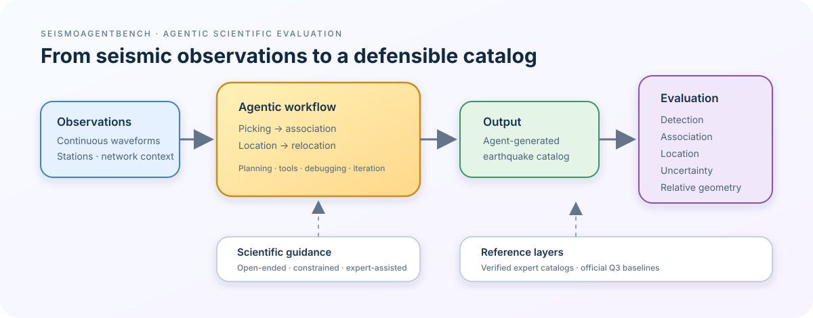
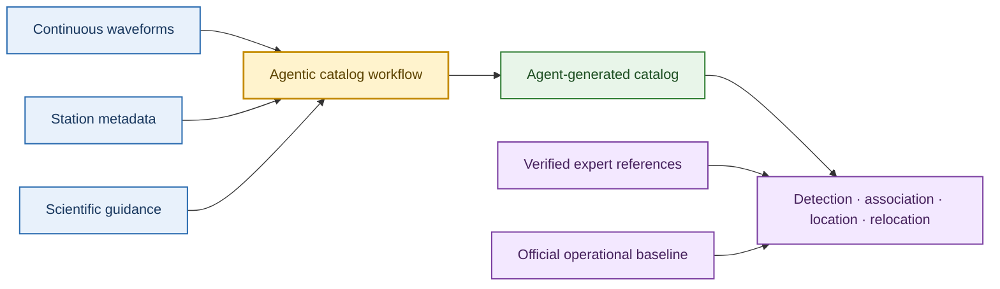

# SeismoAgentBench

### Agentic Seismic Catalog Benchmark

SeismoAgentBench evaluates what an AI agent can do when asked to build an earthquake catalog from continuous seismic observations—and how much expert guidance is still required.

<p align="center">
  
</p>

The benchmark is built around six real, published earthquake and volcanic sequences. Each case has several independent reference catalogs and a human-in-loop catalog (an Agent workflow we steered by hand) that serves as the upper bound; general-purpose Agents build catalogs from the same waveforms and are scored against both.

The extraction contract for paper methods, catalog schemas, and case-level synthesis is defined in [`docs/data/preparation/02_Extraction_Contract.md`](docs/data/preparation/02_Extraction_Contract.md).

The current status and work plan are tracked in [`docs/research/progress/STATUS_AND_PLAN.md`](docs/research/progress/STATUS_AND_PLAN.md).

## Evaluation environment

Formal runs are launched by each case's `workflows/tasks/<case>/run.sh`, which runs Claude Code with GLM-5.3 through `python -m SeismoAgentBench run-claude` in a fresh run directory under `workflows/tasks/<case>/runs/`, records the command, environment and transcript, applies a time budget, and keeps execution separate from scoring (`python -m SeismoAgentBench evaluate`). The run layout is described in [`docs/framework/01_Run_Layout_and_Records.md`](docs/framework/01_Run_Layout_and_Records.md); execution runs on the host (trusted development), and stronger isolation is a replaceable backend.

## Professional tool snapshots

[seismotools/](seismotools/README.md) contains copied PhaseNet/DPP/EQTransformer models, GaMMA, NonLinLoc and hypoDD sources, local weight identities, usage documentation and validation/build commands. It is the validated tool library offered to Agents in the `tools` stage and used by the human-in-loop workflow; case data and experiment scripts stay separate, and every run records the tool commit it saw.

## What this project does

- Curates six information-rich seismic benchmark cases.
- Verifies the papers, supplements, waveform context, and published catalogs associated with each case.
- Freezes common time, space, depth, network, and quality conditions for fair comparisons.
- Keeps multiple reference catalogs separate when they measure different scientific capabilities.
- Provides official operational catalogs as Q3 baselines, not as universal ground truth.
- Prepares article extraction, catalog summaries, visualizations, waveform manifests, and evaluation-ready inputs.
- Runs general-purpose Agents in stages that each add one factor (tools, knowledge, automated validation) and scores every catalog with pre-registered metrics, including a trusted-catalog verdict.

## The benchmark idea



The central question is:

> How independently, and to what level of scientific quality, can an agent construct an earthquake catalog from seismic observations?

## Study design

| Stage | The Agent additionally gets | Status |
|---|---|---|
| S0 `min` | task, data, output contract | formal runs in progress |
| S1 `tools` | the validated tool library `seismotools` | formal runs in progress |
| S2 `knowledge` | case-agnostic expert knowledge as an Agent Skill | designed |
| S3 `checker` | a reference-free checker and repair playbook | designed |
| upper bound | the human-in-loop final catalog | done for all six cases |

Every run is scored with catalog metrics v2: detection, location, structure and magnitude against several references and directly against the human-in-loop final, plus a trusted-catalog verdict on event reality, time, space and strength (accuracy and stability), with completeness reported apart. Design: [`docs/research/00_Research_Plan.md`](docs/research/00_Research_Plan.md); metrics: [`docs/framework/02_Catalog_Metrics.md`](docs/framework/02_Catalog_Metrics.md).

## Phase I cases

| Case | Regime | Difficulty tier | Main challenge |
|---|---|---|---|
| [Prague, Oklahoma](data/2011_prague_oklahoma) | Induced aftershock sequence | basic | Changing heterogeneous network |
| [Magna, Utah](data/2020_magna_utah) | Moderate mainshock–aftershock | basic | Basin structure; permanent versus nodal networks |
| [Maple Creek, Yellowstone](data/2017_maple_creek_yellowstone) | Earthquake swarm | intermediate | Sparse routine catalog; vertical-only stations |
| [Kīlauea, Hawaiʻi](data/2018_kilauea_hawaii) | Volcanic caldera collapse | intermediate | High rate; Mw 6.9 inside the window |
| [Ridgecrest, California](data/2019_ridgecrest_california) | M6.4 / M7.1 sequence | hard | Mainshock coda; overlapping events |
| [Kaikōura, New Zealand](data/2016_kaikoura_new_zealand) | Multi-fault aftershocks | hard | 260-km network; 3-D structure |

Windows, tiers and primary references: [`docs/data/00_Case_Registry.md`](docs/data/00_Case_Registry.md).

The cases are deliberately different. The goal is not one leaderboard, but a capability profile showing where an agent succeeds, fails, or needs expert intervention.

## Project stages

```text
1. Verify papers and data releases                       done
2. Read and extract article methods and scope            done (23 extractions)
3. Organize and normalize reference catalogs             done
4. Freeze common benchmark windows                       done (2026-10-28)
5. Prepare waveform and station manifests                done
6. Build human-in-loop catalogs (upper bound)            done (six cases)
7. Run Agent stages S0-S3                                S0/S1 in progress; S2/S3 designed
8. Score against references and the human-in-loop final  metrics v2, per run
```

Current status, scored runs and the work plan: [`docs/research/progress/STATUS_AND_PLAN.md`](docs/research/progress/STATUS_AND_PLAN.md).

## Repository map

```text
docs/
  research/                 questions, benchmark design, evidence, paper outline, status
  framework/                workflow, run layout and records, catalog metrics, process
  data/                     case registry, case data inventory, case pool, preparation
  archive/                  records no longer maintained

data/
  <case>/references/        source papers and supplementary materials
  <case>/data/catalogs/     source catalogs and catalog-level analysis products
  <case>/data/waveforms/    local waveform payloads (ignored by Git)
  <case>/analysis/          cross-reference case conclusions

workflows/data_preparation/
  01_pdf_parsing/           official MinerU paper parsing wrapper
  00_catalog_downloading/  official baseline download and audit
  02_supplement_processing/ supplement conversion
  03_information_extraction/ reusable extraction validation
  04_catalog_analysis/     catalog manifest generation

workflows/tasks/
  <task>/                   benchmark task packages and case-specific workflows
```

Detailed organization rules belong in [data/README.md](data/README.md), and the current data readiness belongs in [docs/data/01_Case_Data_Inventory.md](docs/data/01_Case_Data_Inventory.md).

## Quick start

List paper PDFs available for MinerU parsing:

```bash
python workflows/data_preparation/01_pdf_parsing/parse_papers_with_mineru.py --list
```

Parse one paper through the existing official Knowledge Graph MinerU workflow:

```bash
python workflows/data_preparation/01_pdf_parsing/parse_papers_with_mineru.py \
  --source COCHRAN2020_GJIGGAA153 \
  --timeout 1800
```

Download official operational baseline snapshots:

```bash
python workflows/data_preparation/00_catalog_downloading/download_official_baselines.py --direct --scope full
```

## Reference interpretation

Reference catalogs are role-specific expert targets, not a single absolute truth set. A catalog can be excellent for detection completeness or relative relocation while being unsuitable for absolute-location evaluation. Each case therefore records the reference role, spatial and temporal scope, quality tier, and network condition separately.

## Project status

Phase I has six cases with archived references, extraction records, catalog audits, official operational snapshots, frozen windows (2026-10-28) and human-in-loop final catalogs. Formal S0/S1 Agent runs (Claude Code × GLM-5.3) are scored for four cases; Kaikōura and Ridgecrest are running or queued. No run has yet reached the trusted-catalog standard. Next: finish S0/S1, then build the knowledge skill and the checker for S2/S3. Details and open items: [`docs/research/progress/STATUS_AND_PLAN.md`](docs/research/progress/STATUS_AND_PLAN.md).

## Documentation

- [Documentation index](docs/README.md)
- [Research plan](docs/research/00_Research_Plan.md)
- [Expert experience and checker](docs/research/01_Expert_Experience_and_Checker.md)
- [Paper outline](docs/research/02_Paper_Outline.md)
- [Status and work plan](docs/research/progress/STATUS_AND_PLAN.md)
- [Case registry](docs/data/00_Case_Registry.md)
- [Candidate case pool](docs/data/02_Case_Pool.md)
- [Case data inventory](docs/data/01_Case_Data_Inventory.md)
- [Extraction contract](docs/data/preparation/02_Extraction_Contract.md)
- [MinerU parsing audit](docs/data/preparation/03_MinerU_Parsing_Audit.md)
- [Framework documentation](docs/framework/README.md)
- [Catalog metrics and trusted-catalog standard](docs/framework/02_Catalog_Metrics.md)
- [Data organization rules](data/README.md)
- [Repository cleanup and retention decisions (2026-09-24)](docs/archive/2026-09-24_repository_cleanup.md)

- **Canonical project name:** `SeismoAgentBench`
- **Repository slug:** `seismoagent-bench`
- **Short form:** `SABench`

The project code package is [`SeismoAgentBench/`](SeismoAgentBench/README.md). Source registry tools are one utility under [`utils/source_prepare/`](SeismoAgentBench/utils/source_prepare/), with regression tests in [`tests/`](tests/). Ridgecrest is the first case using the versioned source registry; see its [source registry and commands](data/2019_ridgecrest_california/README.md#source-整理入口). Scoring lives in [`SeismoAgentBench/scoring/`](SeismoAgentBench/scoring/).

Automated regressions use one entry point: `python -B -m unittest discover -s tests -v`. Follow the [test maintenance rules](tests/AGENTS.md) when adding or changing tests.
