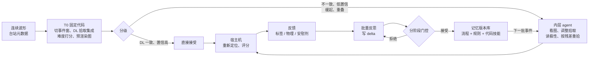
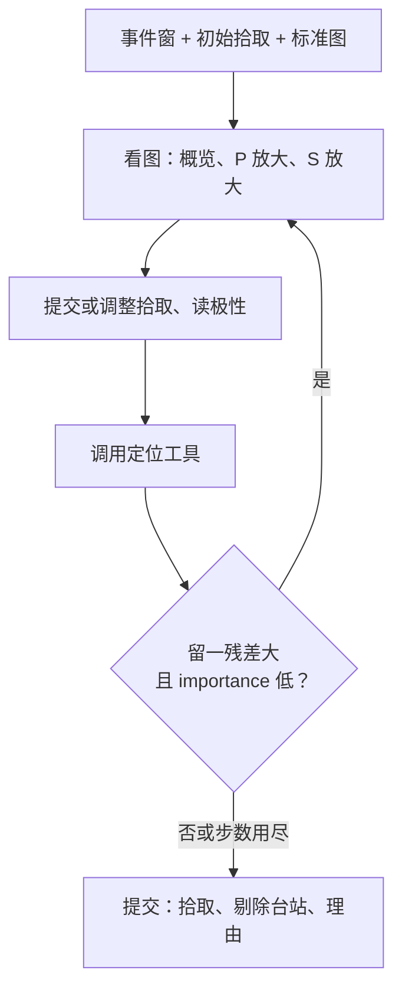
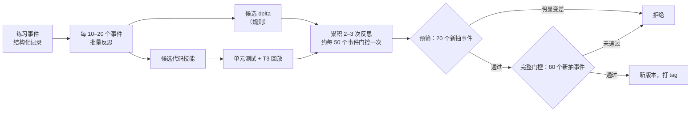

# LLM 地震分析员 Agent

本稿依据 [deep_research/](deep_research/README.md) 的 16 份调研修订。文中 [D01]–[D16] 指 `deep_research/` 下对应编号的报告，具体文献和数字在报告中。上一版保存在 `../weekly_highlight/20261111/design.md`。

## 0. 一句话与总流程

一个能看图的通用 LLM agent 担任天然地震分析员：判断并调整震相拾取、读初动极性、定位、根据定位残差重拾；不更新模型权重，只靠自己写的经验（规则和代码技能）在事件之间改进。我们要回答三件事：它在哪类震相上比深度学习拾取器更好；它能否可靠地从经验中学习；只用定位残差这类物理反馈（不看分析员标签）能学到多少。

| 部分 | 表示什么 |
|---|---|
| T0 | 确定性代码，不用 LLM：取数、DL 拾取器集成、难度分数、标准图 |
| 分级 | 只把难的拾取交给 LLM，控制成本（H4） |
| 内层 agent | 单个事件内的自主部分：看哪里、怎么滤波、改哪些拾取、哪些台站要重拾 |
| 宿主机 | 定位、残差和评分都在沙箱外重算，agent 无法伪造 |
| 反馈 → 门控 → 记忆 | 跨事件学习的外循环；门控决定一条经验能否进入记忆 |

---

## 1. 定位与新颖性

### 1.1 最接近的已有工作

| 工作 | 内容 | 与我们的区别 |
|---|---|---|
| **FA-Agent**（Li & Yuan，arXiv 2611.06555，2026-11，投稿 *Geophysics*）[D08][D15] | GPT-6 Astra（网页界面）目视拾取勘探共炮集初至波：扫描道集、放大问题区、保留/修正/删除初始拾取；技能库 + 专家复核案例库 | 勘探数据，只有初至；无 S、极性、定位；反馈来自专家；无学习曲线；只与自研常规拾取器做定量比较 |
| **TRACE**（arXiv 2603.21152，本组工作）[D15] | 多 agent 调度 PhaseNet、GaMMA、HypoDD 构建 Ridgecrest 等目录 | 调度工具，不在单道波形层面看图判读；无跨事件学习；未报告与固定流程或单 agent 的对比 |
| SeisAgentBench（ICLR 2027 投稿）[D15] | 勘探地震数据处理 agent 基准（95 个任务、19 类处理），SFT + 强化学习后训练 | 勘探数据、更新权重；方法上相近处：按中间产物的质量诊断修改参数、比较候选再停止 |
| SeisAgentBench（Shinohara，ICML 2026 AI4Science 海报）[D15] | 破裂反演的多 agent 基准，设计方案与路线图，无定量结果 | 任务不同，仅名字相近 |
| **训练式 LLM 拾取器**：SeisMoLLM（GRL 2026）、Si et al.（SSA 2026，预训练大模型的拾取评测）、Chatting With the Earth（SSA 2026）、Bassani et al.（JGR-MLC 2026）[D15] | 对 LLM 做微调或重训，直接输出到时、震级或位置 | 都更新权重、都不是看图的 agent；本项目**不更新权重** |
| MULTISEISMO（arXiv 2605.26320）[D08] | 多模态地震指令数据集 | 波形以文本数值输入，**没有给模型看图**；不能用来说明“通用模型看图效果差” |
| SCSN 业务化 ML（Tepp et al. 2025，*Sci. Rep.*）[D01][D15] | PhaseNet 进入 SCSN 后处理（hypoPN），分析员仍复核 | 据我们检索，未见台网在事件复核中使用 LLM 的报道 |
| Cianetti, Lomax et al.（GJI 2026）[D04] | 意大利中部 52 万条人工拾取对比：DL 拾取的定位总体更好、更自洽；人工只在主震和 M<2 低信噪比上占优 | **必须正面回应**：说明 agent 的价值集中在哪些子集，而不是笼统声称优于 DL |
| Münchmeyer et al. 2022（JGR）[D04][D15] | 拾取器跨域基准：同距离范围跨区域只轻度退化；大残差在跨域时上升 | 原稿把“缓起、低信噪比导致大残差”归于它，实为远震结论，已改写 |
| On the Fragility of Self-Improving Agents（arXiv 2608.18066）；RBC（arXiv 2610.18427）[D10][D11] | 自我改进不稳定、受顺序影响；agent 自评与实测效果几乎无关 | 直接决定我们的门控与选择协议（§7） |

### 1.2 主张的强弱分级

| 主张 | 状态 | 写法 |
|---|---|---|
| 通用多模态 agent 在天然地震上端到端完成分析员工作（拾取、极性、残差驱动重拾） | 新 | “据我们所知首个”，同时引用 FA-Agent 和 TRACE 说明区别 |
| 不更新权重、跨事件学习，且有安慰剂和等算力对照的学习曲线 | 新 | 主卖点；与训练式 LLM 拾取器划清界线 |
| 物理（残差）反馈能学到**纠正粗差**的规则（错相、错波列、漏拾 S、误拾） | 新（H3，已缩小范围） | 不声称物理反馈能提高起始点细调精度 [D03] |
| 缓起、低信噪比、事件重叠时拾取更准 | 有潜力 | “更准确”只能由半合成数据支撑；对分析员只能说“更一致” [D02] |
| 极性约 95% 一致 | 持平，已接近标签噪声上限 | 只说“可比”；用不依赖分析员的物理指标体现价值 [D06] |

**摘要定位句（草稿）**：深度学习拾取器已承担台网大部分预处理，但最终的拾取、极性和定位复核仍依赖分析员；现有 LLM 工作要么调度拾取器，要么训练专用模型，要么处理勘探道集。本文展示，不更新权重的通用多模态 LLM agent 可以在天然地震上完成分析员式的判读和残差驱动重拾，并在门控协议下从事件中可靠地积累经验；只用物理反馈即可恢复标签反馈的一部分收益，且这部分收益集中在粗差纠正上。

---

## 2. 研究问题与假设

| 假设 | 内容 | 主要证据 |
|---|---|---|
| **H1** | 在缓起、低信噪比和事件重叠的震相上，agent 的拾取比 DL 拾取器更准（半合成）、与分析员更一致（真实数据）；清晰震相上持平 | 半合成 T3（主）；真实数据按权重码、重叠程度分层（辅） |
| **H1b** | 自主性带来增益：同模型同工具下，自主 agent 优于步骤写死的固定流程；LLM 优于不用 LLM 的残差重拾规则 | F-fixed、R0–R2 对照 [D03][D09] |
| **H2** | 在门控协议下，自写记忆带来可重复的提升，显著优于安慰剂记忆、等算力对照和“把最终规则写进提示词” | 多条学习流（种子 × 顺序）的学习曲线 [D11][D13] |
| **H3** | 只用物理反馈（不看分析员拾取）可恢复标签反馈收益的一部分；报告为 (A-physics − A-placebo) / (A-label − A-placebo) 及其置信区间，并按错误类型分解 | 标签组 / 物理组 / 安慰剂组；错误注入实验 [D03][D12] |
| **H4** | 分级处理在成本大幅降低的同时保持质量，可扩展到整个序列 | 成本–性能帕累托曲线 [D09][D14] |

H3 不再写成“与标签反馈相当”：要证明“相当”需要事先给出等效界并做等效性检验，每组约 16–17 条学习流 [D13]。

---

## 3. 编排架构

**混合架构：外层固定，内层受限自主，自主程度本身作为实验变量** [D09]。

| 层 | 负责 | 理由 |
|---|---|---|
| 外层（代码） | 取波形、DL 拾取集成、难度分数、预渲染标准图、定位、残差、评分、门控、记忆版本 | 顺序确定、出错代价高；宿主机重算定位是防作弊措施 |
| 内层（单个 agent） | 一个事件内决定看哪些台站、换什么滤波/分量/窗口、改哪些拾取、对哪些台站按残差重拾 | 论文主张“agent 当分析员”；记忆要能改变做法 |
| 约束 | 步数上限、预算上限、明确的终止条件；工具集小而稳 | 极简控制循环 + 强模型 + 好工具胜过复杂编排 [D09] |

**两种输入模式**（同一个 agent，两种条件）：

| 模式 | 初始拾取 | 适用 |
|---|---|---|
| 复核模式（主） | 本区域最好的 DL 拾取器结果（加州用 SCEDC 权重，日本用 `jma`） | 成本低，可直接与 DL 对比，“agent 增益”定义清楚 |
| 从零模式 | 无，agent 自己找起始 | 复现试点设置；DL 初值明显不可靠的场景 |

**不做**：多 agent 角色分工（规划者/执行者/审查者）——现有证据显示通常不如单 agent 且更贵 [D09]；LLM 评审打分——评分始终用宿主机确定性程序。

---

## 4. 数据与真值

### 4.1 标签规则（所有数据集通用）[D01][D02]

- **标签来源用 FDSN QuakeML**（SCEDC、NCEDC），保存每个拾取的 `evaluationMode`、`onset`、`uncertainty`、`polarity`、残差和权重；S3 相位文件只作备份。
- **只把 `evaluationMode=manual` 的拾取当参考**；全部参考拾取作为次要结果另报。SCSN 终审事件中 manual P 的比例：2012 年 99%，2021 年 68%，2024 年 45%；Ridgecrest/Coso 2025–26 年 M2.5–3 为 57%（每组抽样 25–40 个事件，正式选数据前做全量统计）。
- **排除 PhaseNet 自己产生的参考拾取**：2023-11-06 以后 SCSN M<3 事件中的 automatic 拾取；hypoPN 测试日期 2020-01、2020-04-06/07、2020-04-12/15、2023-09-29。
- **质量分层用一个维度**：SCSN 质量 1.0/0.8/0.5/0.2 对应 Hypoinverse 权重码 0–3（约 0.03/0.06/0.15/0.30 s），1.0/0.8 总是 i、0.5/0.2 总是 e；i/e 与权重码不是独立维度。SCSN 与 NCSN 的 i/e 习惯不同，不合并统计。
- **机构偏差**：原版 PhaseNet 相对 JMA 和意大利人工拾取都偏晚。每个数据集先估计各方法相对该机构分析员的中位偏差，同时报原始误差和扣除常数偏差后的离散度 [D04][D05]。

### 4.2 标签噪声底线 [D02]

以分析员为参考的指标一律称“与分析员的一致性”。两个方法的误差差小于该层的分析员间差异时，只说“无法区分”。

| 层 | 分析员间差异（中位数 / 90% 分位） | 依据 |
|---|---|---|
| P，双方都标 i | 0.01 s / 0.04 s | 我们对 SCSN 与 NCSN 分析员拾取的对比（36 个事件、374 对）；两网是否共享拾取待确认 |
| P，标 e | 0.05 s / 0.30 s | 同上 |
| S | 0.05 s / 0.30 s | 同上 |

Ross 2018 的 σ=0.023 s 是“条件很好时的一致性”，不再作为标签噪声底线。

### 4.3 三级 baseline

| 级别 | 数据 | 标签 | 用途与注意 |
|---|---|---|---|
| **基础**：南加州、北加州 | 南加州：Ridgecrest/Coso 区域，按试点描述自行重建（练习 2025 年，测试取所选模型训练截止之后、M≥2.5，优先 M≥3）。北加州：NCSN 权威区、非 Geysers、复核标记 F 的事件 | QuakeML manual 拾取。北加州已复核事件几乎全是人工拾取，但 S 很少（约 0.15 个 S/P） | 打通全流程、建立第一组基线数字；试点材料拿不到，评分程序自己写 |
| **进阶**：2019 Ridgecrest（T1，07-04 至 07-06） | 上游项目已有的本地波形、PhaseNet 拾取和多种残差；高精度目录 | 需从 SCEDC 下载 2019-07 的 QuakeML；manual 约占 P 的 80% | **按重叠程度分层**（孤立 / 轻度 / 严重，按 ±30 s 内是否有其他事件，用 QTM 判断），这是“agent 在重叠上更好”的检验 [D04]；主震和 M≥5 单列；2019 年在模型训练数据内，需匿名化（§4.6） |
| **高难**：日本已知失效子场景 | 2024-01-01 至 07 能登早期序列（密集重叠，>1.1 万个完整复核事件）；2022-03 福岛县冲 S-net；M≥4 事件；低频地震 | JMA 一元化检测值的人工子集（完整复核事件中仍有 30–40% 带自动标记）；**JMA 没有极性标签**；数据约滞后 2 年 | 不笼统说“PhaseNet 在日本失效”：陆上 Hi-net 上原版 PhaseNet 还可以，差在海底台、JMA/F-net 台和 S 波 [D05]。对照组必须含 SeisBench `jma`、`jma_wc`、海域加 `phasenet_sn`；agent 从 `jma` 拾取出发 |

**日本先做“失效地图”**（不用 LLM）：在能登和福岛县冲事件上，按台网 × 震相 × 震级档比较原版 / `jma` / `phasenet_sn` 相对 JMA 人工拾取的误差和召回；只在 `jma` 仍明显差的格子里放 agent [D05]。

**公开备选失效区**：火山（SeisBench VCSEIS，含 HVO、AVO、NCSN、JMA 的分析员拾取）。原版 PhaseNet 在长周期事件上 recall 低到 P 0.3、S 0.2，且有重训模型可作强基线 [D04]。

**数据合规（日本）**：NIED 禁止再分发波形和派生数据；只发布事件 ID、下载与预处理脚本和我们自己的拾取。各成员尽早注册 Hi-net 账号 [D05]。

### 4.4 数据集划分

| 数据集 | 内容 | 用途 |
|---|---|---|
| 练习池 | 2020-01 至 2023-10 Ridgecrest/Coso 已终审事件，剔除 hypoPN 测试日期；只用 manual 拾取 | 学习流 |
| 门控集 | 每次门控从练习池**新抽**（按震级、震中距、信噪比分层），不重复使用同一批事件 | 判断是否接受记忆更新 [D13] |
| 选择集 | 从未参与门控的练习池事件 | 学习结束后在多个候选记忆中选最终版本 [D10][D11] |
| 测试集 | T1（进阶）分层 400 个事件；基础 baseline 的训练截止后事件；日本子集 | 最终结果，从不用于学习 |
| T3 半合成 | 见 §4.5 | 精度的主证据 |
| E 错误注入集 | 在分析员拾取上注入已知错误（§6.4） | 残差反馈能纠正什么 |

### 4.5 半合成集 T3 [D02]

- 用真实噪声做半合成不是新做法（DeepDenoiser，Zhu et al. 2019），本项目不主张其新颖性。
- **母本**：SCSN 2012 年及以前、或 NCSN 非 Geysers 终审事件中，manual、权重码 0/1、原始信噪比 ≥30 dB 的 P；S 单独、谨慎处理。不能用“i 型 + 质量 1.0”在 2013 年后选样：2021 年这类拾取 96% 是自动的。
- **真值**：母本拾取，并用 AIC 和互相关在原记录上复核，三者相差 >0.02 s 的剔除。
- **噪声**：同台同通道、同一小时内无事件的真实噪声段，−5 到 20 dB 扫描，每档多个噪声实现。
- **对照**：同谱的高斯色噪声版本。
- **指标**：每档的偏差、平均绝对误差、离群率（>0.1 s、>0.3 s）、漏拾率。

### 4.6 防记忆污染（T1 是 2019 年数据）

保持原方案：窗口时间整体平移、台站名匿名化、坐标刚体平移或旋转后在宿主机变换回来；比较匿名化前后的表现。若明显变差，以匿名化结果和训练截止后的测试集为准。

### 4.7 定位参考 [D07]

- **主指标**：同一定位器、同一速度模型、同一台站校正下，**相对分析员拾取定位的位移**（水平、深度分开，报中位数和 90% 分位，另报发震时刻差）。速度模型误差两边共有，差值主要来自拾取。
- **外部目录只作合理性检查**：先统一深度基准（Shelly：海拔 0.7 km 地表；Lin：海平面；SCSN：台站平均高程），去掉共同偏移，剔除 M>5 和 M7.1 附近时段。
- **“真值带”**：每个事件取与被评方法拾取来源不同的多个目录，算两两距离的中位数；落在带内只报告为“不可区分”。Liu 2020（PhaseNet）和 Atterholt 2025（PhaseNO）不能用来评价对应基线。
- 形式误差普遍低估真实误差（Ridgecrest 合成实验中 Hypoinverse 只有 13.1% 落在 95% 椭圆内），不能当带宽。
- **不依赖目录的相对精度检验**：按波形相干分箱，看事件对距离是否随相干升高而缩小（Cianetti 2026 的做法）。

---

## 5. 实验组

### 5.1 不用 LLM 的基线

| 组 | 内容 | 回答的问题 |
|---|---|---|
| B1–B3 | PhaseNet / EQTransformer / GPD，加州用 SCEDC 权重；日本加 `jma`、`jma_wc`、`phasenet_sn`；关联统一用 PyOcto | DL 基线；本地重训模型是必需的强基线 [D04][D05] |
| B4 | PhaseNO | 多台站模型 |
| B4b | PhaseNet 小步长滑动窗口汇总（Park et al. 2023） | 防止 agent 的优势只来自修补 PhaseNet 默认设置的不稳定 [D04] |
| B5 | PhaseNet + 与 agent 相同的 AIC 精修 | 精度来自看图还是来自 AIC |
| B6 | STA/LTA + AIC | 经典基线 |
| **R0** | 稳健定位，不重拾（Hypoinverse 残差加权或 RANSAC 式） | 只靠剔除/降权能做到多少 [D03] |
| **R1** | 在预测到时附近窗口内按固定规则重拾 + 稳健定位 | LLM 是否只等于“确定性的残差驱动重拾” [D03][D09] |
| R2 | R1 + 用练习池 VELEST 冻结的台站校正 | 台站项能把可检测门槛降多少 |
| B7 | 极性：Ross et al. 2018 CNN（JGR）为主；RPNet（日本、到时不准时）为次 | 极性基线 [D06] |
| B8 | 分析员拾取 → 同一定位器 | 定位上限，也是 §4.7 主指标的参考 |

### 5.2 Agent 组（按优先级）

| 优先级 | 组 | 内容 | 回答的问题 |
|---|---|---|---|
| 核心 | A0 | 空记忆 | 零样本能力 |
| 核心 | A-expert | 专家手写的固定 playbook | 自学是否优于人工经验 |
| 核心 | **F-fixed** | 同模型、同工具、同图，但步骤写死 | 自主性本身有没有用（H1b）[D09] |
| 核心 | A-label | 标签反馈学习 | 学习上限 |
| 核心 | A-physics | 物理反馈学习（不看分析员拾取），带覆盖度约束 | H3 |
| 核心 | A-placebo | 反馈来自另一个事件（按震级和台站数匹配，台站名映射到本事件），token 和调用数相同 | 排除“反思过程本身有用” |
| 核心 | A-bestofN | 无记忆，等算力多次采样或投票 | 排除“多花算力就有用” |
| 核心 | A-prompt-final | 把学到的最终 playbook 写进初始提示词，不再学习 | 区分“学习过程有用”与“这几条规则有用”（试点提升基本来自一条规则）[D10] |
| 次要 | A-physics-unconstrained | 物理反馈但不加覆盖度约束 | 若出现刷分，即“约束必要”的直接证据 [D12] |
| 次要 | A-shuffled | 残差在台站间随机置换后作为反馈 | agent 是否真的利用了残差信息 [D03][D12] |
| 次要 | A-reflect-only | 只回顾自己的做法，没有任何反馈 | 区分“反思”和“反馈信息” [D12] |
| 次要 | A-nogate | 同样的反思，全部接受 | 门控的价值；文献预期会出现低于 A0 的学习流 [D11] |
| 次要 | F-fixed + playbook | 固定流程 + 学到的 playbook | 学习收益是否依赖自主性 |
| 可选 | A-generic | 等长的通用地震学说明 | 排除“上下文更长就有用” |

消融（视预算）：不做内循环；不看图只用数值；有无 S 工具；只用规则 / 只用代码技能 / 两者都用。

---

## 6. 物理反馈设计（H3）

### 6.1 残差能纠正什么 [D03]

- 一维模型下残差主要是模型误差：南加州分析员随机拾取误差约 0.02 s（P）、0.03 s（S），而一维模型残差离散度（MAD）为 0.173 s，三维层析后 0.076 s。
- 单事件留一残差只能抓粗差。模拟（20 台、残余模型误差 0.1 s、误报 5%）：0.1 s 误差检出约 1%，0.3 s 约 15%，1 s 约 96%；只有 7 个台时 1 s 误差也只有约 33%。残余模型误差降到 0.05 s 时，0.3 s 误差检出约 46%。
- 系统偏差不可见：全台一致的偏差被发震时刻吸收，单台一致的偏差被台站项吸收。

**因此 H3 只针对粗差**：认错震相、错波列、漏拾 S、误拾、明显的周期跳跃。起始点细调（<0.1 s）只用标签或半合成数据评价。

### 6.2 反馈分三层 [D12]

| 层 | 内容 | 是否进门控分数 |
|---|---|---|
| 硬约束 | P、S 覆盖度不低于**宿主机独立定义的“可拾取台站集合”**的固定比例（按信噪比和非 ML 检测器判定）；次级方位角空隙不差于可拾集合能达到的水平；删除台站必须附波形理由 | 任一不满足即不合格 |
| 主奖励 | 用 agent 改不了的数据：留出台站的预测到时与非 ML 起始检测器（AIC、峰度）的吻合度；有相似邻居时，加上与互相关差分时的吻合度 | 是 |
| 诊断信息 | 普通残差、留一残差、学生化值、importance、Wadati 离群、震源机制极性拟合 | 只给 agent 看 |

- **不用 RMS 作反馈或门控分数**：上游项目中 6/10 个案例—模型组合的 RMS 识别坏事件的 AUC 低于 0.5；agent 曾用单侧台站 S 延迟吸收真实深度偏差 [D03]。
- **“预测留出台站到时”本身仍可刷**：agent 手里有定位器，可以算出预测值再把拾取挪过去；所以主奖励的目标值必须来自波形证据，而不是预测值 [D12]。
- **评分前冻结速度模型和台站校正**：在练习池上跑一次 VELEST（上游 seismotools 已有接口）后冻结；联合反演只作诊断 [D03][D12]。
- Wadati 和 S−P 一致性只对 ≥0.3 s 的 S 粗差有用；近台 S−P 深度在多数情况下方向不可靠，不作深度反馈 [D03]。

### 6.3 给 agent 的残差工具

每个拾取返回：留一残差、importance（帽子矩阵对角元，全部之和等于未知数个数 4）、学生化值。importance >0.5 的拾取标注“残差不可信”。

### 6.4 错误注入实验（E 集）[D03][D12]

在分析员拾取上注入：0.05 / 0.1 / 0.3 / 1 s 的单个误差、P/S 互换、按主频半周期的周期跳跃、单台小偏差、全部整体平移、S 漏拾。检查：

1. 每个奖励项能否发现各类错误（奖励准确率）；
2. agent（只看残差、不看标签）、R0、R1 各能找回多少，按 importance 分层（<0.2、0.2–0.5、>0.5）。

这是评价“残差驱动重拾”最干净的方法，在学习实验之前完成。在练习池有标签子集上统计“残差判定与标签判定的一致率”；若偏低，H3 的预期相应下调。

---

## 7. 记忆结构与更新协议

### 7.1 记忆结构 [D10]

| 层 | 文件 | 内容 | 借鉴 | 怎么改 |
|---|---|---|---|---|
| L0 流程 | `README.md` | 步骤和工具调用顺序，以人工撰写为主 | Agent Workflow Memory | 很少改，改动必须经门控 |
| L1 规则 | `playbook.yaml`（渲染给模型看） | 每条：`id`、`block`（P 起始 / S 起始 / 极性 / 残差重拾 / 滤波 / 台站类型 / 震中距 / 通用）、`when`、`do`、`expect`、`evidence`（支持事件数，不含事件 ID）、`helpful`/`harmful` 计数、`status`（候选 / 生效 / 退役） | ACE 条目与 delta 合并；ExpeL 投票；RBC 分块 | 只允许 ADD / MODIFY / MERGE / RETIRE，由脚本确定性合并并去重 |
| L2 代码技能 | `skills/<name>/SKILL.md` + 代码 + 测试 | SKILL.md 含名称、用途、适用条件、可观测的契约（如“在 T3 上精修后中位误差不大于输入”） | Agent Skills；Voyager；Skill-V | 先过单元测试和 T3 回放（确定性、几乎免费），不占门控预算 |
| L3 案例（默认关闭） | `cases/` | 少量严格筛选的成败对照案例，文字描述，不存图 | ExpeL；ReasoningBank | 作为消融单独测试 |

上限：L1 约 40 条、3k token，8 个块。L2 只把名称和描述放进系统提示，正文按需读取。记忆中不得出现事件 ID、日期、坐标或台站特定答案（泄漏检查）。

### 7.2 更新协议 [D10][D11][D13]

1. **记录**：每个练习事件结束后，harness 生成结构化记录（拾取、残差、工具调用、理由、用到的规则 ID）。规则的 helpful/harmful 计数只作参考，**不能作删除依据**：RBC 发现这类自评与实测效果的秩相关只有 0.21。
2. **批量反思**：每 10–20 个事件一次。输入是汇总误差表（按震相、震中距、台站类型、权重码分组）加 3–5 对成败对照案例。新规则至少需要本批 3 个事件支持。反思提示词写明评分细则：残差怎么算、多大算异常、覆盖度要求、物理分数可被刷的方式。
3. **门控频率**：累积 2–3 次反思的 delta 后门控一次（200 个练习事件约 4 次门控）。单批规则效应太小，门控分辨不出来。
4. **分阶段门控**：先跑 20 个新抽事件（1 个种子），明显变差直接拒绝；通过后跑 80 个新抽事件。当前版本的结果缓存复用。
5. **接受条件**：
   - 主指标（P、S 拾取 F1 与定位位移的综合）点估计 >0，且配对 bootstrap 90% 下界 > −δ，δ 取 A0 在门控集上两次重复运行之差的 1–2 倍标准差（先实测）。不要求下界 >0：80 个事件上它只能分辨约 2.5–3.5 个百分点的改进，大多数正常更新会被拒（推断，依赖每事件差值的离散度）。
   - 次要指标：只对 P recall、S recall 做置信区间非劣效检验，其余用点估计护栏（极性不降超过 2 个百分点、定位中位位移不增超过 10%）。四项都做区间检验时，真正无害的更新全部通过的概率只有约 10%。
   - 物理反馈组：覆盖度是硬约束，任一项低于当前版本即拒绝。
6. **累积退化检查**：每 5 次接受后，在从未用于门控的事件上比较“当前版本 vs 5 次之前的版本”。
7. **最终选择**：学习结束后，在选择集上从“空记忆 / 专家 playbook / 各条学习流的最终版 / 整理版”中选（RBC 的“多候选 + 保留空记忆”）。报告一律用测试集，避免赢家诅咒。
8. **整理**：学习结束后做一次 RBC 式随机分块消融（8 个块、每块以 1/2 概率开启、约 150 个事件、带事件固定效应的岭回归），删除贡献 ≤0 的块。不再每 5 批整理一次。
9. **监控“传染”**：记录每条规则的调用率；调用率持续上升而对应指标不变的规则，人工检查。
10. **报告门控本身**：每条学习流的提议数、接受数、拒绝原因分布。

**不做**：整体重写 README 或 playbook；让 agent 自己决定删除哪些规则；把所有经验直接加入记忆；整个 agent 自修改（如 Darwin Gödel Machine，单次运行约 $22k）。

---

## 8. Agent 工具与图件

### 8.1 图件规范 [D08]

VLM 擅长在给定范围内找形状，不擅长回归单点的精确坐标；一个视觉 token 大约覆盖 28–32 像素（推断）。

| 图 | 内容 | 规格 |
|---|---|---|
| 概览图 | 整段三分量，三个共享时间轴的子图 | 约 1600×400，长宽比不超过约 4:1 |
| P 放大图 | 以候选时刻为中心、宽 1–2 s 的 Z 分量 | 每 0.1 s 一个带数字的主刻度、0.02 s 浅色网格；时间轴用“相对候选的秒数” |
| S 放大图 | 以候选时刻为中心、宽 2–4 s 的水平分量（可 R/T 旋转） | 同上 |

- 在放大图上画带编号的候选线（DL、AIC、STA/LTA），让模型选择或按网格微调，而不是凭空估坐标。
- 显式设置分辨率档位（OpenAI `detail`、Gemini `media_resolution`、自部署 Qwen 不调小 `max_pixels`）。
- 频谱图只作辅助，不让模型从频域图读数值。

### 8.2 工具

| 工具 | 用途 | 依据 |
|---|---|---|
| 数值片段（按需调用） | 返回结构化短文本，如“AIC 最小值在 +0.034 s；第一个超过噪声 3σ 的采样点在 +0.028 s，符号为 +”，不返回原始采样值 | 图加数值一起给只比单一模态略好；数值适合按需查询 [D08] |
| 残差工具 | 留一残差、importance、学生化值 | §6.3 |
| `rotate_rt` | 按反方位角旋转到 Z/R/T 并作图 | [D06] |
| `polarization_filter` | 去 P 能量后的 S 特征函数图（Ross & Ben-Zion 型） | [D06] |
| `s_candidates` | AR-AIC 和 DL S 概率给出的 2–3 个候选，标在图上 | [D06] |
| `wadati_check` | 用本区域 Vp/Vs（VELEST 或重定位目录）做 L1 拟合，报告离群台站；阈值为区域均值 ± 若干倍离散度，不写死 1.6–1.9 | [D06] |

### 8.3 极性评估拆成“计时”和“判读”[D06]

同一组台站跑四种条件：(a) 分析员 P 到时 + 模型极性；(b) agent 的 P 到时 + 模型极性；(c) 分析员 P 到时处的截图给 agent 判极性；(d) agent 全流程。DiTingMotion 改用 PhaseNet 到时后准确率从约 90% 降到 71–75%，所以不拆开就分不清差异来自哪一步。不依赖分析员的指标：SKHASH 极性错配率和机制质量；相似事件簇内同台极性一致性；Ridgecrest 上与 Cheng et al. 2023 机制目录的 Kagan 角。

---

## 9. 模型与扩规模

### 9.1 模型选择 [D08][D14]

- 前沿闭源模型在图表基准上已不可区分（CharXiv 95–96%），公开基准不能用来选模型。
- 上游运行框架默认的 GLM-5.3 只支持文本，不能作看图模型；GLM 系列中 GLM-5.3-Flash 是多模态的。
- 开源候选：Qwen3.8-27B（自报 CharXiv 推理题 83.7，不用工具；单卡 H200 部署可行，需实测）、Gemma 4 31B（无公开图表成绩）。

**第一步：读图校准实验**（单轮，可走 Batch，成本低）。用已知分析员拾取的波形，把真实起始随机平移后重新渲染；自变量为窗口宽度（0.5/1/2/4/60 s）、刻度密度、有无候选线、图宽（800/1600/2400）、是否附数值摘要；因变量为读出时刻误差和极性正确率；模型为 gpt-6.1-sol、一个 Claude 5.5、Gemini 3.8 Flash、Qwen3.8-27B、Gemma 4 31B；每个条件约 100 张图。结果用来定放大窗宽度和默认绘图参数，并判断开源模型能否承担分级的第一层。

### 9.2 分级处理

| 层级 | 运行位置 | 内容 |
|---|---|---|
| T0 | CPU，确定性 | 预下载波形；DL 多模型集成；极性 CNN；预渲染标准图；每个拾取的难度分数（峰值概率、模型间离散度、极性置信度、信噪比、震中距、重叠程度） |
| T1 | 集群开源模型 | 只用“选择/确认候选线”的问题形式；与集成一致的拾取直接接受 |
| T2 | 闭源模型 | T0 判为困难或 T1 不一致、低置信的拾取；另随机抽 5% “简单”事件审计 |

开源模型部署要自己配新版 vLLM（Kempner 仓库只有纯文本配方、vLLM 0.11.2）；Qwen3.8 的前缀缓存需 `--mamba-cache-mode align`（实验性）。上线前在 `gpu_h200` 上用试点类轨迹回放实测吞吐和每事件 GPU 秒 [D14]。

### 9.3 预算（推断，按每事件 $0.50–0.75 的标准价，2026-11-13 的价格）

价格：gpt-6.1-sol 输入 $2、缓存 $0.10、输出 $10（每百万 token）；Batch 五折；**是否可用 Flex 未确认**。Sonnet 5.5 同价、无 Flex；Gemini 3.8 Flash 约为其 1/3，有 Flex；Gemini 4 系列 2026-12-01 起多数价格翻倍。图片本身便宜（1600×400 约 $0.002/张），成本主要在多轮上下文和输出，压缩重点是缓存命中率和输出长度 [D14]。

| 实验 | 运行次数 | 标准价 |
|---|---|---|
| 读图校准（单轮，Batch） | 约 5 个模型 × 数十个条件 × 100 张图 | 数十美元量级 |
| H1：T1 分层 400 个事件 × 4 个核心组（A0、A-expert、F-fixed、A-bestofN）× 3 次重复 | 4,800 | 约 $2.4–3.6k |
| 学习流（闭源模型只作方向确认）：3 组 × 3 条流 × （200 练习 + 约 240 门控） | 约 4,000 | 约 $2.0–3.0k |
| 学习后测试：9 条流的最终记忆 × 400 个事件 | 3,600 | 约 $1.8–2.7k |
| **合计（闭源）** | — | **约 $6–9k**；若 Flex 可用约减半 |

H2/H3 的确认性检验需要每组 ≥10 条学习流 [D13]，按闭源价不可承受，计划放在开源模型上（只耗 GPU）。若开源模型未通过读图校准，H3 降级为探索性结论，并写明最小可检测差。

---

## 10. 评估与统计 [D13]

- **拾取指标**：precision、recall、F1、平均绝对误差、0.05 / 0.1 / 0.2 s 内命中率；P、S 分开；按权重码、重叠程度、震级、震中距分层；manual 参考为主、全部参考为次。S 以 recall 和 0.2 s 内命中率为主。
- **措辞**：以分析员为参考一律称“一致性”；差异在 §4.2 噪声带内只说“无法区分”；“更准确”只来自 T3 和 E 集。
- **H1 比较**：按事件配对的整群 bootstrap；小子集比例用 Wilson 区间。试点式的逐拾取 p 值不再使用。
- **学习（H2/H3）**：统计单位是**学习流**（种子 × 顺序）。每条流算终点分数、归一化 AUC、对 log₂(练习事件数) 的斜率；组间用 Welch t 检验，4 个主比较做 Holm 校正；复核用交叉随机效应混合模型（流、事件、台站）。各组共用相同的种子–顺序组合。顺序用分层随机排列，另加 1 种“难事件在前”的压力顺序只作稳健性检查。
- **规模**：开源模型上每个主要组 ≥10 条流（5 种顺序 × 2 个种子）；先用 10–20 条 50 事件的短流估计流间标准差，再定最终流数。闭源模型每组 3 条流，只看方向。
- **快照**：中间快照（0、25、50、100 个练习事件）用固定的 100–150 个事件评估；终点快照用全部 400 个。
- **报告**：每条流的曲线（不只平均曲线）；最差流和低于 A0 的流所占比例；同一记忆在测试集上重复评估两次的差（评估噪声底线）；IQM 和性能剖面作补充展示。
- **成本**：每组按图片 token / 文本输入 / 缓存命中 / 输出分开记账，画成本–性能帕累托图；记录内层 agent 的失败类型（不终止、重复操作、越权修改、工具报错）。

---

## 11. 执行阶段

| 阶段 | 内容 | 检查点 |
|---|---|---|
| 0 预实验（不用或少用 LLM） | 读图校准实验；E 集错误注入下 R0/R1 的检出率；全量统计目标时段的 manual 比例；日本“失效地图”；Hi-net 注册 | 定下放大窗口和绘图参数；确认残差反馈能纠正的错误范围；确定开源模型能否作 T1 |
| 1 打通基础 baseline | 按试点描述重建南加州事件集，跑 B1–B8、R0–R2，写评分程序；跑 A0 和 F-fixed | 第一组完整基线数字 |
| 2 H1 | T1 分层集和 T3 上跑核心组 | H1 / H1b 结果 |
| 3 学习 | 开源模型上的学习流预实验 → 正式学习流（label / physics / placebo 等）；闭源模型方向确认 | H2、H3 |
| 4 扩展 | T1 全量分级处理；日本子场景（或火山备选） | H4；高难 baseline 结果 |

老师希望 1–2 周出结果：建议先交付阶段 0 和阶段 1（基线数字、读图校准、残差能力边界），学习实验和日本需要更长时间。

---

## 12. 图件（GRL，12 个出版单位）

1. **方法**：§0 的总流程（含分级、门控）+ 一个事件的决策记录片段。
2. **精度**：(a) T3 中误差随信噪比的变化，agent 与各基线；(b) T1 中按权重码和重叠程度分层的一致性，标出 §4.2 的噪声带。
3. **学习**：每条学习流的曲线和组均值，对比标签 / 物理 / 安慰剂 / 等算力 / 写进提示词；同一图中画覆盖度和“拉向预测”指数。
4. **残差与规模**：(a) E 集中各类注入错误的找回率（agent vs R0/R1，按 importance 分层）；(b) 分级处理的成本–性能帕累托曲线。

论文图件由作者用确定性代码绘制；agent 画的检查图只作为补充材料中的决策记录示例。

---

## 13. 风险与备选

| 风险 | 备选 |
|---|---|
| 半合成上 agent 的优势消失 | 重点改为“端到端 + 可解释的决策记录 + 可靠的学习协议”，精度只写持平 |
| 优势只在原版 DL 上、输给本地重训模型 | 结论写成“没有本地训练数据时的替代方案”，不写“优于深度学习” [D04] |
| 门控后学习收益很小 | 如实报告；“未经门控的学习不可靠”本身是方法学结论 |
| 物理反馈组无效或被刷分 | 报告恢复比例和 A-physics-unconstrained 的刷分证据，讨论无分析员台网的适用性 |
| 开源模型不通过读图校准 | 闭源模型 + 分级处理，缩小 T1 全量范围；H3 降级为探索性 |
| 日本标签或许可受限 | 改用火山（VCSEIS）作高难 baseline |
| T1 存在记忆污染 | 以匿名化结果和训练截止后的测试集为准 |
| 记忆中泄漏事件信息 | 保留泄漏检查 |
| 近邻工作很快出现（FA-Agent 2026-11-04 才发布） | 尽早挂预印本；选非 CC 许可，保留投 SRL 的可能 [D16] |

---

## 14. 待确认事项

- [ ] 主测试集：进阶 baseline 用 2019 Ridgecrest（T1）、基础 baseline 用训练截止后的南加州事件，这一安排是否同意。
- [ ] 高难 baseline 选日本（能登 / S-net / M≥4）还是火山（VCSEIS）；若选日本，谁注册 Hi-net 账号。
- [ ] 主力闭源模型和预算上限；gpt-6.1-sol 能否用 Flex。
- [ ] 集群 GPU 配额，能否部署 Qwen3.8-27B（老师目前部署的是 Gemma）。
- [ ] 老师是否接受 H3 的新写法（“恢复标签反馈收益的比例”，限于粗差）。
- [ ] 投稿首选（GRL / Seismica / JGR-MLC）和预印本时间 [D16]。

已决定不做（2026-11-13）：联系 Advikar 索取试点材料；在 AGU 摘要库和 ESSOAr 补充检索。

---

## 参考资料

详细文献、数字出处和核实状态见 [deep_research/](deep_research/README.md) 各报告的参考文献部分；试点内容见 [advikar_pilot_summary.md](advikar_pilot_summary.md)。
