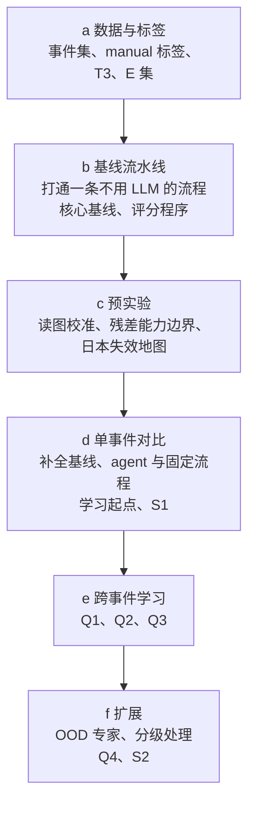
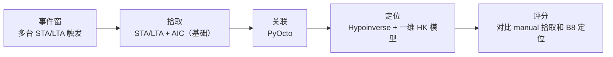
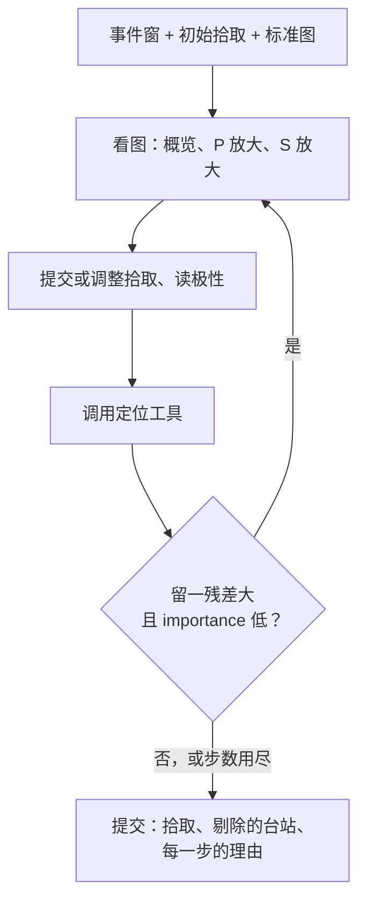
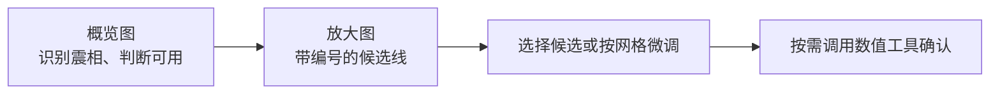
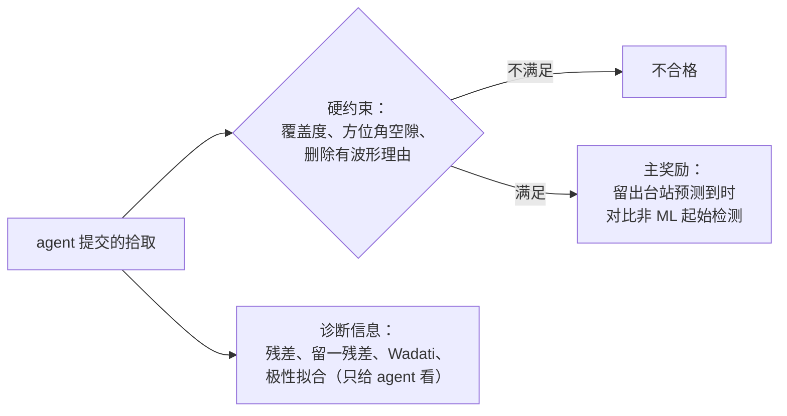
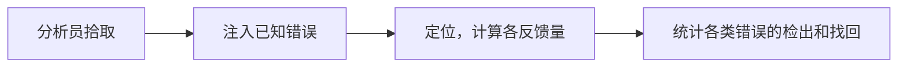
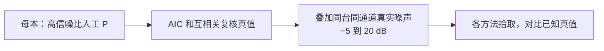
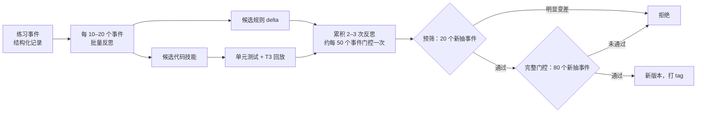
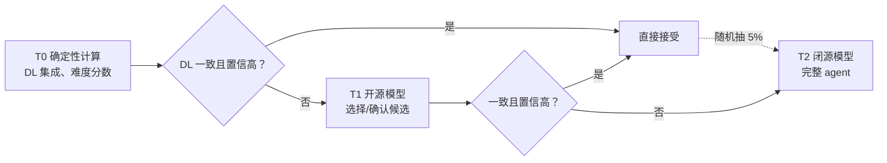
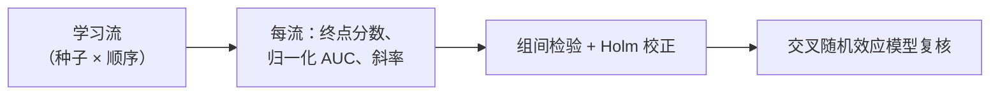

# LLM 地震分析员 Agent：设计

## 1. 目标

让一个能看图的通用 LLM agent 担任天然地震分析员：判断并调整 P/S 震相拾取、读初动极性、定位，并根据定位残差重拾。agent 不更新模型权重，只靠自己写下的经验（规则和代码技能）在事件之间改进。

要回答的问题是一条递进的链：Q1 成立，Q2 才有意义；Q1、Q2 成立后，再看 Q3 的上限和 Q4 的 OOD 专家。

| 编号 | 问题 |
|---|---|
| Q1 持续提升 | 从基础 base（STA/LTA + AIC）出发，随着练习事件增加，agent 写下的经验（规则和代码技能）能否让拾取质量持续提升；提升是否超过安慰剂记忆、等算力对照和“把最终规则直接写进提示词”，并在留出事件上成立 |
| Q2 RSI 可行 | 若 Q1 成立：提升能否在多条学习流（不同种子和事件顺序）上重复、经门控不退化；在不看分析员拾取、只用物理反馈（定位残差等）时还剩多少。满足这些，才算自我改进循环可行 |
| Q3 上限 | 学习曲线的上限能否达到甚至超过同域 DL 强基线（PhaseNet、EQTransformer 及其集成）；按子集看在哪里追平、在哪里超过、在哪里仍落后 |
| Q4 OOD 专家 | 在 DL 的 OOD 区域或场景中，agent（从基础 base 或 DL 拾取出发）能否经同样的循环迭代成该场景的拾取专家：调整拾取、剔除明显错误，使结果超过原版和本地重训的 DL 模型 |
| S1（辅助） | 增益来自哪里：同模型同工具下，自主 agent 是否优于步骤写死的固定流程；LLM 是否优于不用 LLM 的残差重拾规则 |
| S2（辅助） | 只把难的拾取交给 LLM 的分级处理，能否在大幅降低成本的同时保持质量，并扩展到整个序列 |

产出：可复现的 agent 框架和记忆版本库；各方法在各数据集上的拾取、极性和定位结果；学习曲线；一篇论文。

本任务与已有工作的区别：TRACE 等 agent 调度拾取器而不看波形；SeisMoLLM、Si et al. 等训练或微调专用 LLM；FA-Agent 和两篇 SeisAgentBench 处理勘探数据或破裂反演。本任务是不更新权重、在天然地震上看图判读的 agent。详见 `brain_storm/deep_research/15_related_work_novelty.md`。

## 2. 数据

| 数据集                 | 范围                                                                      | 来源                                        | 局限                                                                                                   |
| ------------------- | ----------------------------------------------------------------------- | ----------------------------------------- | ---------------------------------------------------------------------------------------------------- |
| 南加州 | Ridgecrest/Coso 以外的一个区域，选定 R2（圣贝纳迪诺山、Cajon Pass，Transverse Ranges 东段；由 a1 按地震活动、台站密度和人工拾取比例选出，避开 Hadley–Kanamori 模型近似差的深盆地）；练习池 2020-01 至 2023-10；测试候选池取人工拾取比例高的时段和事件，不按模型训练截止划分；第一批只取几十个事件打通流程 | SCEDC 连续波形（S3）和事件 QuakeML | 终审事件中大量拾取是自动拾取（manual P 比例随年份下降）；2023-11-06 起 M<3 事件的自动拾取来自 PhaseNet；若干 hypoPN 测试日期的终审拾取也来自 PhaseNet |
| 北加州                 | NCSN 权威区、非 Geysers、复核标记 F 的事件                                           | NCEDC                                     | 已复核事件几乎全是人工拾取，但 S 拾取很少；Geysers 事件大多不复核                                                               |
| 2019 Ridgecrest（T1） | 2019-07-04 至 07-06，分层抽 400 个事件，另有全量                                     | 上游项目 SeismoAgentBench 的本地波形；SCEDC QuakeML | 在模型训练数据之内，需要匿名化；事件密集重叠；M7.1 附近定位不可靠                                                                  |
| 日本（高难）              | 2024-01-01 至 07 能登早期序列；2022-03 福岛县冲 S-net 事件；M≥4 事件；低频地震                | NIED Hi-net/S-net 等（HinetPy）；JMA 一元化检测值   | 检测值约滞后 2 年；完整复核事件中仍有 30–40% 带自动标记；**没有极性标签**；禁止再分发波形和派生数据                                            |
| 火山（日本的备选）           | SeisBench VCSEIS                                                        | HVO、AVO、NCSN、JMA 的分析员拾取                   | 长周期事件的起始本身更不确定                                                                                       |
| T3 半合成              | 高质量人工 P 拾取叠加同台同通道的真实噪声，信噪比 −5 到 20 dB                                   | 由南加州 2012 年及以前、或北加州非 Geysers 的事件生成        | 只覆盖“母本”所在的台站和震源类型                                                                                    |
| E 错误注入              | 在分析员拾取上注入已知错误                                                           | 由南加州练习池生成                                 | 注入的错误类型由我们决定，不代表真实错误的分布                                                                              |

**数据划分**：练习池用于学习；门控集每次从练习池新抽；选择集取从未参与门控的练习池事件，用于在候选记忆中选最终版本；测试集（基础测试集、T1、日本或火山）从不用于学习。

**防记忆污染（T1）**：窗口时间整体平移、台站名匿名化、坐标刚体平移或旋转后在宿主机变换回来，并比较匿名化前后的表现。

## 3. 检验基准

| 基准      | 怎么来                                                 | 能说明什么            | 局限                                                                        |
| ------- | --------------------------------------------------- | ---------------- | ------------------------------------------------------------------------- |
| 分析员拾取   | QuakeML 中 `evaluationMode=manual` 的拾取（全部参考拾取另作次要结果） | 与分析员的一致性         | 不是真值；分析员之间也有差异（见下表）；不同机构有系统偏差                                             |
| T3 半合成  | 母本拾取，并经 AIC 和互相关复核，三者相差 >0.02 s 的剔除                 | 起始点的准确性          | 母本质量决定上限                                                                  |
| E 错误注入  | 注入的误差大小和类型已知                                        | 残差驱动重拾能找回哪些错误    | 见第 2 节                                                                    |
| 分析员拾取定位 | 分析员拾取经同一定位器、同一速度模型、同一台站校正定位                         | 拾取差异对定位的影响（主指标）  | 继承速度模型误差，但两边共有                                                            |
| 外部高精度目录 | Ridgecrest 的 QTM、Shelly 2020、Lin 2020、HYS 等         | 绝对位置的合理性检查和“真值带” | 只有相对精度或形式误差；深度基准不同；Liu 2020（PhaseNet）和 Atterholt 2025（PhaseNO）评价对应基线时是循环的 |
| 物理一致性   | SKHASH 极性错配、相似事件同台极性一致性、按波形相干分箱的事件对距离               | 不依赖分析员的极性和相对定位质量 | 单事件内信号弱                                                                   |

**分析员间差异**（我们对 SCSN 与 NCSN 分析员拾取的初步对比，36 个事件、374 对；来源见 `results.md`）：

| 层        | 中位数 / 90% 分位    |
| -------- | --------------- |
| P，双方都标 i | 0.01 s / 0.04 s |
| P，标 e    | 0.05 s / 0.30 s |
| S        | 0.05 s / 0.30 s |

两个方法与分析员的误差差小于该层分析员间差异的中位数时，只能说“无法区分”。

## 4. 执行逻辑

整个任务分六部分，按执行顺序排列。基线放在预实验之前：预实验要用到基线流水线的定位器和候选拾取，日本失效地图本身也是在跑基线。

| 部分 | 步骤 | 输入 | 由谁判断 | 得到什么 |
|---|---|---|---|---|
| a 数据与标签 | 1 选事件、下载波形和 QuakeML | 第 2 节的范围 | 程序（按规则筛选） | 各数据集的事件表和波形 |
| | 2 统计并筛选标签 | QuakeML | 程序 | 每个事件的 manual 拾取、权重码；剔除 PhaseNet 来源的参考 |
| | 3 生成 T3 和 E 集 | 高质量人工拾取、噪声段 | 程序 | 已知真值的半合成数据 |
| b 基线流水线 | 1 打通主流水线 | 南加州练习池的一小批事件 | 程序（5.1 的固定选择） | 从事件窗到拾取、关联、定位的完整流程 |
| | 2 写并检验评分程序 | 主流水线的输出、manual 标签 | 程序 | 统一的拾取、极性、定位指标；固定的匹配窗口 |
| | 3 跑核心基线 | 各数据集 | 程序 | B0（基础）、B8、B1（强基线）、R0、R1 的结果 |
| c 预实验 | 1 读图校准 | 已知起始的波形；B0 的 STA/LTA、AIC 候选线（增强模式另加 B1 的 DL 候选线） | 多个 LLM（单轮） | 放大窗口宽度和绘图参数；各模型能否承担分级的第一层 |
| | 2 残差能力边界 | E 集；主流水线的定位器 | 程序（定位器 + R0/R1 规则） | 各类注入错误的检出率；冻结的速度模型和台站校正 |
| | 3 日本失效地图 | 能登、福岛县冲事件 | 程序（原版和日本重训拾取器，走主流水线） | 本地重训模型仍明显差的台网 × 震相 × 震级格子 |
| d 单事件对比 | 1 补全强基线 | 各数据集；c2 冻结的台站校正 | 程序 | B2–B5、B-ens、B7、R2 的结果 |
| | 2 无记忆 agent 和固定流程 | 测试集；c1 定下的图件参数 | LLM agent（基础模式；OOD 子集另跑增强模式） | 学习曲线的起点（after_0）及其与强基线的初始差距；S1 |
| e 跨事件学习 | 1 预实验：短学习流估计流间离散 | 练习池 | LLM agent + 门控程序 | 正式学习流的数量 |
| | 2 正式学习流 | 练习池、门控集 | LLM agent + 门控程序 | 各反馈条件的记忆版本和学习曲线 |
| | 3 选择与测试 | 选择集、测试集 | 程序 | 最终记忆及其测试结果（Q1–Q3） |
| f 扩展 | 1 分级处理全量 | T1 全量 | 程序分级 + 开源 / 闭源 LLM | 整个序列的 agent 目录、成本–性能曲线（S2） |
| | 2 OOD 场景 | 日本子场景或火山 | 同 d、e | 该场景的拾取专家及其与原版、本地重训 DL 的比较（Q4） |

各部分之间的关系：

- **a → b**：a 只给出数据和标签；b 先用一条固定的、不用 LLM 也不用训练好的拾取器的经典流程（STA/LTA + AIC）把“事件窗 → 拾取 → 定位 → 评分”走通，再在同一流程上换入 DL 强基线，回答“经典方法和 DL 天花板各能做到多好”。例如，分析员拾取（B8）经这条流程定位后若复现不了目录位置，问题出在速度模型或台站表，必须先修好，后面所有比较才有意义。
- **b → c**：b 提供了定位器、评分程序和候选拾取；c 用它们回答“看图能看多准”和“残差能发现多大的错误”。例如，读图校准里的候选线就是 B0 的 STA/LTA 和 AIC 拾取；若 2 s 宽的窗口读不出 0.02 s 的差别，d 中的 P 放大图就固定为 1 s。
- **c → d**：c 定下了冻结的台站校正和图件参数；d 先用它们补全依赖这些参数的基线（如 R2），再回答：只用经典工具的 agent 离 DL 天花板多远；agent 复核 DL 拾取时在 OOD 和极端情况下能多做什么；增益来自自主性还是来自 LLM 本身。
- **d → e**：d 是空记忆、单事件的能力；e 回答经验能否在事件之间积累，以及只用物理反馈能积累多少。
- **e → f**：e 得到最终记忆；f 把它用到整个序列和 DL 失效的场景。

## 5. 相关方法介绍

### 5.1 基线流水线

基线分三层：**基础 base** 是经典的 STA/LTA + AIC，不用任何训练好的拾取器；**强基线**是同域训练的 DL 拾取器（PhaseNet、EQTransformer 等）和它们的集成，代表深度学习训练能达到的天花板，用来对比最终结果；**agent + 强基线**由 agent 复核 DL 拾取，主要针对 OOD 区域和极端情况（第 5.2 节）。所有组共用同一条流水线，只替换拾取环节，这样结果的差异只能来自这个环节。

| 部分 | 表示什么 |
|---|---|
| 方框 | 流水线的一个环节；括号外是环节名，括号内是第一轮的固定选择 |
| 拾取方框 | 唯一会被替换的环节：换成 DL 强基线、加 AIC、加残差重拾规则，或换成 agent |

**怎么选**：

1. 基础 base 选不依赖训练数据的经典做法，代表“没有 DL 时”的水平，也是 agent 基础模式能用的全部自动工具。
2. 强基线选同域训练的 DL 模型（加州用 SCEDC 权重），代表 DL 天花板；不用跨域权重充当强基线。
3. 定位选业务上真在用的方法：Hypoinverse 和 Hadley–Kanamori 一维模型（Hutton et al. 2010；2010 年后日常定位是否改用其他模型待核）。
4. 优先用上游 seismotools 已经验证过的接口（PhaseNet、EQTransformer、PyOcto、Hypoinverse、VELEST 都有）；DL 权重取自 `data/models/seisbench/` 链接的本地权重库，离线加载。
5. 参数一次定下并记录，不按测试集结果调。

| 环节 | 第一轮的选择 | 理由 | 备选或之后再加 |
|---|---|---|---|
| 事件窗 | 多台 STA/LTA 网络触发：各台垂直分量的触发按 10 s 重合计数，事件取计数曲线的峰；从峰往前回溯到计数仍不低于 max(5 台, 峰值的一半) 的起点，取其中最早的单台触发为网络触发时刻；窗口为触发前 60 s 至后 180 s。宿主机按目录匹配事件，只用于评分 | 与试点相同；agent 和基线拿到同样的窗口，不泄露位置和震级。只用“5 台”门槛时，噪声台站的零星触发会让窗口提前几十秒 | — |
| 台站与通道 | 区域框内、窗口内有数据的台站（约 30 个）。有 HH 三分量的台站用 HH；只有 EHZ 的短周期台用 EHZ + 加速度计 HNE、HNN（与分析员在这类台站上 P 拾 EHZ、S 拾 HN 的做法一致）；有两套位置码时取有人工拾取的那一套 | 与试点可比；所有拾取方法共用 | — |
| 拾取（基础 B0） | P：垂直分量上递归 STA/LTA（0.3 s / 5 s）检测，取窗口内最大的触发，在其前 1 s 至后 0.5 s 内用 AIC 精修（最小值落在搜索窗两端 10% 内视为精修失败，保留触发时刻）。S：在 P 后 1–30 s 内，对两个水平分量的合成振幅做 STA/LTA（0.5 s / 3 s），取最大峰，在振幅较大的水平分量上用 AIC 精修。检测用 1–20 Hz 因果带通，AIC 定起始点只用 1 Hz 因果高通。不用零相位滤波：它把能量抹到起始点之前，在 M4 事件上使 STA/LTA 提前约 1 s 触发、AIC 找不到真正的起始点；网络触发和所有波形图也一律用因果滤波；信噪比低于 3（S 为 2）的拾取丢弃 | 不依赖训练数据的经典做法。ObsPy 的 AR-AIC（`ar_pick`）在本机对同一输入重复调用时约 8% 返回 S = 0，结果不可复现，弃用 | — |
| 拾取（强基线 B1） | PhaseNet，SCEDC 权重（SeisBench `scedc` v2），阈值用权重自带的 P 0.409、S 0.404 | 同域权重，单模型中最强 | EQTransformer、GPD、集成等在 d1 补 |
| 关联 | PyOcto，用与定位相同的一维模型；每个事件至少 8 个拾取、其中至少 4 个 P，不要求 S；每个事件窗取拾取最多的那个 PyOcto 事件 | 试点基线也用它；B0 的 S 少，要求 S 时有 13/40 个事件关联不上；门槛对所有拾取器相同 | GaMMA |
| 定位 | Hypoinverse + SCSN 版 Hadley–Kanamori 一维模型（Hutton et al. 2010 表 5：层顶 0 / 5.5 / 16 / 32 km，Vp 5.5 / 6.3 / 6.7 / 7.8 km/s），Vp/Vs 1.73，第一轮不用台站校正 | Hutton et al. 2010 记载 SCSN 1932–2008 目录用此模型定位（Long Beach 序列除外）；所有组共用。上游的 `UCVM_HK_1D` 是 CVM-S 的分段线性版本，层值不同，不用 | NonLinLoc 只作敏感性检查；台站校正在 c2 冻结后用于 R2 |
| 日本 | 同一流水线，强基线换成原版和 `jma`、`jma_wc`、`phasenet_sn`，速度模型用与 JMA2001 对应的一维模型 | 只替换与地区有关的部分 | 具体模型在 c3 前定下 |

**第一轮的核心基线**（b3），每个都是后面步骤马上要用的：

| 组 | 为什么第一轮就要 |
|---|---|
| B0 STA/LTA + AIC（基础） | 打通流水线的主拾取器；基础模式 agent 的起点和候选线；读图校准的候选线 |
| B8 分析员拾取 → 同一定位器 | 检验流水线：复现不了目录位置，就先查速度模型、台站表和深度基准；也是定位主指标的参考 |
| B1 PhaseNet（SCEDC 权重） | 强基线的代表：DL 天花板的第一个数字；增强模式的初始拾取 |
| R0、R1 | 残差能力边界（c2）的对照；“确定性的残差驱动重拾”基线（先作用在 B0 上） |

其余基线（B2–B5、B-ens、B7、R2）放到 d1：R2 要用 c2 冻结的台站校正，其他只在与强基线的比较（Q3）中用到。

**打通的标准**（b1、b2）：B8 的定位与目录位置之差的分布合理（先看分布再定阈值）；B0 和 B1 都能走完全流程；B1 与 manual 标签的一致性与公开报告的 PhaseNet 在南加州的水平同一量级；抽查 20 个事件的拾取图。

怎样读、不能怎样读：基础 base 和强基线的参数都是固定的常用做法，不是每个方法的最优设置；B4b 等变体就是用来检验“agent 的优势是否只来自基线设置不好”。agent 在同域清晰拾取上与强基线持平是预期，不是失败；提升应出现在第 6 节分层中的困难子集和 OOD 场景。

### 5.2 编排与内层 agent

外层由固定代码负责，单个事件之内交给一个受限的 agent。自主程度本身是实验变量（第 5.10 节的 F-fixed 组）。

| 部分        | 表示什么                |
| --------- | ------------------- |
| 方框        | agent 在一个事件内的一步操作   |
| 菱形        | agent 依据残差工具的输出做的判断 |
| 回到“看图”的箭头 | 残差驱动的重拾（内循环）        |

| 层            | 负责                                       | 理由                                |
| ------------ | ---------------------------------------- | --------------------------------- |
| 外层（代码）       | 取波形、DL 拾取集成、难度分数、预渲染标准图、定位、残差、评分、门控、记忆版本 | 顺序确定、出错代价高；在宿主机上重新定位，agent 无法伪造结果 |
| 内层（单个 agent） | 看哪些台站、换什么滤波/分量/窗口、改哪些拾取、对哪些台站重拾          | 论文主张是“agent 当分析员”；记忆要能改变做法        |
| 约束           | 步数上限、预算上限、明确的终止条件；工具集小而稳；每次工具调用都要写理由     | 极简控制循环 + 强模型 + 好工具胜过复杂编排          |

两种输入模式：

| 模式 | 起点 | agent 能用的工具 | 回答 | 主要用在 |
|---|---|---|---|---|
| **基础模式**（主） | 基础流水线 B0 的拾取，或不给初值（从零，即 Advikar 试点的设置） | 只有经典工具：STA/LTA、AIC、数值片段、旋转和偏振滤波；**看不到任何 DL 拾取或概率** | Q1–Q3：从经典起点出发，经验积累能把拾取提到多高、能否追上 DL 天花板 | 所有数据集 |
| **增强模式**（agent + 强基线） | 强基线（DL 集成）的拾取 | 经典工具，加上 DL 拾取和概率曲线 | Q4：在 DL 的 OOD 场景中迭代出拾取专家，特别是调整拾取、剔除明显错误 | OOD 区域和极端情况：Ridgecrest 事件重叠、日本海底台和低频地震、火山；同域数据上只作“不变差”的检查 |

**固定流程 F-fixed 怎么定**：与 agent 用同一模型、同一工具、同一套图，只是顺序和次数写死，不能自选。步骤取自分析员的常规做法和试点中 agent 的典型过程：

1. 对每个被标记的拾取：看概览图 → 看 P 放大图，选候选线或按网格微调 → 读极性；S 同样处理（S 放大图，可旋转到 R/T）；
2. 全部处理完后定位一次；
3. 对留一残差最大、且 importance 低的 k 个拾取各重看一次（k 固定，如 3），再定位一次；
4. 提交。

F-fixed 也是分级处理中开源模型那一层的候选做法：如果它与自主 agent 差距很小，T1 层就用它。

怎样读、不能怎样读：agent 的提交只是拾取和理由；位置一律由宿主机重算，agent 自己算出的位置不作为结果。

### 5.3 图件与工具

| 图     | 内容                                 | 规格                                          |
| ----- | ---------------------------------- | ------------------------------------------- |
| 概览图   | 整段三分量，三个共享时间轴的子图                   | 约 1600×400，长宽比不超过约 4:1                      |
| P 放大图 | 以候选时刻为中心、宽 1–2 s 的 Z 分量（宽度由 b1 确定） | 每 0.1 s 一个带数字的主刻度，0.02 s 浅色网格；时间轴为“相对候选的秒数” |
| S 放大图 | 以候选时刻为中心、宽 2–4 s 的水平分量，可旋转到 R/T    | 同上                                          |

| 部分（放大图上）      | 表示什么                                 |
| ------------- | ------------------------------------ |
| 黑色曲线          | 滤波后的波形                               |
| 带字母 A/B/C 的竖线 | 不同方法给出的候选起始，图例写明对应关系；基础模式下只有 STA/LTA 和 AIC，增强模式下另加 DL |
| 主刻度数字         | 相对候选时刻的秒数                            |
| 浅色竖网格         | 0.02 s 间隔，供“向左/向右移几格”的微调             |

| 工具                    | 返回什么                                                                 |
| --------------------- | -------------------------------------------------------------------- |
| 数值片段（按需）              | 结构化短文本，如“AIC 最小值在 +0.034 s；第一个超过噪声 3σ 的采样点在 +0.028 s，符号为 +”；不返回原始采样值 |
| 残差工具                  | 每个拾取的留一残差、importance、学生化值；importance >0.5 的标注“残差不可信”                 |
| `rotate_rt`           | 旋转到 Z/R/T 后的图                                                        |
| `polarization_filter` | 去掉 P 能量后的 S 特征函数图                                                    |
| `s_candidates`        | AR-AIC 和 DL S 概率给出的 2–3 个候选，标在图上                                     |
| `wadati_check`        | 用本区域 Vp/Vs 做 L1 拟合，报告离群台站；阈值为区域均值 ± 若干倍离散度                           |

怎样读、不能怎样读：VLM 擅长在给定候选中确认，不擅长凭空回归单点坐标；所以让模型做选择或微调，而不是直接读出时刻。频谱图只作辅助，不让模型从中读数值。

### 5.4 物理反馈

| 层    | 内容                                                                                 | 进入门控分数    |
| ---- | ---------------------------------------------------------------------------------- | --------- |
| 硬约束  | P、S 覆盖度不低于宿主机独立定义的“可拾取台站集合”的固定比例（按信噪比和非 ML 检测器判定）；次级方位角空隙不差于可拾集合能达到的水平；删除台站必须附波形理由 | 任一不满足即不合格 |
| 主奖励  | 用 agent 改不了的数据：留出台站的预测到时与非 ML 起始检测器（AIC、峰度）的吻合度；有相似邻居时，加上与互相关差分时的吻合度               | 是         |
| 诊断信息 | 普通残差、留一残差、学生化值、importance、Wadati 离群、震源机制极性拟合                                       | 否         |

- 评分前冻结速度模型和台站校正（b2 中在练习池上跑一次 VELEST）。
- 不用 RMS 作反馈或门控分数。
- 不把“预测留出台站到时”的预测值本身当目标：agent 手里有定位器，可以算出预测值再把拾取挪过去。

怎样读、不能怎样读：一维模型下残差主要是模型误差，单事件留一残差只能发现粗差（约 0.3 s 以上，台站少时更大）；全台一致的偏差被发震时刻吸收，单台一致的偏差被台站项吸收，残差都看不见。所以物理反馈只用来学习纠正粗差（错相、错波列、漏拾 S、误拾、周期跳跃），不能用来说明起始点细调更准。

### 5.5 错误注入实验（E 集）

| 注入类型         | 参数                     |
| ------------ | ---------------------- |
| 单个拾取误差       | 0.05 / 0.1 / 0.3 / 1 s |
| P/S 互换       | —                      |
| 周期跳跃         | 按主频的半个周期               |
| 单台小偏差、全部整体平移 | 用来确认残差看不见系统偏差          |
| S 漏拾         | —                      |

结果按 importance 分层（<0.2、0.2–0.5、>0.5），比较 agent（只看残差、不看标签）、R0、R1 各能找回多少。另在练习池有标签的子集上统计“残差判定与标签判定的一致率”，若偏低，Q2 中物理反馈部分的预期相应下调。

### 5.6 半合成 T3

- 母本：南加州 2012 年及以前、或北加州非 Geysers 终审事件中，manual、权重码 0/1、原始信噪比 ≥30 dB 的 P；S 单独、谨慎处理。2013 年后不能用“i 型 + 质量 1.0”选样，那样选出的大多是自动拾取。
- 噪声：同一小时内、与母本不重叠的无事件噪声段，每档多个噪声实现；另做同谱高斯色噪声版本作对照。
- 指标：每档信噪比的偏差、平均绝对误差、离群率（>0.1 s、>0.3 s）、漏拾率。

### 5.7 记忆结构

| 层           | 文件                                 | 内容                                                                                                                                                           | 怎么改                                                    |
| ----------- | ---------------------------------- | ------------------------------------------------------------------------------------------------------------------------------------------------------------ | ------------------------------------------------------ |
| L0 流程       | `README.md`                        | 步骤和工具调用顺序，以人工撰写为主                                                                                                                                            | 很少改，改动必须经门控                                            |
| L1 规则       | `playbook.yaml`（渲染给模型看）            | 每条：`id`、`block`（P 起始 / S 起始 / 极性 / 残差重拾 / 滤波 / 台站类型 / 震中距 / 通用）、`when`、`do`、`expect`、`evidence`（支持事件数，不含事件 ID）、`helpful`/`harmful` 计数、`status`（候选 / 生效 / 退役） | 只允许 ADD / MODIFY / MERGE / RETIRE 四种 delta，由脚本确定性合并并去重 |
| L2 代码技能     | `skills/<name>/SKILL.md` + 代码 + 测试 | 名称、用途、适用条件、可观测的契约（如“在 T3 上精修后中位误差不大于输入”）                                                                                                                     | 先过单元测试和 T3 回放，不占门控预算                                   |
| L3 案例（默认关闭） | `cases/`                           | 少量严格筛选的成败对照案例，文字描述，不存图                                                                                                                                       | 只作为消融                                                  |

上限：L1 约 40 条、3k token；L2 只把名称和描述放进系统提示，正文按需读取。记忆中不得出现事件 ID、日期、坐标或台站特定答案（泄漏检查）。

### 5.8 记忆更新与门控

| 环节     | 规则                                                                                                                                                                              |
| ------ | ------------------------------------------------------------------------------------------------------------------------------------------------------------------------------- |
| 记录     | 每个练习事件结束后生成结构化记录（拾取、残差、工具调用、理由、用到的规则 ID）；规则的 helpful/harmful 计数只作参考，不作删除依据                                                                                                      |
| 反思     | 输入是汇总误差表（按震相、震中距、台站类型、权重码分组）加 3–5 对成败对照；新规则至少需要本批 3 个事件支持；提示词写明残差怎么算、多大算异常、覆盖度要求和物理分数可被刷的方式                                                                                     |
| 接受条件   | 主指标（P、S 拾取 F1 与定位位移的综合）点估计 >0，且配对 bootstrap 90% 下界 > −δ（δ 取 A0 在门控集上两次重复运行之差的 1–2 倍标准差，先实测）；P recall、S recall 做区间非劣效检验，其余次要指标用点估计护栏（极性不降超过 2 个百分点、定位中位位移不增超过 10%）；物理反馈组的覆盖度是硬约束 |
| 累积退化检查 | 每 5 次接受后，在从未用于门控的事件上比较当前版本与 5 次之前的版本                                                                                                                                            |
| 最终选择   | 学习结束后，在选择集上从“空记忆 / 专家 playbook / 各学习流最终版 / 整理版”中选；报告一律用测试集                                                                                                                      |
| 整理     | 学习结束后做一次随机分块消融：8 个块、每块以 1/2 概率开启、约 150 个事件、带事件固定效应的岭回归，删除贡献 ≤0 的块                                                                                                               |
| 监控     | 记录每条规则的调用率；调用率持续上升而对应指标不变的规则，人工检查                                                                                                                                               |

怎样读、不能怎样读：门控通过只说明“在新抽的门控事件上不比当前版本差”，不说明规则本身正确；学习效果以测试集上的学习流统计为准（5.11）。

### 5.9 分级处理

| 部分   | 表示什么                       |
| ---- | -------------------------- |
| 实线箭头 | 正常分流                       |
| 虚线箭头 | 对“简单”事件的随机审计，用来估计分级漏掉了多少问题 |

难度分数由峰值概率、模型间离散度、极性置信度、信噪比、震中距和重叠程度组成。T1 只用“选择/确认候选线”的问题形式；是否设 T1 层，由 b1 读图校准的结果决定。

### 5.10 实验组

**不用 LLM 的基线**

| 层 | 组 | 内容 | 回答的问题 |
|---|---|---|---|
| 基础 | B0 | STA/LTA + AIC（P），AR-AIC（S） | 不用训练数据的经典水平；基础模式 agent 的起点 |
| 强基线 | B1–B3 | PhaseNet / EQTransformer / GPD，加州用 SCEDC 权重；日本用 `jma`、`jma_wc`、海域加 `phasenet_sn`，原版权重只作跨域对照 | DL 单模型的天花板 |
| 强基线 | B-ens | 同域 DL 模型的集成（PhaseNet、EQTransformer、GPD 等的 SCEDC 权重，按拾取时间取中位或投票） | DL 能达到的最强自动结果；增强模式的初值 |
| 强基线 | B4 | PhaseNO | 多台站模型 |
| 强基线 | B4b | PhaseNet 小步长滑动窗口汇总 | agent 的优势是否只来自修补 PhaseNet 默认设置的不稳定 |
| 精修 | B5 | PhaseNet + 与 agent 相同的 AIC 精修 | 精度来自看图还是来自 AIC |
| 残差规则 | R0 | 稳健定位，不重拾（残差加权或 RANSAC 式） | 只靠剔除或降权能做到多少 |
| 残差规则 | R1 | 在预测到时附近窗口内按固定规则重拾 + 稳健定位（分别作用在 B0 和 B-ens 上） | LLM 是否只等于“确定性的残差驱动重拾” |
| 残差规则 | R2 | R1 + 冻结的台站校正 | 台站项能把可检测门槛降多少 |
| 极性 | B7 | Ross et al. 2018 CNN（JGR）为主；RPNet 为次（日本、到时不准时） | 极性基线 |
| 参考 | B8 | 分析员拾取 → 同一定位器 | 定位的参考和上限 |

**Agent 组**

| 优先级 | 组                       | 内容                                          | 回答的问题                |
| --- | ----------------------- | ------------------------------------------- | -------------------- |
| 核心  | A0                      | 空记忆；基础模式（OOD 子集另跑增强模式 A0-DL）       | 零样本能力，学习曲线的起点 |
| 核心  | A-expert                | 专家手写的固定 playbook                            | 自学是否优于人工经验           |
| 核心  | F-fixed                 | 同模型、同工具、同图，步骤写死                             | 自主性本身有没有用（S1）       |
| 核心  | A-label                 | 标签反馈学习                                      | 学习上限                 |
| 核心  | A-physics               | 物理反馈学习（不看分析员拾取），带覆盖度约束                      | Q2：不看标签的自我改进 |
| 核心  | A-placebo               | 反馈来自另一个事件（按震级和台站数匹配，台站名映射到本事件），token 和调用数相同 | 排除“反思过程本身有用”         |
| 核心  | A-bestofN               | 无记忆，等算力多次采样或投票                              | 排除“多花算力就有用”          |
| 核心  | A-prompt-final          | 把学到的最终 playbook 写进初始提示词，不再学习                | 区分“学习过程有用”与“这几条规则有用” |
| 次要  | A-physics-unconstrained | 物理反馈，不加覆盖度约束                                | 约束是否必要（是否出现刷分）       |
| 次要  | A-shuffled              | 残差在台站间随机置换后作反馈                              | agent 是否真的利用了残差信息    |
| 次要  | A-reflect-only          | 只回顾自己的做法，没有反馈                               | 区分“反思”和“反馈信息”        |
| 次要  | A-nogate                | 同样的反思，全部接受                                  | 门控的价值                |
| 次要  | F-fixed + playbook      | 固定流程 + 学到的 playbook                         | 学习收益是否依赖自主性          |
| 可选  | A-generic               | 等长的通用地震学说明                                  | 排除“上下文更长就有用”         |

消融（视预算）：不做内循环；不看图只用数值；有无 S 工具；只用规则 / 只用代码技能 / 两者都用。

**极性评估拆成计时和判读**：(a) 分析员 P 到时 + 模型极性；(b) agent 的 P 到时 + 模型极性；(c) 分析员 P 到时处的截图给 agent 判极性；(d) agent 全流程。

### 5.11 统计方法

| 比较                | 方法                                                                                               |
| ----------------- | ------------------------------------------------------------------------------------------------ |
| agent 与基线（学习起点、S1） | 按事件配对的整群 bootstrap；小子集比例用 Wilson 区间；不用逐拾取 p 值                                                    |
| 学习（Q1–Q4）         | 统计单位是学习流；每条流算终点分数、归一化 AUC、对 log₂(练习事件数) 的斜率；组间用 Welch t 检验，4 个主比较做 Holm 校正；交叉随机效应混合模型（流、事件、台站）复核 |
| 物理反馈的报告量（Q2）           | (A-physics − A-placebo) / (A-label − A-placebo)，带置信区间，并按错误类型分解                                   |
| 规模                | 开源模型上每个主要组 ≥10 条流（5 种顺序 × 2 个种子），各组共用相同组合；先用 10–20 条 50 事件的短流估计流间离散再定最终数量；闭源模型每组 3 条，只看方向        |
| 快照                | 0、25、50、100 个练习事件处用固定的 100–150 个事件评估；终点用全部 400 个                                                 |

怎样读、不能怎样读：“差异不显著”不能说明两组相当；要说相当，必须事先给出等效界并做等效性检验。闭源模型 3 条流的结果只能说方向，不能单独下显著性结论。

## 6. 口径

- 以分析员为参考的指标一律称“与分析员的一致性”；“更准确”只来自 T3 和 E 集。
- 参考拾取以 manual 为主、全部参考为次；排除 PhaseNet 来源的参考后再与 PhaseNet 比较。
- 分层维度：权重码（0/1/2/3）、重叠程度（孤立 / 轻度 / 严重，按 ±30 s 内是否有其他事件）、震级、震中距；SCSN 与 NCSN 的 i/e 不合并统计。
- 每个数据集先估计各方法相对该机构分析员的中位偏差，同时报原始误差和扣除常数偏差后的离散度。
- 拾取指标：precision、recall、F1、平均绝对误差、0.05 / 0.1 / 0.2 s 内命中率；P、S 分开；S 以 recall 和 0.2 s 内命中率为主。拾取与参考的匹配窗口在 c2 中用基线数据确定后固定。
- 定位主指标：相对分析员拾取定位（B8）的位移，水平和深度分开报中位数和 90% 分位，另报发震时刻差；比较外部目录前统一深度基准、去掉共同偏移、剔除 M>5 和 M7.1 附近时段。
- 极性：一致率与覆盖率一起报。
- 成本：按图片 token / 文本输入 / 缓存命中 / 输出分开记账；同时记录工具调用数和耗时。

## 7. 验证

- 分析员拾取经我们的定位器，应复现目录位置到合理范围；不能复现时先查速度模型、台站表和深度基准。
- 评分程序用人工构造的拾取（已知偏差、漏拾、误拾）做单元测试。
- 每个数据集抽查几十个事件的波形和标签，确认时间对齐、通道和极性符号正确。
- 记忆的泄漏检查；T1 匿名化前后的表现对比。
- 同一记忆在测试集上重复评估两次，得到评估噪声底线。
- 每组报告最差的学习流和低于 A0 的学习流所占比例。

## 8. 产出

- agent 框架：工具、提示词、harness、评分程序（可公开）。
- 记忆版本库：每个接受版本带 git tag。
- 各方法在各数据集上的拾取、极性、定位结果和决策记录。
- 学习曲线、错误注入结果、成本–性能曲线。
- 论文：首选 GRL，备选 Seismica / JGR-MLC。预印本选非 Creative Commons 许可，以保留投 SRL 的可能。

## 9. 不做的内容

- 不更新模型权重（不微调、不强化学习）。
- 不做多 agent 角色分工；不用 LLM 评审打分。
- 不做整个 agent 的自修改；不让 agent 自行删除规则；不把所有经验直接加入记忆。
- 不以物理反馈声称起始点细调更准。
- 不做远震、DAS 和诱发地震。
- 不发布 NIED 波形和 JMA 检测值，只发布事件 ID、下载脚本和我们自己的结果。
- 不联系 Advikar 索取试点材料；试点的数字只作参考。

## 参考

- 调研报告与文献：`brain_storm/deep_research/`（各报告的参考文献部分）。
- 试点整理：`brain_storm/advikar_pilot_summary.md`。
- 讨论稿（含相关工作、风险、预算和图件规划）：`brain_storm/design.md`。

