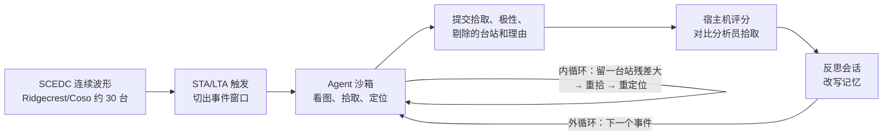

# Advikar 试点：做了什么、怎么做的、结果和待核问题

来源：同目录下 `Agent_Seismology_Research_Advikar.docx`（Advikar 的试点报告）。本文只整理报告里写明的内容；报告没写的标为“未说明”，我们自己的判断单独放在第 4、5 节。

## 1. 要回答的问题

报告提出两个主张：

1. 一个多模态 LLM agent 能否**自己当分析员**，不依赖深度学习拾取器，拾取质量达到 PhaseNet / EQTransformer 的水平；
2. 它能否**从自己的错误中学习**：每个练习事件后写经验，下一个事件带着经验做，越做越好。

和此前的工作（让 Gemini 看一张波形图回答一个问题）不同，这次 LLM 是完整的分析员，而不是分析员手里的一个工具。

## 2. 实现方案

### 2.1 总体流程

| 环节 | 做法 |
|---|---|
| 数据 | SCEDC 公开的 S3 连续波形，Ridgecrest/Coso 区域约 30 个台站，100 Hz 三分量 |
| 事件窗口 | STA/LTA 扫描整天的数据，找多个台站同时触发的时刻；每个窗口取触发前 60 s 到触发后 180 s |
| 答案 | 宿主机上把窗口匹配到 ComCat 事件，取 SCSN 分析员拾取作为答案；agent 看不到这一步 |
| 震级门槛 | 只用 M≥2.5，报告认为这是 SCSN 分析员逐个人工计时的门槛 |
| 模型 | OpenAI gpt-6.1-sol，训练截止 2026-04 |

### 2.2 数据划分

| 组 | 事件数 | 时间 | 用途 |
|---|---|---|---|
| 练习 | 9 | 2025 | agent 在这些事件上学习，每个事件后拿到评分反馈 |
| 验证 | 8 | 2025 | 选出最好的记忆快照，不用于学习 |
| 测试 | 11 | 2026-07 至 09 | 最终评分；都晚于模型训练截止 |

（报告正文写“25 个事件”，但表中合计是 28 个，见第 4 节。）

### 2.3 单个事件内 agent 能用什么

- Docker 容器，不联网；只有事件窗口的波形和台站坐标表，没有位置、震级和发震时刻；
- 持续的 bash 和 Python（ObsPy、NumPy、matplotlib、Hypoinverse）；
- 工具包 `seiskit`：读数据、画按震中距排列的波形剖面、画单台三分量、放大、算信噪比、AIC 自动精修起始点、运行 Hypoinverse、算留一台站残差；
- `view_image` 工具：保存的图可以直接看；
- 只读的记忆文件夹（之前练习事件后写下的经验）。

提示词要求：独立完成编目，先看图拾取、再用数值精修，定位，检查残差，修正不合理的拾取，只提交一次，提交时列出全部拾取、被剔除的台站和理由。**每次工具调用都必须带 reason 字段**，这些理由组成决策记录（decision ledger）。

速度模型：报告未说明 Hypoinverse 用哪个模型；示意图里写的是 ObsPy · TauP（IASP91）。

### 2.4 一个事件的典型过程（报告中的例子：M2.5，32 次工具调用）

1. 读记忆和工具包说明；
2. 列出可用的道，画按震中距排列的垂直分量剖面，先看全台网的 P、S 走时规律和台站质量；
3. 分组画三分量图，原始和滤波后各一张（约 6 张图）；
4. 单独检查两个没触发的加速度计；
5. 逐个放大：P 窄窗、S 宽窗（约 10 张图）；
6. 在自己框定的范围内用 AIC 精修，然后定位；
7. 算留一台站残差，找出可疑的晚 S 拾取，扩大窗口、换频带重看；
8. 单独读极性：在原始道和轻度高通后的垂直道上看第一个四分之一周期；
9. 检查深度敏感性、去掉最近台站的影响；
10. 提交。

结果：27 个台站用了 22 个，剔除 5 个并写明理由；震中与官方相差 0.36 km，深度差 0.6 km，发震时刻差 0.2 s；成本约 $0.60。

### 2.5 学习环节（外循环）

每个练习事件后开一个新会话，agent 看到反馈文件：每个台站的拾取与分析员的差、错拾和漏拾、极性不一致、定位误差，以及 PhaseNet 在同一事件上的结果。记忆文件夹此时可写，必须更新三样东西：

| 文件 | 内容 |
|---|---|
| `README.md` | 下次做事的步骤 |
| `playbook.md` | 简短、可检验的规则，每条附证据，另有修改记录 |
| `skills/` | 想复用的 Python 函数，每个函数配一个必须通过的测试 |

harness 把记忆提交到 git 并打标签（`after_0`、`after_5`、`after_9`）。泄漏检查拒绝任何写出事件日期、编号或位置的记忆。

5 个练习事件后学到的规则（转述）：

- P 波继续用“先目视、再窄窗精修”。证据：多次会话中 P 匹配 20/20、18/19、13/13，平均绝对误差 0.03 s。
- S 波精修前，先在两个水平分量上、暂定起始点之前至少 1 s 的宽窗里检查。证据：第 4 次会话 15 个 S 全部晚约 0.23 s，而目视初值本身就晚了，不是精修函数的问题。
- 不要只凭残差判断台站有延迟。证据：SEV 台残差 +1 s，但拾取与分析员只差 0.02 s。
- 不要因为上一个事件极性不一致就翻转极性。证据：第 1 次会话的 4 个极性错误都是“agent 判下、分析员判上”。
- RMS 低不代表定位好。证据：RMS 0.17 s 时深度误差 1.8 km。

agent 也会撤回被新证据推翻的结论：它先怀疑 SEV 台总是偏晚，第 5 次会话后写下“台站持续偏晚的判断被推翻”。

### 2.6 对照组与防作弊

各组共用同一个关联步骤、同一个 Hypoinverse 和同一个评分程序。

| 组 | 内容 |
|---|---|
| PhaseNet | SCEDC 训练的权重，PyOcto 关联 |
| EQTransformer | 原始权重，PyOcto 关联 |
| 分析员拾取 | 直接送入 Hypoinverse，作为“拾取完美时定位能做到多好”的上限 |
| Agent after_0 / after_5 / after_9 | 空记忆，学过 5 个、9 个练习事件后的记忆 |

防作弊措施：沙箱不联网；测试事件晚于训练截止；答案不挂载进沙箱；任务只给时间窗和台站表；验证、测试事件从不用于学习；记忆有泄漏检查；记忆快照按验证集选；**定位由宿主机根据提交的拾取重新计算**，agent 无法伪造位置。

评分：每个 agent 拾取与同一台站 2 s 内最近的分析员拾取匹配。

## 3. 核心结果

### 3.1 P 波（11 个测试事件，216 个分析员 P 拾取）

| 组 | P recall | 平均绝对误差 | 0.1 s 内 | 震中误差 | 极性一致率 |
|---|---|---|---|---|---|
| Agent after_0 | 87% | 0.02 s | 97% | 0.35 km | 96%（114 个） |
| Agent after_5，第 1 次 | 98% | 0.02 s | 98% | 0.31 km | 93%（121 个） |
| Agent after_5，第 2 次 | 98% | 0.02 s | 97% | 0.33 km | 95%（126 个） |
| Agent after_9 | 97% | 0.02 s | 99% | 0.36 km | 92%（118 个） |
| PhaseNet | 98% | 0.04 s | 89% | 0.37 km | 无 |
| EQTransformer | 100% | 0.05 s | 87% | 0.35 km | 无 |

- recall 从 87% 升到 98%，主要来自一条规则：“不要因为模型拟合差就删掉可信的观测到时”。空记忆时 agent 剔除台站过多。
- 震中误差在 0.31–0.37 km 之间波动，各组都在这个范围内，报告认为是噪声。

### 3.2 缓起与清晰的 P 起始（按分析员权重划分，只统计双方都有的拾取）

| 子集 | 共有拾取 | Agent 误差 | PhaseNet 误差 | 倍数 | p |
|---|---|---|---|---|---|
| 缓起，after_0 | 73 | 0.036 s | 0.069 s | 1.9× | 0.0009 |
| 清晰，after_0 | 112 | 0.016 s | 0.019 s | 1.2× | 0.07 |
| 缓起，after_5 | 50 | 0.027 s | 0.051 s | 1.9× | 0.0014 |
| 清晰，after_5 | 52 | 0.018 s | 0.017 s | 0.9× | 0.2 |

- 清晰起始上两者持平，都接近人与人之间的一致性极限；缓起上 agent 约准 2 倍，after_9 时达到 2.7 倍。
- 缓起拾取 0.1 s 内命中率：agent 92–96%，PhaseNet 75–82%，EQTransformer 87–88%。
- 逐对比较（after_5 第 2 次）：比 PhaseNet 更接近分析员的 121 次、更远的 70 次（p = 4e-7）；对 EQTransformer 为 133 比 67（p = 5e-10）。
- 报告的概括：**明显的到时 agent 读不过拾取器，模糊的到时 agent 靠选滤波、窗口和分量做出更好的判断。**

### 3.3 S 波

| 组 | S recall | 误差中位数 | 0.1 s 内 |
|---|---|---|---|
| Agent after_0 | 72% | 0.090 s | 53% |
| Agent after_5 | 96% | 0.060 s | 65% |
| Agent after_9 | 78% | 0.080 s | 59% |
| PhaseNet | 83% | 0.070 s | 62% |
| EQTransformer | 99% | 0.050 s | 73% |

after_9 变差，原因是第 9 个事件后的反思加了一条更严格的 S 拾取准入规则，损失了 recall。S 波上 agent 落后 EQTransformer（p = 7e-7），与 PhaseNet 持平。

### 3.4 验证集上的快照选择（8 个 2025 年事件，更小、更噪；PhaseNet 在这里只有 65% 在 0.1 s 内）

| 快照 | P recall | S recall | 极性 | 平均绝对误差 |
|---|---|---|---|---|
| after_5 | 97% | 95% | 95% | 0.05 s |
| after_9 | 93% | 73% | 92% | 0.05 s |

据此选定 after_5，并且是在看测试集差异之前选的。

### 3.5 成本

| 项目 | 费用 |
|---|---|
| 每个事件的 agent 运行 | $0.50–0.75（随步骤变长而上升） |
| 每次反思 | 约 $0.07 |
| 9 个练习事件加反思 | 约 $6 |
| 整个试点（训练、3 个快照、验证、2 次重复） | 约 $60 |

### 3.6 报告自己的结论

已证明：

- 不用深度学习拾取器的 LLM agent，在训练截止后的真实地震上能达到拾取器的质量，每个决定都有理由记录；
- P 波计时显著比两种拾取器准，优势集中在缓起震相；
- 极性与分析员约 95% 一致，而拾取器不输出极性；
- 自写的经验在 5 个事件内把 recall 从 87% 提到 98%，规则可读、带证据、会被修正。

未证明：

- S 波或定位上的任何优势；
- 单调的学习：学得更多后 S 波和极性反而变差；
- 普适性：只有一个区域、11 个测试事件、2 次重复。

Advikar 自己的疑问：规模不够；太贵；参考答案本身来自人的主观判断，可能就不是“真值”；想看到人工拾取和 agent 拾取的逐道对比，但不知道去哪里找人工拾取。

## 4. 我们复核时发现的问题

这些问题要在复现时逐条确认，必要时直接问 Advikar。

| # | 问题 | 为什么重要 |
|---|---|---|
| 1 | 正文说 25 个事件，表中 9 + 8 + 11 = 28 | 数据划分要以实际事件列表为准 |
| 2 | 共有拾取数：after_0 是 73 + 112 = 185，after_5 只有 50 + 52 = 102，而 after_5 的 recall 更高 | 共有拾取怎么定义的说不清，倍数和 p 值可能是在不同子集上算的 |
| 3 | 对照组表里有“分析员拾取”组（定位上限），但结果里没有它的数字 | 没有上限，0.31–0.37 km 的震中误差无从解读 |
| 4 | “0.1 s 内”和误差只在匹配上的拾取里算；after_0 的 recall 只有 87% | agent 丢掉的多是难拾的，留下的自然更准；比较要在共有拾取上做 |
| 5 | p 值把每个拾取当作独立样本，但同一事件的拾取是相关的，测试只有 11 个事件 | 显著性被高估，应按事件做配对 bootstrap |
| 6 | agent 有 AIC 精修，对照组没有“PhaseNet + 同一个 AIC” | 精度优势中有多少来自 AIC、多少来自看图，目前分不开 |
| 7 | PhaseNet 用 SCEDC 权重，EQTransformer 用原始权重 | 两个基线不在同一起点 |
| 8 | 震中误差的参考是 ComCat，而 ComCat 本身由分析员拾取经 Hypoinverse 算出 | 衡量的是“与分析员拾取的定位一致”，不是绝对位置准确 |
| 9 | 据 design.md §3.1，SCSN 从 2023-11 起 M<3 事件以 PhaseNet 结果为起点复核；测试集是 2026 年的 M≥2.5 | 其中 M2.5–3 的参考拾取可能偏向 PhaseNet；这会让 PhaseNet 占便宜，agent 的优势可能被低估，但需要核实 |
| 10 | 极性一致率只统计 agent 给出极性的 114–126 个拾取，约为 P 拾取的一半 | 覆盖率和一致率要一起报 |
| 11 | 学习只有一种事件顺序、一个种子；after_0 到 after_5 的提升基本来自一条规则 | 这条规则写进初始提示词同样能做到；需要“专家 playbook”和安慰剂对照 |
| 12 | 快照只在 after_5 和 after_9 之间比较，没有 after_0；验证集只有 8 个事件 | 选择本身的不确定性很大 |
| 13 | 验证集上误差是 0.05 s，测试集是 0.02 s | 难度差异大，要分层报告 |
| 14 | 外循环的反馈用的是**分析员标签**；残差只在单个事件内部使用（内循环） | 我们的设想是用残差作外循环反馈，Advikar 没有做过这一点 |

## 5. 对我们的意义

- **可以直接继承的**：沙箱加看图工具的形式、reason 字段和决策记录、三件套记忆（README / playbook / skills）、git 标签管理快照、泄漏检查、宿主机重新定位。
- **需要补上的**：PhaseNet + AIC 对照、分析员拾取定位的上限、事件级统计、多种子和多种顺序、安慰剂记忆、S 波专用工具。
- **向 Advikar 要的东西**：代码和 `seiskit`、28 个事件的列表和窗口、评分程序、每组的提交结果、决策记录和对话记录、记忆仓库的全部标签。有了这些，第 4 节的大部分问题不用重跑就能核实。
- **复现的第一步**：用报告里的事件列表，在我们的环境里重跑 PhaseNet、EQTransformer 和分析员拾取三组（不需要 LLM），先确认评分程序和这几组的数字一致，再跑 agent。
