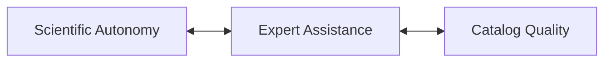
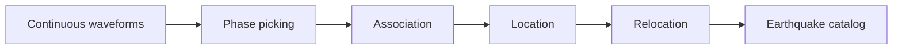
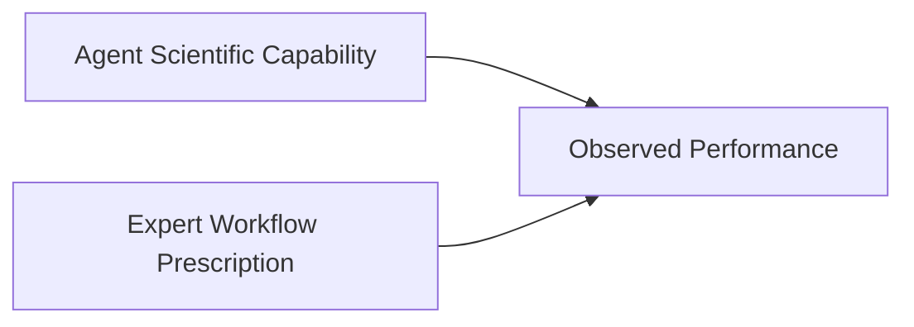
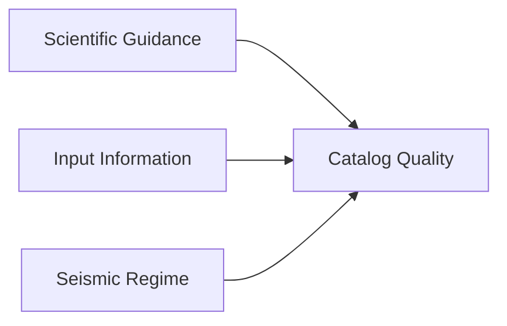

# SeismoAgentBench research plan

**Formal name:** Agentic Seismic Catalog Benchmark  
**Short project name:** SeismoAgentBench  
**Repository/CLI slug:** `seismoagent-bench`  
**Short abbreviation:** SABench

`SeismoAgentBench` is the canonical project name. The hyphenated `seismoagent-bench` form is reserved for repository names, command-line commands, URLs, and other contexts where lowercase slugs are preferred.

This document is the single place where the benchmark design is defined: questions, cases and tiers, Agent stages, the form of the knowledge and the checker, controls, leakage rules and reference principles. The paper built on it is outlined in [`02_Paper_Outline.md`](./02_Paper_Outline.md); progress and the work plan are in [`progress/STATUS_AND_PLAN.md`](./progress/STATUS_AND_PLAN.md). The candidate case pool, the case registry and the information-collection standard are in [`docs/data/`](../data/).

**Version:** v0.3 (2026-10-29; v0.2 2026-09-18)  
**Phase I cases:** Prague (2011), Magna (2020), Maple Creek (2017), Kīlauea (2018), Ridgecrest (2019), Kaikōura (2016)

> **Interpretation rule:** Reference catalogs in this benchmark are **expert reference catalogs / high-quality target catalogs**, not absolute ground truth. A catalog may be an excellent target for detection completeness or relative relocation while remaining unsuitable as an absolute-location truth set.

---

## 1. Motivation and core questions

Agentic AI systems are rapidly evolving from language-generation tools into systems capable of long-horizon planning, coding, tool use, execution, debugging, and iterative problem solving. General-purpose agents have demonstrated increasingly strong capabilities on complex software-engineering tasks, while domain-specific scientific agents have begun to execute multi-step scientific workflows in areas such as seismic monitoring and earthquake analysis.

However, for a **specific, complete, and objectively testable scientific task** such as earthquake catalog construction, the actual capability boundary of current Agents remains unclear.

Several fundamental questions remain open:

- Can an Agent construct a scientifically usable earthquake catalog directly from seismic observations with minimal expert intervention?
- How much domain knowledge, workflow prescription, parameter guidance, or human debugging is still required?
- Can an Agent-generated catalog approach the quality of catalogs carefully constructed by domain experts?
- Or should current Agent-generated catalogs primarily be regarded as preliminary products that still require substantial expert refinement?

These questions are critical for determining how Agentic systems should be used in future seismic monitoring. Before large-scale deployment, we need a controlled benchmark that can determine **what current Agents can do independently, what level of scientific product they can produce, and where expert support remains necessary**.

> **Core benchmark question:**  
> **How independently, and to what level of scientific quality, can current Agents construct earthquake catalogs from seismic observations?**

The benchmark therefore focuses on the relationship among three quantities:

It evaluates the complete Agent-controlled seismic-monitoring workflow rather than a single picker, associator, locator, or relocation algorithm:

The resulting catalog is then compared with high-quality expert reference products that are withheld from the Agent during the benchmark.

The benchmark is intended to provide the empirical basis for later reliability-aware and self-improving systems. With hidden expert references, we can determine when the Agent actually succeeds or fails; later, when those references are unavailable, we can test whether the Agent itself can recognize that reliability.

---

## 2. Benchmark design

### 2.1 Compact, high-information cases

The benchmark should favor **short-duration, information-rich seismic sequences** rather than multi-year continuous catalogs.

A preferred benchmark case should contain:

- **3–7 days** of continuous waveform data;
- generally **no more than 14 days** unless scientifically necessary;
- a manageable number of stations;
- a sufficiently dense event population to stress the workflow;
- one or more high-quality published reference catalogs that can be subset to the same temporal and spatial window.

This design keeps waveform downloading, preprocessing, repeated Agent runs, controlled ablations, and manual inspection computationally feasible.

The goal is to benchmark **scientific capability**, rather than storage capacity or data-transfer bandwidth.

### 2.2 Scientific regimes and difficulty tiers

The case set should include different monitoring conditions, such as:

- mainshock–aftershock sequences;
- earthquake swarms;
- volcanic seismicity;
- induced or triggered seismicity;
- dense permanent networks;
- temporary near-source deployments;
- changing network geometries;
- simple and complex fault systems.

The objective is **diversity of scientific difficulty**, not geographic diversity for its own sake.

The six Phase I cases form three difficulty tiers (2026-10-29). Tiers are assigned from features known before any run; the expert's experience has to confirm the order. Events per day are from the human-in-loop final.

| Tier | Case | Regime | Stations | Window | Final events/day | Main difficulty |
|---|---|---|---:|---|---:|---|
| Basic | Prague 2011 | induced, aftershocks of Mw 5.7 (mainshock before window) | 23 | 8 d | ~850 | compact network, 1-D layered model; changing deployment |
| Basic | Magna 2020 | moderate mainshock–aftershock, Mw 5.7 in window | 47 | 8 d | ~680 | basin velocity structure, depth control |
| Intermediate | Maple Creek 2017 | Yellowstone swarm, max Mw 4.4 | 27 | 8 d | ~1,550 | vertical-only sites; high rate of small events; magnitude of the largest events |
| Intermediate | Kīlauea 2018 | volcanic summit collapse, Mw 6.9 in window | 25 | 8 d | ~650 | 3-D structure, template families mislocate; Mw 6.9 coda |
| Hard | Ridgecrest 2019 | M6.4 and M7.1 sequence | 42 | 3 d | ~6,000 | mainshock coda, extreme association density, large-event QC |
| Hard | Kaikōura 2016 | multi-fault aftershocks of Mw 7.8 | 53 | 8 d | ~1,600 | 260-km network, 3-D structure, 1-D vs 3-D frame offset (expert scatter 2.78 km) |

To tabulate in Phase A (`evaluation/tiers.json`): network aperture and median inter-station distance, largest magnitude inside the window, event rate, structural complexity (1-D adequate or not), station defects; expert difficulty: human-in-loop rounds, blind → final change per dimension, reference-to-reference ceiling. Kīlauea (Mw 6.9 inside the window) is the case most likely to move tier; a move is recorded with its reason, not hidden.

### 2.3 Two experimental dimensions

The benchmark should explicitly control both:

1. **what observational information the Agent receives**; and
2. **how much scientific guidance the Agent receives**.

#### Observational input conditions

| Input condition | Agent receives | Main capability tested |
|---|---|---|
| **Raw-waveform condition** | Continuous waveforms + station metadata + general regional context | Full catalog construction from observations |
| **Routine-catalog-assisted condition** | Waveforms + station metadata + operational catalog | Catalog enhancement, refinement, and relocation |
| **Phase-assisted condition** | Waveforms + metadata + routine phase picks | Location, relocation, and higher-level workflow reasoning |

These should be treated as different benchmark tasks rather than merged into one score.

#### Scientific-guidance settings

| Guidance setting | Agent access | Main capability tested |
|---|---|---|
| **Closed-reference** | Generic tools and scientific knowledge, but no target paper, target catalog, or target-specific workflow details | Independent workflow construction |
| **Open-literature** | Papers, software documentation, and public method descriptions are accessible; target catalog remains hidden | Scientific retrieval, adaptation, and workflow reuse |
| **Expert-guided control** | Expert workflow, parameter guidance, or target-specific scientific decisions are supplied | Upper-control performance with strong expert support |

These conditions make it possible to separate:

the Agent's own scientific capability from performance contributed by expert workflow prescription.

The Agent stages below all use the raw-waveform, closed-reference condition; the other conditions are kept for later tasks.

### 2.4 Agent capability stages (revised 2026-10-29)

Within the closed-reference, raw-waveform task the Agent arms form a ladder in which each stage adds exactly one factor. The Agent, its harness, the model and the output contract stay the same, except that S3 adds the checker report to the contract (§2.5). The evidence that expert results need experience is in [`01_Expert_Experience_and_Checker.md`](./01_Expert_Experience_and_Checker.md).

| Stage | Arm | Agent additionally gets | Question | Status |
|---|---|---|---|---|
| S0 | `min` | task, data, output contract | Can a general Agent build a trusted catalog on its own? | implemented |
| S1 | `tools` | validated tool library `seismotools` with usage docs | What do tools add? | implemented |
| S2 | `knowledge` | tools + case-agnostic expert knowledge given up front (§2.5) | What does knowledge add on top of tools? | not implemented |
| S2c | `checker` | tools + reference-free checker, no knowledge (§2.5) | Does knowing *that* something is wrong let the Agent find and repair it? | not implemented; run first (2026-10-30) |
| S3 | `knowledge_checker` | tools + knowledge + checker (§2.5) | Does knowledge plus automated validation close the gap to the expert? | not implemented; run after S2c |
| — | human-in-loop final | — | upper bound | done (all six) |

Decided 2026-10-30: both components are built, and the `checker` arm (S2c: tools + checker, no knowledge) runs before S3. Compared with S1 it isolates the effect of automated validation; S2 versus S3 and S2c versus S3 then separate knowing how to do it from knowing that it went wrong.

**Yardstick.** The human-in-loop final is the single yardstick and the upper bound. It used the references during its iteration, so part of it is out of an Agent's reach; that part is attributed with the expert ladder and the intervention coding ([`01_Expert_Experience_and_Checker.md`](./01_Expert_Experience_and_Checker.md) §5). The first-round blind catalog is not a yardstick: it used no template matching.

**Headline number.** Gap closure per dimension, `(S_k − S1) / (final − S1)`, for detection `recall_norm`, `shift`, `dz_median` and the magnitude offset, reported by tier.

The `guided` arm (expert scaffolding, fixed window, `report.md` contract) varies how prescriptive the task statement is and also changes the window and contract; it is not on this ladder and stays optional.

### 2.5 Form of the knowledge and the checker

**Principle.** The paper claims something about *general-purpose* Agents. So the Agent, its loop and the model are never modified. Every stage only adds files to the Agent's environment, the same way S1 adds tools. No custom agent loop, no harness-side retries, and no custom subagent.

#### Two layers

| Layer | Form | Why this form |
|---|---|---|
| Diagnostics | a deterministic program in `seismotools/checker/` (CLI) that reads the Agent's picks, events, catalog and the station metadata and writes `checker_report.json` plus figures; rules and ranges only, no case numbers, no references. It reports **symptoms only** (what is measured and where it falls outside the expected range), never a cause or a repair: deciding what a symptom means and what to change is the Agent's job (decided 2026-10-30) | same status as every other tool; no LLM inside, so it cannot rationalise a symptom away; identical for any Agent |
| Knowledge | an Agent Skill (`SKILL.md` + reference files): method choices, safe parameter ranges, known pitfalls; in S3 also the symptom → likely cause → upstream repair table of [`01_Expert_Experience_and_Checker.md`](./01_Expert_Experience_and_Checker.md) §3 | an open format that general Agents load natively (Claude Code skills; Codex skills); progressive disclosure keeps it out of context until relevant |

**Delivery.** The skill is installed in the Agent's runtime skill directory. An Agent without skill support gets the same files linked from the prompt, as `prompt_tools.md` does for the tools. The S2 and S3 prompts add one line naming the skill, just as S1 adds the tools section.

#### S2 — knowledge

The skill holds what an expert knows before looking at any data:

- the pipeline and when template matching and double-difference relocation are expected to add events or precision;
- velocity-model and locator choices, and grid bounds;
- magnitude: units, direct versus chained ML, large-event handling;
- pitfalls observed in the runs and the ladder, e.g. never fix depth silently, check the magnitude scale, apply the PhaseNet blinding offset, do not let station terms absorb a frame shift.

#### S2c and S3 — checker

In S2c the checker skill only says that the tool exists, what it measures and that its report and a disposition per flag are part of the output; it gives no causes and no repairs. In S3 the knowledge skill adds the symptom → likely cause → upstream repair playbook. In both arms the contract adds two items:

- `checker_report.json`, produced by the checker on the submitted catalog;
- one disposition per flag: `fixed` (with what changed) or `justified` (with evidence).

The scorer re-runs the checker on the submitted files and verifies the report. This is the only enforcement, and it is a contract item, not a loop. Whether and how often the Agent runs the checker before submission is logged from the transcript and is itself a result.

#### Why not a subagent

- **Not portable.** Subagent definitions are harness-specific, so the "general Agent" claim would hold for one harness only.
- **Adds a confound.** A reviewing subagent is a second LLM context: extra compute and a second opinion. A gain could come from the multi-agent architecture rather than from the knowledge.
- **Wrong fix for the observed failure.** The Agent's main failure was rationalisation: Prague tools explained ML −8 as "ultra-quiet array microseismicity". A deterministic flag that must be dispositioned addresses that directly; another LLM's opinion may not.

An independent reviewer — a fresh session of the same general Agent given the checker skill — is a possible later ablation. It is not part of the ladder.

#### Constraints

- **Leakage.** Rules are case-agnostic and reference-free, and every use is logged.
- **Circularity.** Each rule records the case(s) it was learned from (`01_Expert_Experience_and_Checker.md` §3, *Evidence*). Results are reported both for cases a rule came from and for the others (§2.6).

### 2.6 Controls

- **Repeats.** Metrics v1 §6 asks for at least two runs per configuration. First pass: one run per case × stage. Second runs go first to S1 and S3 (the headline contrast), starting with Prague and Magna S1, to measure run-to-run spread before deciding the rest.
- **Second model.** Run S1 and S3 on three cases (one per tier) with a second model, so the conclusion is about agentic methods rather than one model (GLM-5.3 in Claude Code so far).
- **Held-out generalisation (optional).** One case from Tier B of the candidate pool ([`02_Case_Pool.md`](../data/02_Case_Pool.md) §3; e.g. South Napa 2014 or Westmorland 2020) with references and ceiling but no human-in-loop final, run under S1 and S3. Neither the knowledge nor the checker rules were learned from it.
- **Analyses for every run:** catalog metrics v2 with the trusted-catalog verdict, component swap, blind audit. The second rater spot-checks 10 per run.

### 2.7 Target leakage control

Target leakage is a major methodological risk.

If an Agent accesses the target catalog, exact event tables, target-specific parameters, or published expert decisions during a nominally autonomous run, the experiment may measure reproduction rather than autonomous scientific reasoning.

Therefore:

- target reference catalogs should remain hidden in all benchmark conditions;
- closed-reference runs should block target-specific publications and supplementary material;
- open-literature runs should record whether the Agent retrieved the target paper or a closely related workflow;
- all accessible resources should be logged as part of the benchmark record.

---

## 3. Reference catalogs and evaluation

### 3.1 Reference hierarchy

A single earthquake sequence may have several high-quality catalogs. The benchmark should not automatically select the largest or newest catalog.

For each case, reference products should be organized as:

| Reference level | Role |
|---|---|
| **Primary reference** | Preferred high-quality target for the principal benchmark dimension |
| **Secondary reference** | Complementary high-quality catalog based on different data, methods, or scientific emphasis |
| **Baseline / auxiliary reference** | Routine operational catalog, phase-arrival dataset, structural product, or other supporting information |

The primary reference should be selected using:

- construction quality;
- expert/scientific acceptance;
- method transparency;
- data accessibility;
- uncertainty and QC information;
- overlap with the compact benchmark window;
- suitability for the intended evaluation dimension;
- independence from the Agent workflow.

> **The catalog with the most events is not necessarily the best benchmark target.**

### 3.2 Reference quality and case-level evaluation

Reference catalogs are not absolute ground truth. Each case may contain multiple reference products with different quality, scope, and scientific roles. The quality hierarchy and required case-level reference record are defined in [`00_Case_Registry.md`](../data/00_Case_Registry.md); the benchmark design uses those records when selecting targets and assigning metrics.

### 3.3 Reference independence and multi-role evaluation

Reference quality, evaluation role, and methodological independence must be kept separate. A case may use several products for detection, phase timing, association, absolute location, relative relocation, completeness, and uncertainty; no single catalog should be treated as complete truth for every dimension. The detailed quality tiers, scope fields, and allowed metrics are specified in [`00_Case_Registry.md`](../data/00_Case_Registry.md).

### 3.4 Metrics and the trusted-catalog standard

Every run is scored with the pre-registered catalog metrics, v2 since 2026-10-30 ([`02_Catalog_Metrics.md`](../framework/02_Catalog_Metrics.md)): a capability profile per case and stage, no composite score, read next to the run's map and depth section. The trusted-catalog verdict (metrics §7a) answers the core question per case and stage: are the events real, and are their times, locations and magnitudes accurate and stable against the human-in-loop final? Completeness against the final is reported beside it, not folded into it.

---

## 4. Expected benchmark outputs

The benchmark should not produce only a single leaderboard score.

Its primary output should be a **capability map** describing what current Agents can achieve, under which conditions, and with how much expert assistance.

Each Agent configuration should be characterized along several dimensions:

| Dimension | Main question |
|---|---|
| **Task completion** | Did the Agent complete the full scientific workflow successfully? |
| **Catalog quality** | How closely does the result approach the relevant expert references? |
| **Scientific autonomy** | Which scientific decisions were made independently by the Agent? |
| **Expert assistance** | What domain knowledge, workflow prescription, or human intervention was required? |
| **Workflow bottlenecks** | Which processing stages or scientific decisions most often limited performance? |
| **Failure modes** | How and why did the workflow fail when it failed? |
| **Computational cost** | How much execution, retrying, and tool use was required? |
| **Case dependence** | How does behavior change across different seismic regimes? |

Conceptually, the benchmark should characterize:

The objective is to determine whether current Agentic systems are best viewed as:

- autonomous earthquake-catalog constructors;
- expert-level workflow assistants;
- preliminary-catalog generators;
- or systems whose appropriate role depends strongly on the scientific setting.

A useful benchmark conclusion may therefore take the form:

> Under a curated tool-and-knowledge environment, the Agent approaches expert-reference quality for selected catalog dimensions in dense regional networks, but still requires expert support for specific scientific decisions in more complex settings.

Such a capability profile is more informative for scientific deployment than a single aggregate score.

Ultimately, the benchmark should establish:

> **What can current Agents do independently, what still requires expert support, and what level of earthquake catalog can be trusted as a scientific product?**
