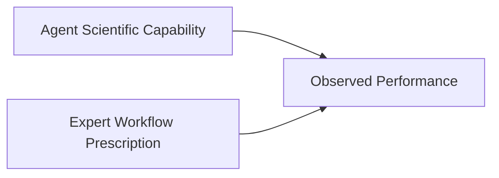
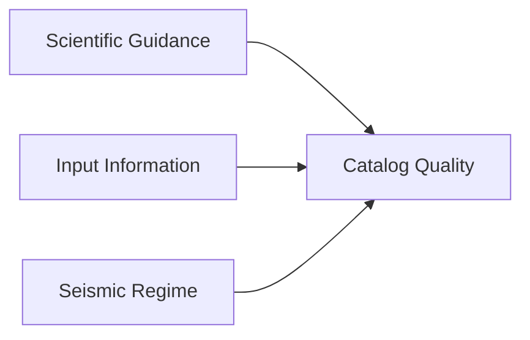

# SeismoAgentBench 研究计划

**正式名称：** Agentic Seismic Catalog Benchmark  
**项目简称：** SeismoAgentBench  
**仓库/CLI slug：** `seismoagent-bench`  
**缩写：** SABench

`SeismoAgentBench` 是项目的标准名称。带连字符的 `seismoagent-bench` 形式只用于仓库名、命令行命令、URL 以及其他偏好小写 slug 的场合。

本文档是定义基准设计的唯一位置：问题、案例与层级、Agent 阶段、知识与 checker 的形式、对照、泄漏规则和参考原则。基于本文档的论文大纲见 [`02_Paper_Outline.md`](./02_Paper_Outline.md)；进展和工作计划见 [`progress/STATUS_AND_PLAN.md`](./progress/STATUS_AND_PLAN.md)。候选案例池、案例登记表和信息收集标准见 [`docs/data/`](../data/)。

**版本：** v0.3（2026-10-29；v0.2 2026-09-18）  
**第一阶段案例：** Prague（2011）、Magna（2020）、Maple Creek（2017）、Kīlauea（2018）、Ridgecrest（2019）、Kaikōura（2016）

> **解释规则：** 本基准中的参考目录是**专家参考目录 / 高质量目标目录**，不是绝对真值。一个目录可以是检测完整性或相对定位的优秀目标，同时仍不适合作为绝对定位的真值集。

---

## 1. 动机与核心问题

Agentic AI 系统正迅速从语言生成工具演变为能够进行长程规划、编程、工具使用、执行、调试和迭代求解问题的系统。通用 Agent 在复杂软件工程任务上表现出越来越强的能力，而领域专用的科学 Agent 已开始在地震监测和地震分析等领域执行多步科学工作流。

然而，对于地震目录构建这样**具体、完整且可客观检验的科学任务**，当前 Agent 的实际能力边界仍不清楚。

若干基本问题仍未解决：

- Agent 能否在最少专家干预下，直接从地震观测构建科学上可用的地震目录？
- 仍需要多少领域知识、工作流规定、参数指导或人工调试？
- Agent 生成的目录能否接近领域专家精心构建的目录的质量？
- 抑或当前 Agent 生成的目录主要应被视为仍需专家大量完善的初步产品？

这些问题对于确定 Agentic 系统在未来地震监测中应如何使用至关重要。在大规模部署之前，我们需要一个受控的基准，来确定**当前 Agent 能独立做什么，能产出什么水平的科学产品，以及哪些地方仍需要专家支持**。

> **核心基准问题：**  
> **当前 Agent 能以多高的独立程度、达到什么科学质量水平，从地震观测构建地震目录？**

因此，本基准关注三个量之间的关系：

它评估完整的、由 Agent 控制的地震监测工作流，而不是单个拾取器、关联器、定位器或相对定位算法：

然后将所得目录与高质量的专家参考产品比较；这些产品在基准测试期间对 Agent 扣留。

本基准旨在为之后具备可靠性意识和自我改进能力的系统提供实证基础。有了隐藏的专家参考，我们可以确定 Agent 何时真正成功或失败；之后在这些参考不可用时，我们可以检验 Agent 自己能否识别这种可靠性。

---

## 2. 基准设计

### 2.1 紧凑、高信息量的案例

本基准应优先选择**持续时间短、信息丰富的地震序列**，而不是多年的连续目录。

理想的基准案例应包含：

- **3–7 天**的连续波形数据；
- 除非科学上必要，一般**不超过 14 天**；
- 数量可控的台站；
- 足够密集的事件总体，以对工作流形成压力；
- 一个或多个可截取到相同时间和空间窗口的高质量已发表参考目录。

这种设计使波形下载、预处理、重复的 Agent 运行、受控消融和人工检查在计算上可行。

目标是对**科学能力**做基准测试，而不是对存储容量或数据传输带宽。

### 2.2 科学情形与难度层级

案例集应包含不同的监测条件，例如：

- 主震–余震序列；
- 震群；
- 火山地震活动；
- 诱发或触发地震活动；
- 密集的永久台网；
- 临时近源布设；
- 变化的台网几何；
- 简单和复杂的断层系统。

目标是**科学难度的多样性**，而不是为地理多样性本身而追求地理多样性。

六个第一阶段案例构成三个难度层级（2026-10-29）。层级根据任何运行之前已知的特征指定；专家的经验必须确认这一顺序。每天事件数取自 human-in-loop 最终目录。

| 层级 | 案例 | 情形 | 台站数 | 窗口 | 最终目录事件数/天 | 主要难点 |
|---|---|---|---:|---|---:|---|
| 基础 | Prague 2011 | 诱发，Mw 5.7 的余震（主震在窗口之前） | 23 | 8 d | ~850 | 紧凑台网，1-D 分层模型；布设变化 |
| 基础 | Magna 2020 | 中等规模主震–余震，Mw 5.7 在窗口内 | 47 | 8 d | ~680 | 盆地速度结构，深度控制 |
| 中等 | Maple Creek 2017 | 黄石震群，最大 Mw 4.4 | 27 | 8 d | ~1,550 | 仅垂直分量台站；小事件发生率高；最大事件的震级 |
| 中等 | Kīlauea 2018 | 火山山顶塌陷，Mw 6.9 在窗口内 | 25 | 8 d | ~650 | 3-D 结构，模板族定位错误；Mw 6.9 尾波 |
| 困难 | Ridgecrest 2019 | M6.4 和 M7.1 序列 | 42 | 3 d | ~6,000 | 主震尾波，极高的关联密度，大事件 QC |
| 困难 | Kaikōura 2016 | Mw 7.8 的多断层余震 | 53 | 8 d | ~1,600 | 260-km 台网，3-D 结构，1-D 与 3-D 框架偏移（专家离散 2.78 km） |

在 A 阶段列表整理（`evaluation/tiers.json`）：台网孔径和台站间距中位数、窗口内最大震级、事件发生率、结构复杂度（1-D 是否足够）、台站缺陷；专家难度：human-in-loop 轮数、每个维度从盲轮 → 最终目录的变化、参考目录之间的上限。Kīlauea（窗口内有 Mw 6.9）是最可能变更层级的案例；层级变更连同原因一起记录，不隐藏。

### 2.3 两个实验维度

本基准应明确控制以下两者：

1. **Agent 接收哪些观测信息**；以及
2. **Agent 接收多少科学指导**。

#### 观测输入条件

| 输入条件 | Agent 接收 | 主要检验的能力 |
|---|---|---|
| **原始波形条件** | 连续波形 + 台站元数据 + 一般区域背景信息 | 从观测完整构建目录 |
| **常规目录辅助条件** | 波形 + 台站元数据 + 业务目录 | 目录增强、完善和相对定位 |
| **震相辅助条件** | 波形 + 元数据 + 常规震相拾取 | 定位、相对定位和更高层次的工作流推理 |

这些应作为不同的基准任务处理，而不是合并为一个分数。

#### 科学指导设置

| 指导设置 | Agent 可访问 | 主要检验的能力 |
|---|---|---|
| **封闭参考** | 通用工具和科学知识，但没有目标论文、目标目录或目标特定的工作流细节 | 独立构建工作流 |
| **开放文献** | 可访问论文、软件文档和公开的方法描述；目标目录保持隐藏 | 科学检索、适配和工作流复用 |
| **专家指导对照** | 提供专家工作流、参数指导或目标特定的科学决策 | 强专家支持下的上限对照表现 |

这些条件使我们能够区分：

Agent 自身的科学能力与专家工作流规定所贡献的表现。

下面的 Agent 阶段都使用原始波形、封闭参考条件；其他条件留给之后的任务。

### 2.4 Agent 能力阶段（2026-10-29 修订）

在封闭参考、原始波形任务中，各 Agent 变体构成一个阶梯，每个阶段恰好增加一个因素。Agent、其 harness、模型和输出约定保持不变，只是 S3 在约定中加入 checker 报告（§2.5）。专家结果需要经验的证据见 [`01_Expert_Experience_and_Checker.md`](./01_Expert_Experience_and_Checker.md)。

| 阶段 | 变体 | Agent 额外获得 | 问题 | 状态 |
|---|---|---|---|---|
| S0 | `min` | 任务、数据、输出约定 | 通用 Agent 能否独立构建可信目录？ | 已实现 |
| S1 | `tools` | 带使用文档的已验证工具库 `seismotools` | 工具带来什么？ | 已实现 |
| S2 | `knowledge` | 工具 + 预先提供的与案例无关的专家知识（§2.5） | 在工具之上，知识带来什么？ | 未实现 |
| S2c | `checker` | 工具 + 不依赖参考的 checker，无知识（§2.5） | 知道*存在*问题，能否让 Agent 找到并修复它？ | 未实现；先运行（2026-10-30） |
| S3 | `knowledge_checker` | 工具 + 知识 + checker（§2.5） | 知识加自动验证能否弥合与专家的差距？ | 未实现；在 S2c 之后运行 |
| — | human-in-loop 最终目录 | — | 上界 | 已完成（全部六个） |

2026-10-30 决定：两个组件都构建，`checker` 变体（S2c：工具 + checker，无知识）在 S3 之前运行。与 S1 相比，它分离出自动验证的效果；S2 对 S3 以及 S2c 对 S3 则把知道如何做与知道出了错区分开。

**衡量标准。** human-in-loop 最终目录是唯一的衡量标准，也是上界。它在迭代过程中使用了参考目录，因此其中一部分超出 Agent 能力所及；这部分用专家阶梯和干预编码进行归因（[`01_Expert_Experience_and_Checker.md`](./01_Expert_Experience_and_Checker.md) §5）。第一轮盲轮目录不是衡量标准：它没有使用模板匹配。

**核心数字。** 每个维度的差距弥合 `(S_k − S1) / (final − S1)`，针对检测 `recall_norm`、`shift`、`dz_median` 和震级偏移，按层级报告。

`guided` 变体（专家脚手架、固定窗口、`report.md` 约定）改变任务说明的规定程度，同时也改变窗口和约定；它不在这个阶梯上，仍为可选。

### 2.5 知识与 checker 的形式

**原则。** 论文的主张针对*通用* Agent。因此 Agent、其循环和模型从不修改。每个阶段只向 Agent 的环境添加文件，方式与 S1 添加工具相同。没有自定义 agent 循环，没有 harness 端的重试，也没有自定义 subagent。

#### 两层

| 层 | 形式 | 为什么采用这种形式 |
|---|---|---|
| 诊断 | `seismo_checker/` 中的确定性程序（CLI），读取 Agent 的拾取、事件、目录和台站元数据，写出 `checker_report.json` 和图件；只有规则和范围，不含案例数值，不含参考。它**只报告症状**（测量了什么，以及在哪里超出预期范围），从不给出原因或修复：判断一个症状意味着什么、应当改什么，是 Agent 的工作（2026-10-30 决定） | 与其他所有工具地位相同；内部没有 LLM，因此不会把症状合理化掉；对任何 Agent 都相同 |
| 知识 | 一个 Agent Skill（`SKILL.md` + 参考文件）：方法选择、安全的参数范围、已知陷阱；在 S3 中还包括 [`01_Expert_Experience_and_Checker.md`](./01_Expert_Experience_and_Checker.md) §3 的症状 → 可能原因 → 上游修复表 | 通用 Agent 原生加载的开放格式（Claude Code skills；Codex skills）；渐进式披露使其在相关之前不进入上下文 |

**交付方式。** skill 安装在 Agent 运行时的 skill 目录中。不支持 skill 的 Agent 通过提示词中的链接获得相同的文件，就像 `prompt_tools.md` 对工具的做法。S2 和 S3 的提示词增加一行，写明该 skill 的名称，正如 S1 增加工具一节。

#### S2 — 知识

该 skill 包含专家在查看任何数据之前已经知道的内容：

- 处理流程，以及模板匹配和双差相对定位预期在什么情况下增加事件或提高精度；
- 速度模型和定位器的选择，以及网格边界；
- 震级：单位、直接 ML 与链式 ML、大事件的处理；
- 在运行和阶梯中观察到的陷阱，例如：绝不静默固定深度，检查震级标度，应用 PhaseNet 盲区偏移，不让台站项吸收框架偏移。

#### S2c 和 S3 — checker

在 S2c 中，checker skill 只说明该工具存在、它测量什么，以及它的报告和每个报警的处置是输出的一部分；它不给出原因，也不给出修复。在 S3 中，知识 skill 增加症状 → 可能原因 → 上游修复的操作手册。在这两个变体中，约定都增加两项：

- `checker_report.json`，由 checker 在提交的目录上生成；
- 每个报警一个处置：`fixed`（说明改了什么）或 `justified`（附证据）。

评分程序在提交的文件上重新运行 checker 并核对报告。这是唯一的强制手段，它是一个约定项，不是一个循环。Agent 在提交前是否运行 checker、运行几次，从对话记录中统计，这本身也是一个结果。

#### 为什么不用 subagent

- **不可移植。** subagent 的定义依赖具体 harness，因此“通用 Agent”的主张只对一个 harness 成立。
- **引入混杂因素。** 审查用的 subagent 是第二个 LLM 上下文：额外的计算和第二种意见。增益可能来自多 agent 架构，而不是来自知识。
- **针对观察到的失败是错误的修复。** Agent 的主要失败是合理化：Prague tools 把 ML −8 解释为“超安静台阵的微地震活动”。一个必须处置的确定性报警直接针对这一点；另一个 LLM 的意见未必能做到。

独立审查者（同一通用 Agent 的一个新会话，配备 checker skill）是之后可能的消融。它不属于阶梯。

#### 约束

- **泄漏。** 规则与案例无关且不依赖参考，每次使用都有记录。
- **循环性。** 每条规则记录它是从哪个（些）案例学来的（`01_Expert_Experience_and_Checker.md` §3，*Evidence*）。结果分别针对规则来源的案例和其他案例报告（§2.6）。

### 2.6 对照

- **重复。** 指标 v1 §6 要求每个配置至少运行两次。第一轮：每个案例 × 阶段运行一次。第二次运行先给 S1 和 S3（核心对比），从 Prague 和 Magna 的 S1 开始，先测量运行间离散，再决定其余部分。
- **第二个模型。** 在三个案例（每个层级一个）上用第二个模型运行 S1 和 S3，使结论针对 agentic 方法而不是单个模型（目前为 Claude Code 中的 GLM-5.3）。
- **保留案例泛化（可选）。** 从候选池的 B 层中取一个案例（[`02_Case_Pool.md`](../data/02_Case_Pool.md) §3；例如 South Napa 2014 或 Westmorland 2020），有参考目录和上限，但没有 human-in-loop 最终目录，在 S1 和 S3 下运行。知识和 checker 规则都不是从它学来的。
- **每次运行的分析：** 目录指标 v2 及可信目录标准判定、组件替换、盲审。第二评审人每次运行抽查 10 个。

### 2.7 目标泄漏控制

目标泄漏是一个主要的方法学风险。

如果 Agent 在名义上自主的运行中访问了目标目录、确切的事件表、目标特定的参数或已发表的专家决策，实验测量的可能是复现，而不是自主的科学推理。

因此：

- 目标参考目录在所有基准条件下都应保持隐藏；
- 封闭参考运行应屏蔽目标特定的出版物和补充材料；
- 开放文献运行应记录 Agent 是否检索到了目标论文或密切相关的工作流；
- 所有可访问的资源都应作为基准记录的一部分记录下来。

---

## 3. 参考目录与评估

### 3.1 参考层级

同一个地震序列可能有多个高质量目录。本基准不应自动选择最大或最新的目录。

对每个案例，参考产品应组织为：

| 参考级别 | 作用 |
|---|---|
| **主要参考** | 针对主要基准维度的首选高质量目标 |
| **次要参考** | 基于不同数据、方法或科学侧重的互补高质量目录 |
| **基线 / 辅助参考** | 常规业务目录、震相到时数据集、结构产品或其他支持信息 |

主要参考的选择依据：

- 构建质量；
- 专家/科学界的认可；
- 方法透明度；
- 数据可获取性；
- 不确定性和 QC 信息；
- 与紧凑基准窗口的重叠；
- 对预期评估维度的适用性；
- 独立于 Agent 工作流。

> **事件最多的目录不一定是最好的基准目标。**

### 3.2 参考质量与案例级评估

参考目录不是绝对真值。每个案例可能包含多个质量、范围和科学作用各不相同的参考产品。质量层级和所需的案例级参考记录定义在 [`00_Case_Registry.md`](../data/00_Case_Registry.md) 中；基准设计在选择目标和分配指标时使用这些记录。

### 3.3 参考独立性与多角色评估

参考质量、评估角色和方法独立性必须分开。一个案例可以将多个产品分别用于检测、震相到时、关联、绝对定位、相对定位、完整性和不确定性；不应把任何单一目录当作在每个维度上都完整的真值。详细的质量层级、范围字段和允许使用的指标在 [`00_Case_Registry.md`](../data/00_Case_Registry.md) 中规定。

### 3.4 指标与可信目录标准

每次运行都用预注册的目录指标评分，自 2026-10-30 起为 v2（[`02_Catalog_Metrics.md`](../framework/02_Catalog_Metrics.md)）：每个案例和阶段一个能力剖面，没有综合分数，与该运行的地图和深度剖面一起阅读。可信目录标准的判定（指标 §7a）针对每个案例和阶段回答核心问题：事件是否真实，其时间、位置和震级相对 human-in-loop 最终目录是否准确且稳定？相对最终目录的完整性在旁边报告，不并入判定。

---

## 4. 预期的基准产出

本基准不应只产出单一的排行榜分数。

其主要产出应是一张**能力图谱**，描述当前 Agent 能实现什么、在什么条件下实现、需要多少专家协助。

每个 Agent 配置应从若干维度刻画：

| 维度 | 主要问题 |
|---|---|
| **任务完成** | Agent 是否成功完成了完整的科学工作流？ |
| **目录质量** | 结果与相关专家参考的接近程度如何？ |
| **科学自主性** | 哪些科学决策是 Agent 独立做出的？ |
| **专家协助** | 需要哪些领域知识、工作流规定或人工干预？ |
| **工作流瓶颈** | 哪些处理阶段或科学决策最常限制表现？ |
| **失败模式** | 工作流失败时，是如何失败的，为什么失败？ |
| **计算成本** | 需要多少执行、重试和工具使用？ |
| **案例依赖性** | 行为在不同地震情形之间如何变化？ |

从概念上讲，本基准应刻画：

目标是确定当前 Agentic 系统最适合被视为：

- 自主的地震目录构建者；
- 专家级的工作流助手；
- 初步目录生成器；
- 或其合适角色强烈依赖科学情境的系统。

因此，一个有用的基准结论可能采取如下形式：

> 在经过整理的工具与知识环境下，Agent 在密集区域台网中的选定目录维度上接近专家参考的质量，但在更复杂的情境中，特定的科学决策仍需要专家支持。

对科学部署而言，这样的能力剖面比单一的综合分数更有信息量。

最终，本基准应当确立：

> **当前 Agent 能独立做什么，什么仍需要专家支持，什么水平的地震目录可以作为科学产品被信任？**
