# 论文大纲

状态：大纲于 2026-10-29 确定；2026-11-04 改为中文，并加入当前结果汇总（§4）、进度（§5）和预注册分析计划（§6）。本文写论文要回答的问题、每个论点需要的证据、章节和图的安排。所依赖的设计（案例分级、Agent 阶段、知识和 checker 的形式、对照）定义在[研究计划](./00_Research_Plan.md)；状态和工作计划在 [`progress/STATUS_AND_PLAN.md`](./progress/STATUS_AND_PLAN.md)；checker 的设计和检验在 [`04_Checker_Design.md`](./04_Checker_Design.md) 和 [`progress/checker_validation/`](./progress/checker_validation/README.md)。

## 1. 目标与核心问题

> **Agent 方法能否自动构建高精度地震目录？如果不能，缺的是工具、知识，还是检验自身结果的能力？**

论文分四部分回答：

1. **分级案例。** 六个案例，从基础到困难，覆盖诱发地震、震群、火山、中强和大型主震–余震序列，以及复杂多断层环境（[研究计划](./00_Research_Plan.md) §2.2）。
2. **工具。** 经过验证的工具库给通用 Agent 带来什么（S0 → S1）。
3. **知识。** 事先给出、与案例无关的专家知识在工具之上还能带来什么（S1 → S2）。
4. **改进 Agent 目录。**
   - *human-in-loop 迭代*：human-in-loop 最终目录是上限；对每次人工干预编码，说明哪些可以自动化（[`01_Expert_Experience_and_Checker.md`](./01_Expert_Experience_and_Checker.md) §5）。
   - *把专家经验变成自动检验*：在 Agent 自己的产物上运行不依赖参考目录的 checker，要求 Agent 回到上游修复（S2 → S3），并度量它弥合了 S1 到最终目录之间多少差距。

## 2. 论点与所需证据

全文只有四个主论点，与 §1 的四部分对应；每个主论点由几个子论点从不同角度支撑。状态：✅ 已有证据　🟡 初步或部分　⏳ 进行中　⬜ 未开始。

**总览**

| 主论点 | 子论点与状态 |
|---|---|
| **1** 基准能分级、客观地衡量目录质量 | 1a 难度分级 ⬜　·　1b 评估方法 ✅ |
| **2** 工具必要但不充分 | 2a 必要 ✅　·　2b 不充分 ✅　·　2c 差在哪里 ✅ |
| **3** 经验变成知识和自动检验，能弥合一部分差距 | 3a 挡住可检测的错误 🟡　·　3b 知识的作用 🟡　·　3c 弥合程度 ⬜ |
| **4** 剩下的差距没有参考信息到不了 | 4a 看不到的误差 ⏳　·　4b 依赖参考的部分 🟡　·　4c 可信与否 ✅ |

### 论点 1：基准能分级、客观地衡量目录质量

| 子论点 | 证据 | 状态 |
|---|---|---|
| 1a 难度随分级上升 | 分级特征；专家迭代轮数；盲目录到最终目录的差距；参考目录之间的上限 | ⬜ 特征待列表 |
| 1b 评估能区分"看起来好"和"真的可信" | 指标 v2；平移与离散分解；按维度的可信目录判定 | ✅ 完成 |

1b 的叙述包括 v1 → v2 的教训（一个汇总数字掩盖了散乱的目录）和 2026-11-04 的两项口径修正（震级斜率至少 30 对；区域判据按台站覆盖）。

### 论点 2：工具必要但不充分

| 子论点 | 证据 | 状态 |
|---|---|---|
| 2a 必要 | S0 对 S1，六个案例 | ✅ S0：2 个未完成，其余不通过 5–12 项；S1：1–7 项 |
| 2b 不充分 | S1 对最终目录 | ✅ 没有运行可信；只找回 22–51 % 的事件 |
| 2c 差在哪里 | 组件替换；检测差距 | ✅ 后端选择（定位、震级）；模板匹配 |

### 论点 3：经验变成知识和自动检验，能弥合一部分差距

| 子论点 | 证据 | 状态 |
|---|---|---|
| 3a 自动检验挡住可检测的错误 | 带 checker 对不带 checker 的 A 层错误率 | 🟡 震级单位和响应错误 3/6 → 0/12（后端） |
| 3b 知识在流程和约定上起作用 | 知识对 checker 的消融 | 🟡 试水：知识 1 项、checker 4 项（一个案例、一次运行） |
| 3c 弥合了多少 | 按维度的差距弥合率；checker 的使用和处置 | ⬜ 需要正式运行 |

A 层错误指有结构、数据能查出的错误（震级单位和响应、拾取时移、定位设置造成的深度堆积）。3a 的效果主要来自工具里正确的参考计算，Agent 照用了它，而不是被报警纠正。

### 论点 4：剩下的差距没有参考信息到不了

| 子论点 | 证据 | 状态 |
|---|---|---|
| 4a checker 和知识看不到的误差 | 离线单因素实验；不给模型时的近地表和建模型检验 | ⏳ 时间、深度偏差是最常见的不通过项；数据只给方向不给水平；建模型检验进行中 |
| 4b 最终目录有一部分依赖参考 | 专家阶梯；human-in-loop 干预编码 | 🟡 阶梯完成，编码未开始 |
| 4c 是否达到可信目录 | 各阶段的可信目录判定 | ✅ 至今没有运行可信 |

4a 指所有台站或事件共有的误差：速度模型和近地表造成的整体时间、深度偏差，震级定标水平，主震尾波中的漏检。4c 最接近可信的两个运行：Kīlauea tools（只有时间偏差 −0.36 s 不通过）和 Kīlauea 知识后端试水（只有深度堆积，已由工具修正离线消除）。

## 3. 章节与图

1. **引言**：Agent 驱动的科学研究；地震目录是一个完整、可客观检验的任务。
2. **基准（论点 1）**：六个分级案例；多个参考目录和上限；human-in-loop 最终目录作为上限。
3. **评估（论点 1）**（[`03_Scoring_Method.md`](03_Scoring_Method.md)）：目录指标 v2（序列尺度的门限、偶然匹配校正、与最终目录直接比较）；平移与离散的分解；组件替换；盲审；按维度的可信目录判定，完整性单列。写进 v1 → v2 的教训：一个汇总数字掩盖了散乱的目录。也写进 2026-11-04 的两项口径修正（震级斜率至少 30 对；区域判据按台站覆盖）。
4. **结果一：工具（论点 2）**：S0 对 S1（必要）；S1 对最终目录（不充分）；组件替换说明差在哪里。
5. **结果二：经验变成知识和自动检验（论点 3）**：S2c、S3 对 S1；checker 挡住的错误；知识对 checker 的消融；差距弥合；checker 的使用和处置；规则来源案例与其他案例分开报告。
6. **结果三：到不了的部分（论点 4）**：checker 和知识看不到的误差（速度模型、定标、尾波漏检）；专家阶梯和 human-in-loop 干预编码；可信目录判定。
7. **讨论**：哪些目录维度、在哪些情形下可以交给 Agent；哪些仍需要人或参考目录。可写入 checker 研究的边界：所有台站或事件共有的误差（速度模型、震级定标水平、主震尾波中的漏检）只靠 Agent 自己的数据判断不了。

| 图 | 论点 | 内容 |
|---|---|---|
| 1 | 1 | 基准概览和带分级的案例地图 |
| 2 | 2、3 | 热图：案例 × 阶段 × 维度，按最终目录归一化 |
| 3 | 3 | 每个分级的差距弥合瀑布图 S1 → S2c → S3 → 最终目录 |
| 4 | 2 | 组件替换（前端对后端） |
| 5 | 3 | checker 的使用：报警、修复、给出理由、漏报 |
| 6 | 4 | human-in-loop 阶梯和干预类别；checker 和知识看不到的误差 |

## 4. 当前结果汇总（2026-11-04）

所有判定都按当前评分口径（指标 v2，加 2026-11-04 的两项修正）重新计算。每个配置大多只有一次运行，结论都是初步的。

### 4.1 S0 和 S1：正式运行（2026-10-28 至 10-29）

| 案例（分级） | S0 `min`：不通过的可信标准 | S1 `tools`：不通过的可信标准 | S1 找回最终目录事件的比例 |
|---|---|---|---|
| Prague（基础） | 未完成 | 2：深度偏差、震级偏差 | 46 % |
| Magna（基础） | 未完成 | 3：深度偏差、水平偏移、震级偏差 | 51 % |
| Maple Creek（中等） | 12 项 | 5：时间偏差、深度偏差、水平离散、偏离构造、震级标度 | 22 % |
| Kīlauea（中等） | 5 项 | 1：时间偏差（−0.36 s） | 37 % |
| Ridgecrest（困难） | 6 项 | 5：深度偏差、深度堆积、大事件、偏离构造、震级偏差 | 39 % |
| Kaikōura（困难） | 8 项 | 7：时间、时间离散、水平偏移、水平离散、深度堆积、大事件、震级偏差 | 43 % |

工具让六个案例都能完成，且不通过项大幅减少；但没有一个运行达到可信标准，找回的事件只有最终目录的 22–51 %（检测差距主要来自 human-in-loop 用的模板匹配）。

**图（由 `python -m SeismoAgentBench.scoring.catalog_metrics.overview_figures` 生成，`assets/results_overview/`）。** 每个案例比较五个目录：最强参考目录、官方目录、S0 `min`、S1 `tools`、human-in-loop 最终目录，都按评分区域裁剪；颜色在所有图中固定对应目录。最强参考和官方目录分别是：Prague 为 Cochran、ComCat；Magna 为 Pang、UUSS；Maple Creek 为 Shelly（只有发震时刻，空间图不画）、ComCat；Kīlauea 为 Shelly、ComCat；Ridgecrest 为 Shelly、SCSN；Kaikōura 为 Chamberlain、GeoNet。

**判据总览。** 每格是该判据的数值除以门槛（门槛由最终目录给出）：蓝色通过、红色超出，格内标 ✓ 或 ✗ 和数值；"–"表示不适用（最终目录与自身比较的项、参考目录没有的量）或配对太少。Ridgecrest 的最终目录本身也漏了主震尾波中的几个 M ≥ 4 事件，所以"大事件"一行全部不通过。

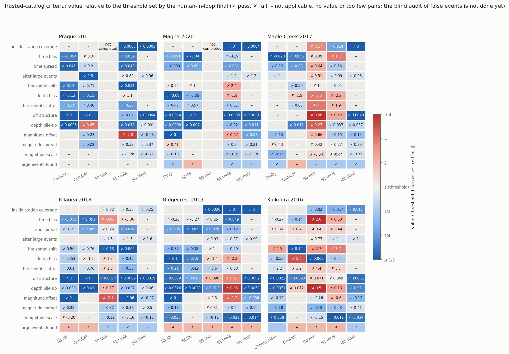

读图要点：
- S1 的红格集中在时间偏差（Maple、Kīlauea、Kaikōura）、深度偏差（Prague、Magna、Maple、Ridgecrest）、深度堆积（Ridgecrest、Kaikōura）和震级偏差（Prague、Magna、Ridgecrest、Kaikōura）；水平偏移在 Magna、Kaikōura 不通过。
- 参考目录相对最终目录也有不通过的判据（例如 Kaikōura GeoNet 的深度偏差和水平离散、Kīlauea ComCat 的深度偏差），说明判据的门槛并不宽松。

**各案例的空间分布和检测。** 空间图：上排震中，下排沿最终目录震中主轴的深度剖面，同一案例所有子图坐标范围相同。检测图：左侧各目录的时间—震级，右侧累计事件数、累计震级—频度分布（圆点为 Mc，最大曲率 + 0.2）、深度分布。

| 案例 | 事件数（最强参考 / 官方 / S0 / S1 / 最终） | Mc（同上） |
|---|---|---|
| Prague | 2,078 / 11 / 未完成 / 3,391 / 6,767 | 0.4 / – / – / −2.5* / −0.3 |
| Magna | 4,169 / 1,432 / 未完成 / 3,109 / 5,412 | 0.7 / 0.7 / – / 1.5 / 0.7 |
| Maple Creek | 18,062 / 626 / 6,824 / 3,411 / 12,422 | −0.7 / 0.7 / 1.1 / 0.7 / −0.2 |
| Kīlauea | 1,902 / 496 / 3,131 / 2,136 / 5,198 | 1.3 / 2.4 / −0.4* / 2.4 / 1.0 |
| Ridgecrest | 7,716 / 6,564 / 7,748 / 12,239 / 17,902 | 1.3 / 2.0 / 2.0 / 0.4* / 1.0 |
| Kaikōura | 2,260 / 1,507 / 1,384 / 8,817 / 12,924 | 1.6 / 2.4 / 2.0 / 1.5 / 0.8 |

\* 震级整体偏低（单位或响应错误：Prague S1 −2.8、Kīlauea S0 −2.4、Ridgecrest S1 −1.2），Mc 不可比。

读图要点：
- S1 的空间分布比 S0 集中得多，但有定位假象：Ridgecrest 在网格顶部和速度分层界面上的水平条带，Maple 的震中落在 0.5 km 网格上；最终目录的结构最清晰。
- S0 的错误在图上一眼可见：Maple 的震中散满整个区域，Kaikōura 大量事件压在 12 km 固定深度。
- 事件数上，S1 在六个案例上都多于官方目录；最终目录（有模板匹配）除 Maple 外最多，Maple 的 Shelly 模板匹配目录更多（18,062）。Mc 上最终目录在可比的案例中最低或并列最低，Maple 的 Shelly 例外（−0.7）。

Prague 2011

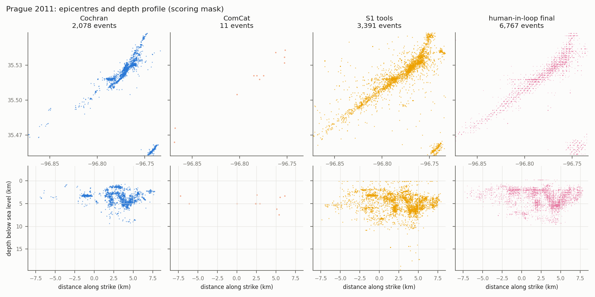
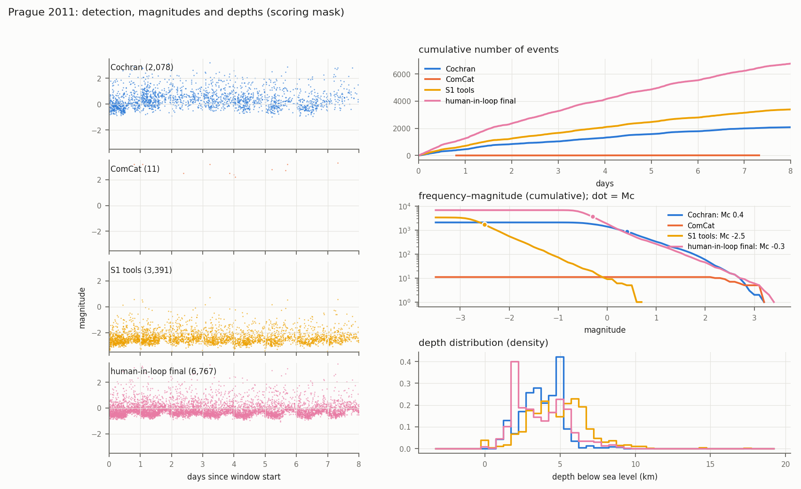

Magna 2020

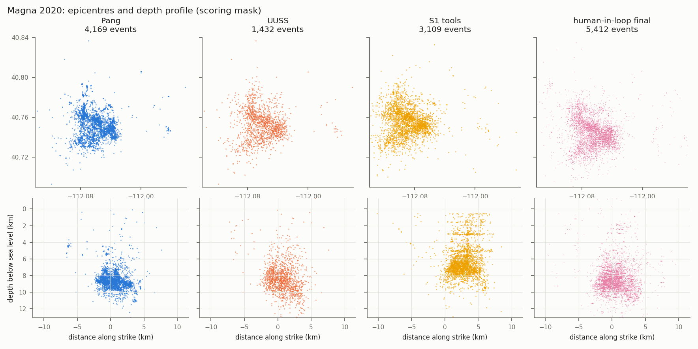
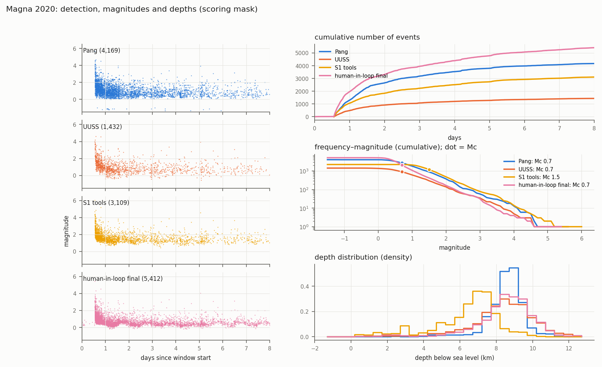

Maple Creek 2017

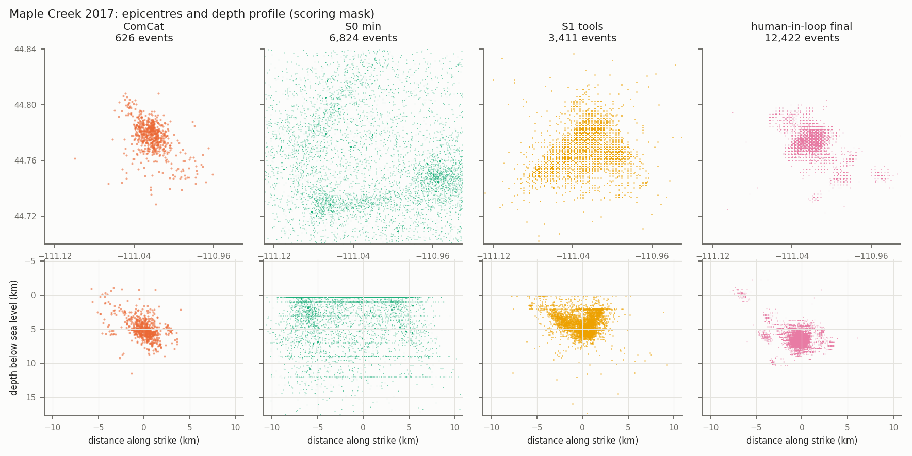
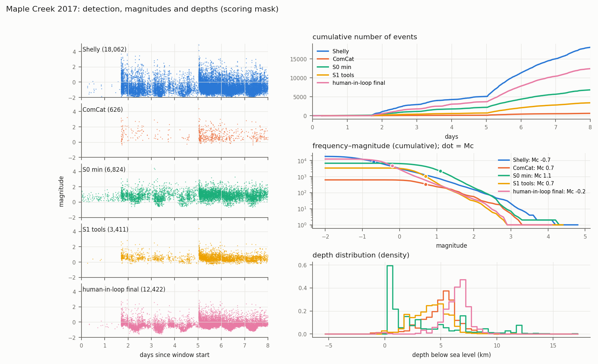

Kīlauea 2018

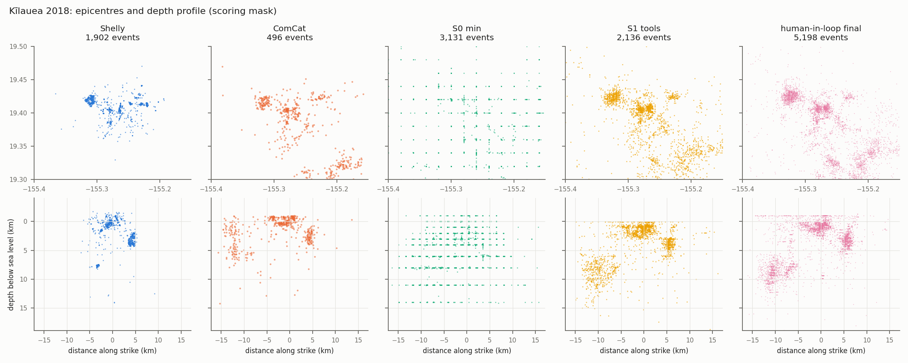
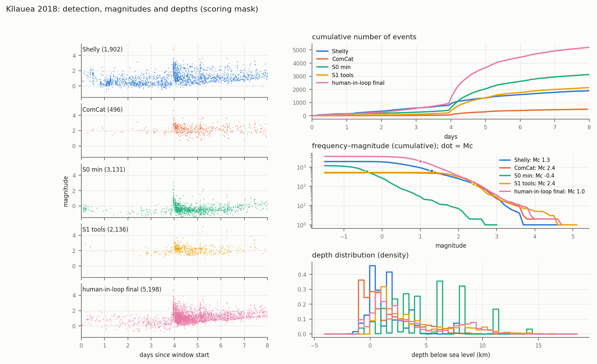

Ridgecrest 2019

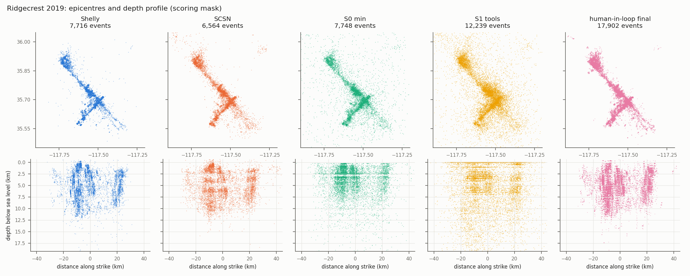
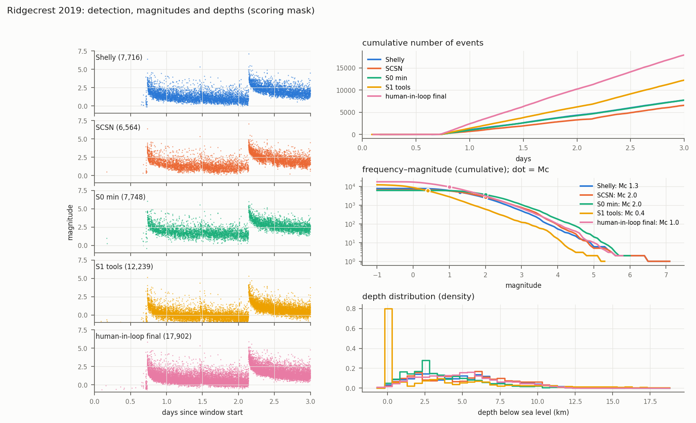

Kaikōura 2016

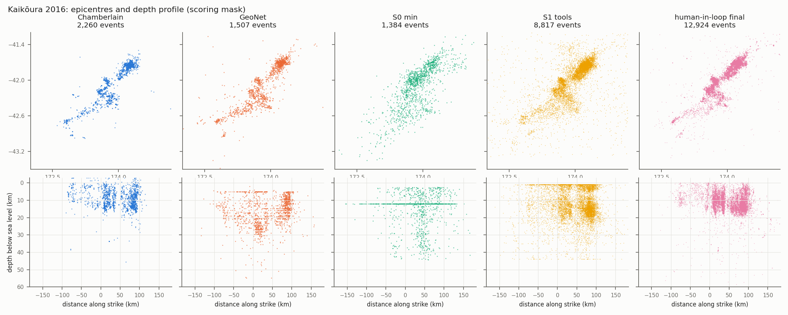
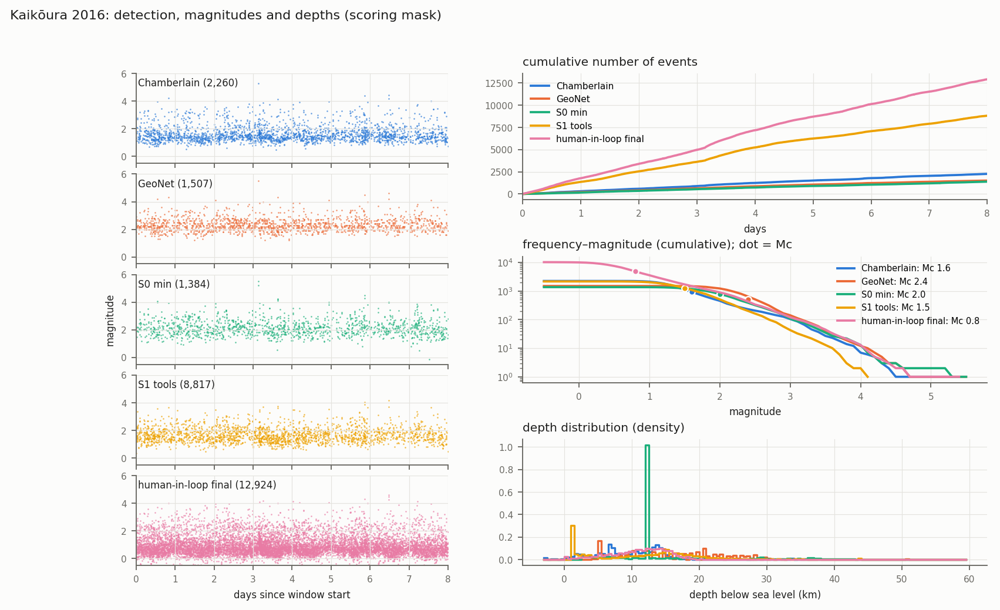

### 4.2 后端消融（B 层，checker 1.0，2026-11-01 至 11-03）

三个变体共用 S1 运行的拾取和关联，只做定位、相对定位和震级：`backend`（只有工具）、`backend_checker`（加 checker）、`backend_knowledge`（加 checker 和知识）。

| 案例 | S1 tools | backend | backend_checker | backend_knowledge |
|---|---|---|---|---|
| Prague | 2 | 4 | 1 | 1 |
| Magna | 3 | 4 | 4 | 4 |
| Maple Creek | 5 | 6 | 4 | 5 |
| Kīlauea | 1 | 1 | 3 | 2 |
| Ridgecrest | 5 | 5 | 3 | 3 |
| Kaikōura | 7 | 4 | 4 | 6 |
| **合计** | 23 | 24 | **19** | 21 |

统一测试试水（Kīlauea，checker 1.2，更新后的知识，2026-11-03）：`backend` 3 项、`backend_checker` 4 项、`backend_knowledge` **1 项**（时间偏差 +0.08 s、深度偏差 −0.07 km，只剩深度堆积；该项随后由 NonLinLoc 接口修正离线消除）。

### 4.3 主要发现（细节见 [`04_Checker_Design.md`](./04_Checker_Design.md) §11）

1. **A 层错误被稳定挡住。** 不带 checker 的后端变体 6 个案例有 3 个犯了震级响应或单位错误，带 checker 的 12 次运行 0 次；起作用的主要是工具里正确的参考计算，Agent 照用了它。
2. **时间和深度的整体偏差来自速度模型（C 层），checker 和知识都没有修好。** 单因素重定位复现了主要偏差（模型顶面放在海平面、采用通用模型、近地表太快）。不提供具体模型时，数据只给方向不给水平；按任何单一测量值挑模型都会在某些案例上选错。
3. **报警会诱导表面修复，处置完整不等于正确。** 4 次报警驱动的改动使结果变差；试水中只有 checker 的 Agent 把正确的报警解释为拾取问题，用台站延迟吸收。
4. **知识在流程和约定上起作用。** 试水中知识变体从原图数字化模型、查明基准面，时间和深度都通过；只有 checker 的变体没取到模型数值、自拟了一个过慢的模型。
5. **工具的约定本身是误差来源。** HypoInverse CRH 模型忽略台站高程、NonLinLoc 深度搜索从参考高程开始、hypoDD 和 GrowClust 把台站放在模型深度 0，都会造成系统偏差；前两项已改接口默认值。
6. **水平偏移在三个案例上与一维模型的选择无关。** Kaikōura、Magna、Maple 上 10 个一维候选模型的水平偏移都在 1.1–2.9 km（门槛 1 km），需要台站项或三维结构来解释（分析进行中）。

## 5. 进度（2026-11-04）

**已完成：** 六个案例的数据、参考目录、上限和 human-in-loop 最终目录；S0、S1 正式运行和评分；组件替换和专家阶梯；评分方法 v2 和两项修正；checker 1.0–1.2 和 1.3 开发版及其检验；知识 skill（小批量协议、方案决定、症状手册、checker 看不到的问题、震级资源）；B 层后端消融；统一测试试水；运行环境写保护、泄漏扫描两层。

**进行中：** 不提供模型时从数据建模型的离线检验（最小一维模型加台站校正，`workflows/development/replay/velocity_from_data.py`）；水平偏移归因。

**未开始：**
- 完整流程（含前端拾取、关联、模板匹配）的 S2c、S3 任务包；目前只有后端版本。
- S2（只有知识、没有 checker）的运行。
- 重复运行（研究计划 §2.6：先在 S1 和 S3 上重复）、第二个模型、保留案例。
- human-in-loop 干预编码；分级特征表；差距弥合的计算和图。

## 6. 预注册分析计划（草案，正式运行前冻结）

正式的 S2c、S3（以及 S2，如果运行）开跑前，以下内容写定并记录提交号，之后不再改动；运行后发现的问题只作为附加分析报告，不改主分析。

### 6.1 冻结的内容

| 项目 | 冻结方式 |
|---|---|
| 评分 | 目录指标 v2 加 2026-11-04 两项修正（`docs/framework/02_Catalog_Metrics.md` 变更记录）；评分器提交号；每个案例的 `metrics.yaml`、`station_coverage.json`、`metrics_baseline.json` |
| checker | 1.3 的标签和提交号；评分端核对用运行时的 checker 版本 |
| 知识 skill 和震级资源 | `data/agent_resource/` 的提交号；不包含任何具体速度模型 |
| 工具 | `seismotools` 的提交号（含 HypoInverse v2、NonLinLoc 搜索顶面） |
| 任务 | 每个阶段的提示词、输出合同、时间预算；提示词不写研究区域 |
| Agent | Claude Code × GLM-5.3，运行配置文件；第二个模型（如做）同样写定 |

### 6.2 假设与比较

| 编号 | 论点 | 假设 | 比较 | 主要度量 |
|---|---|---|---|---|
| H1 | 2a | 工具是必要的 | S1 对 S0 | 完成度；不通过的可信标准数 |
| H2 | 2b | 工具不充分 | S1 对最终目录 | 是否可信；各维度相对最终目录的差距 |
| H3 | 3a、3c | checker 加知识缩小差距 | S3 对 S1 | 不通过的可信标准数；差距弥合率 (S3 − S1)/(final − S1)，针对 `recall_norm`、水平偏移、`dz_median`、震级偏差，按分级报告 |
| H4 | 3b | 知识的贡献不止于报警 | S3 对 S2c（消融） | 同 H3；A 层错误（单位、响应、基准面约定）的发生率 |
| H5 | 4a | checker 挡不住 C 层偏差 | S2c、S3 的时间和深度偏差对 S1 | 时间、深度偏差的绝对值；预期不显著改善 |
| H6 | 3c | 处置的质量 | S2c、S3 的处置记录 | 报警数、修复、给理由、漏报；按审计判断的错误处置比例 |

方向预期：H1、H2 已由现有运行支持；H3 预期在 A 层错误多的案例（Prague、Ridgecrest、Kīlauea）改善、在速度模型主导的案例（Maple、Magna、Kaikōura）不改善；H5 预期成立。

### 6.3 分析单位、重复和排除

- 分析单位是一次运行；按案例配对比较（同一案例的不同阶段）。
- 重复：主要对比（S1、S3）每个案例至少两次（研究计划 §2.6）；先做 Prague 和 Magna，以运行间离散决定其余。
- 排除规则（运行前写定）：提供方限额或宕机中断的运行标为 `EXCLUDED` 并重跑；框架缺陷导致的中断同样处理；泄漏扫描命中扣留产品的运行报告但不进主分析；`environment_integrity` 显示共享环境被改动的运行报告但不进主分析；待审访问由人工核对后决定。
- 所有运行都报告，不挑选。

### 6.4 统计处理

- 每个配置的运行数少（每案例 1–3 次），以描述为主：逐案例给出数值和变化方向，跨案例用符号检验（六个案例中改善的个数），重复运行给出离散范围。
- 不对单次运行的差异下结论；单次差异小于同配置重复运行的离散时记为"无差别"。
- 规则来源案例与其他案例分开报告（研究计划 §2.5）：checker 和知识的规则都在这六个案例上总结和校准（例如 Wadati 偏差门槛来自试水运行、区域判据的余量来自 Kīlauea），因此主结论以保留案例或"规则不来源于该案例"的部分为准；没有保留案例时如实说明。

### 6.5 需要决定后才能冻结的事项

1. 是否运行 S2（只有知识）。研究计划要求它来分离"知道怎么做"和"知道哪里错了"；但知识 skill 的小批量协议和方案决定都依赖 checker，单独拆开不自然。
2. 正式比较用完整流程还是后端版本。完整流程能回答检测和完整性（目前差距最大的维度之一），但每次运行 5–27 小时；后端版本便宜，但前端固定。
3. 重复次数、第二个模型和保留案例是否纳入本轮。
4. 主要度量是"不通过的可信标准数"还是"差距弥合率"，或两者并列。

## 7. 后续工作

1. 完成离线的速度模型检验和水平偏移归因，结论写进知识 skill 或作为论文的边界结论。
2. 冻结 checker 1.3 和知识 skill，做一次端到端冒烟测试。
3. 决定 §6.5 的四项，冻结预注册计划。
4. 搭建完整流程的 S2c、S3 任务包（如果选择完整流程）。
5. 按预注册计划运行：先用最少的运行验证新知识和工具修复（例如 Maple 一次 S3），再按计划扩展。
6. 并行完成 human-in-loop 干预编码、分级特征表、差距弥合计算和图。
