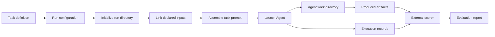

# Reliable Agentic Seismic Monitoring
The goal of this project is to use skill evolution or self-improving agents to obtain more reliable earthquake-location catalogs from seismic observations.

## Assessing the capabilities of general-purpose agents in seismological workflows
- Baseline: a general-purpose Agent framework without expert seismological knowledge or specialized seismic tools.
- Target: an expert-level earthquake-location catalog, such as the Ridgecrest catalog published by Shelly.
- Improvement strategy: a self-improving Agent or an evolving set of skills.

## Baseline and Benchmarking

### Benchmark purpose

The benchmark is designed to determine whether a general-purpose Agent is already capable of performing seismological workflow tasks at a level that is useful for scientific catalog construction. It provides the same task description, observations and execution interface to general-purpose Agents, then compares their workflows and catalogs with expert references.

The benchmark first measures what a general-purpose Agent can achieve independently. These results provide the starting point for later skill evolution or self-improving Agent experiments.

### Baseline

The baseline is a general-purpose Agent without expert seismological knowledge or specialized seismic tools. The formal runs use Claude Code with GLM-5.3 (2026-10-28); a second model is planned for S1 and S3 on three cases. The deterministic `main.py` baseline verifies task execution and catalog artifact generation, while the Ridgecrest phase-picking workflow test verifies the end-to-end task path with real waveform inputs.

### Benchmarking progress

1. Multiple scientific cases have been identified and organized as candidate benchmark tasks.
2. Ridgecrest waveform and station data have been collected and prepared for Agent execution.
3. A reusable benchmark framework has been built, including task definitions, input mapping, Agent execution, run records and post-run evaluation.

### Internal benchmark flow

The framework prepares one run from a task definition and run configuration, exposes the declared inputs to the Agent, launches the selected Agent through its adapter, and preserves the Agent's artifacts and execution records. The external scorer reads the completed run and produces the evaluation report.

## Evaluation status and plan (2026-10-29)

- Paper outline, case tiers, revised Agent stages, usability criteria and work plan: [`05_Paper_Outline_and_Plan.md`](./05_Paper_Outline_and_Plan.md).
- Metrics v1 frozen (`docs/framework/03_EVALUATION_METRICS.md`); single scoring path `python -m SeismoAgentBench evaluate` (catalog-metrics@1), blind review of unsupported events, L5 picks for Magna and Maple Creek.
- Expert baselines corrected and fixed for all six cases (final and blind rows in each `evaluation/human_in_loop/metrics_v1_baseline.json`; Agent runs are compared with the final only, 2026-10-29); expert ladder recorded per case.
- Zero-cost analyses: expert ladder (what each expert step adds) and component swap (Agent front end versus model/locator choice) — [`04_Expert_Experience_and_Checker.md`](./04_Expert_Experience_and_Checker.md).
- Agent stages (revised 2026-10-29): S0 `min` and S1 `tools` implemented; S2 `knowledge` (tools + case-agnostic knowledge as an Agent Skill) and S3 `checker` (+ reference-free diagnostics tool and repair playbook) planned, not implemented.
- Formal runs: Prague and Magna S0/S1 done and scored; Maple Creek `min` running; Maple Creek `tools`, Kīlauea, Kaikōura and Ridgecrest queued. The four earlier Ridgecrest/Magna runs predate the output conventions and remain development runs.
- Next (05 §9): finish S0/S1; in parallel the tier table, frozen usability criteria and coding of the human-in-loop interventions; then build the checker and the knowledge skill for S2/S3.
