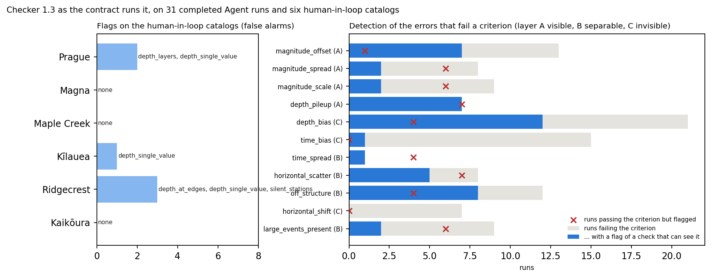

# E1：checker 1.3 的可靠性（2026-11-05）

注册表 B5，检验假设 H-B1（报警可靠）。用 1.3 按输出约定的方式运行 checker（`--stage all`，带波形和 StationXML，不做模型集合重定位），对象是：

- 每个案例 human-in-loop 的定位目录：组件替换所用那一轮的 NonLinLoc 定位和关联，按设计应当基本干净，用来统计误报；
- 全部已完成的 Agent 运行：31 次，包括 S0、S1 和后端消融；它们哪些可信标准不通过，已由评分（2026-11-05 起相对参考）给出，用来统计检出。

另有合成回归测试：14 个场景，干净输入不报警，每类植入错误只由对应检查报出。每次改动 checker 都会运行，1.3 冻结和搬迁后都通过（[06](06_trial_and_tool_fixes.md)、[`smoke_end_to_end`](../../../../workflows/development/smoke_end_to_end/README.md)）。

脚本：`workflows/development/tools_case_validation/validate_checker.py`（运行 checker）、`e1_reliability.py`（统计和图），输出在 `outputs/checker_v13/`（不纳入版本库）。

## 判据与检查的对应

评分只给出判据是否通过，所以要先规定每条判据由哪些检查"能看到"。这一对应是人为判断：

| 判据 | 能看到它的检查 | 可检测性 |
|---|---|---|
| 震级偏差、离散、标度 | 震级复算、最大事件震级、震级–检测关系、震级范围 | A：自身数据能看到 |
| 深度堆积 | 单一深度值、深度位于网格边缘、深度分层 | A |
| 深度偏差 | S−P 深度偏差、深度位于网格边缘、深度分层、单一深度值 | C：多数看不到 |
| 发震时刻偏差 | Wadati 发震时刻偏差、走时截距 | C |
| 时间离散 | Wadati 离散 | B：需要对照 |
| 水平离散、偏离构造 | 孤立事件、拾取过少的事件、台网几何 | B |
| 大事件齐全 | 最大事件震级 | B |
| 水平偏移 | 无 | C |

## 结果

**human-in-loop 目录上的报警（误报）：** 六个案例共 6 个，平均每个案例 1.0 个，正好在 H-B1 的建议值（≤ 1）上。Magna、Maple Creek、Kaikōura 没有报警；Prague 2 个（深度分层、单一深度值），Kīlauea 1 个（单一深度值），Ridgecrest 3 个（深度位于网格边缘、单一深度值、无拾取的台站）。这几个报警并不全是误报：这些目录是早期轮次，Prague 那一轮确有 9–12 % 的事件堆在速度界面附近，Ridgecrest 的基线轮确有 16 % 的事件堆在网格顶部（[00](00_expert_experience_evidence.md) §1.2），后续轮次才修正。所以真正的误报少于 6 个。

**检出：**

| 判据 | 不通过的运行 | 其中有相应报警 | 通过但仍报警 |
|---|---|---|---|
| 震级偏差（A） | 13 | 7 | 1 |
| 其中：单位或响应错误（偏差 0.98–2.77） | 6 | **6** | — |
| 其中：定标偏差（0.3–0.67，主要是 Magna） | 7 | 1 | — |
| 深度堆积（A） | 7 | **7** | 7 |
| 深度偏差（C） | 21 | 12 | 4 |
| 发震时刻偏差（C） | 15 | 1 | 0 |
| 水平偏移（C） | 7 | 0 | 0 |
| 水平离散（B） | 8 | 5 | 7 |
| 偏离构造（B） | 12 | 8 | 4 |
| 大事件齐全（B） | 9 | 2 | 6 |

## 结论

1. **能看到的错误几乎全部报出。** 六个震级单位或响应错误全部有报警；七个深度堆积全部有报警。这些正是 checker 设计要挡住的 A 层错误。
2. **看不到的错误基本没有报警，与设计一致。** 15 个发震时刻偏差只有 1 个有报警，7 个水平偏移没有一个；深度偏差约一半有报警，但多数来自堆积或分层这类伴随症状，不是偏差本身。震级定标偏差（Magna）也看不到。这类误差只能靠知识（计划 B 的 H-B4）。
3. **深度和水平稳定性的检查比评分判据更敏感。** 深度堆积有 7 次在判据通过时仍报警，水平离散 7 次；它们报的是"有症状"，评分判的是"超过门槛"，所以报警多于不通过并不都是误报，但会增加 Agent 的处置负担。
4. **对 H-B1 的初步判断：** 误报 ≤ 1 个/案例刚好满足，且其中有几个是真问题；A 层错误的检出满足"每类植入的可检测错误都被报出"。正式结论在冻结后的 E3 中用新的运行复核。

## 局限

- "能看到"的对应是人为判断；换一种对应，检出率会变。
- human-in-loop 目录用的是定位轮次，不是最终的可达结果（可达结果的模板匹配事件没有逐事件拾取，checker 不能完整运行）。
- 运行都是预实验（checker 1.0–1.2 时期的运行），这里只检验 1.3 对它们的报警，不涉及 Agent 如何处置。
