# 结果汇总与进度（2026-11-05）

从原论文大纲（现 [`01_Register.md`](../01_Register.md)）§4–§5 原样迁出，注册表只保留登记内容。这里的运行都在正式登记之前完成，属于预实验，不进入登记的主分析。

## 1. 当前结果汇总（2026-11-04 至 11-05）

所有判定都按当前评分口径重新计算（指标 v2，加 2026-11-04 的两项修正；2026-11-05 起时间和空间相对主要绝对定位参考计算，门槛按可达结果自身的偏差放宽，配对少于 30 对不判，见[指标 §13](../../framework/02_Catalog_Metrics.md)）。每个配置大多只有一次运行，结论都是初步的。

### 1.1 S0 和 S1：正式运行（2026-10-28 至 10-29）

| 案例（分级） | S0 `min`：不通过的可信标准 | S1 `tools`：不通过的可信标准 | S1 找回最终目录事件的比例 |
|---|---|---|---|
| Prague（基础） | 未完成 | 2：深度偏差、震级偏差 | 46 % |
| Magna（基础） | 未完成 | 3：水平偏移、深度偏差、震级偏差 | 51 % |
| Maple Creek（中等） | 12 项 | 4：时间偏差、水平离散、偏离构造、震级标度 | 22 % |
| Kīlauea（中等） | 5 项 | 2：时间偏差、深度偏差 | 37 % |
| Ridgecrest（困难） | 6 项 | 6：时间偏差、深度偏差、偏离构造、深度堆积、震级偏差、大事件 | 39 % |
| Kaikōura（困难） | 4 项（另有 5 项因与 Lanza 只配上 22 对而不判） | 6：水平偏移、深度偏差、水平离散、深度堆积、震级偏差、大事件 | 43 % |

改为相对参考计算后，S1 不通过的总数不变（23 项），但内容有变化：Maple 的深度偏差通过了（相对 ComCat −0.07 km；可达结果本身比 ComCat 深 1.46 km，原来对可达结果计算时是 −2.18 km）；Kīlauea 增加了深度偏差（相对 Shelly +1.01 km，刚过 1 km 门槛），Ridgecrest 增加了时间偏差（相对 Shelly +0.33 s，刚过 0.3 s）；Kaikōura 的时间偏差和时间离散通过了（门槛按可达结果自身相对 Lanza 的 0.49 s 放宽），但深度偏差不通过（相对 Lanza +2.6 km，相对可达结果只有 +0.9 km）。

工具让六个案例都能完成，且不通过项大幅减少；但没有一个运行达到可信标准，找回的事件只有最终目录的 22–51 %（检测差距主要来自 human-in-loop 用的模板匹配）。

**图（由** `python -m SeismoAgentBench.scoring.catalog_metrics.overview_figures` **生成，**`assets/results_overview/`**）。** 每个案例比较五个目录：最强参考目录、官方目录、S0 `min`、S1 `tools`、human-in-loop 最终目录，都按评分区域裁剪；颜色在所有图中固定对应目录。最强参考和官方目录分别是：Prague 为 Cochran、ComCat；Magna 为 Pang、UUSS；Maple Creek 为 Shelly（只有发震时刻，空间图不画）、ComCat；Kīlauea 为 Shelly、ComCat；Ridgecrest 为 Shelly、SCSN；Kaikōura 为 Chamberlain、GeoNet。

**判据总览。** 每格是该判据的数值除以门槛（时间和空间相对主要绝对定位参考，门槛按可达结果自身的偏差放宽）：蓝色通过、红色超出，格内标 ✓ 或 ✗ 和数值；"–"表示不适用（最终目录与自身比较的项、参考目录没有的量）或配对太少。Ridgecrest 的最终目录本身也漏了主震尾波中的几个 M ≥ 4 事件，所以"大事件"一行全部不通过。

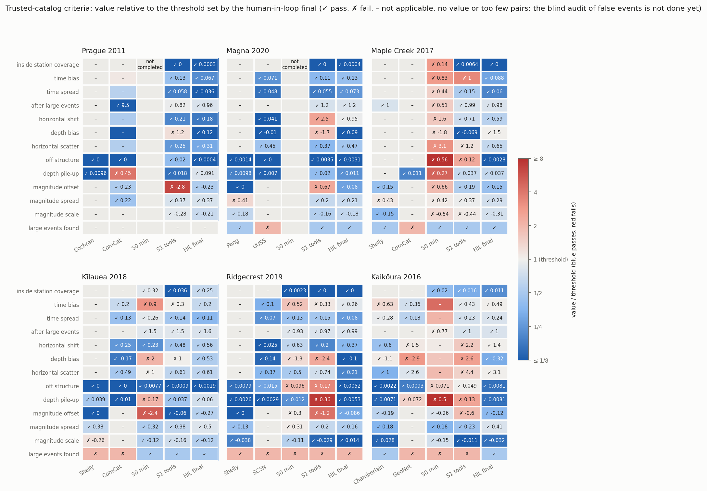

读图要点：

- S1 的红格集中在时间偏差（Maple、Kīlauea、Ridgecrest）、深度偏差（Prague、Magna、Kīlauea、Ridgecrest、Kaikōura）、深度堆积（Ridgecrest、Kaikōura）和震级偏差（Prague、Magna、Ridgecrest、Kaikōura）；水平偏移在 Magna、Kaikōura 不通过。
- 主要定位参考与自身比较的格子没有意义（偏差为零）；官方目录相对主要定位参考也有不通过的判据（例如 Kaikōura GeoNet、Kīlauea ComCat 的深度偏差），说明判据的门槛并不宽松。

**各案例的空间分布和检测。** 空间图：上排震中，下排沿最终目录震中主轴的深度剖面，同一案例所有子图坐标范围相同。检测图：左侧各目录的时间—震级，右侧累计事件数、累计震级—频度分布（圆点为 Mc，最大曲率 + 0.2）、深度分布。

| 案例          | 事件数（最强参考 / 官方 / S0 / S1 / 最终）           | Mc（同上）                        |
| ----------- | --------------------------------------- | ----------------------------- |
| Prague      | 2,078 / 11 / 未完成 / 3,391 / 6,767        | 0.4 / – / – / −2.5* / −0.3    |
| Magna       | 4,169 / 1,432 / 未完成 / 3,109 / 5,412     | 0.7 / 0.7 / – / 1.5 / 0.7     |
| Maple Creek | 18,062 / 626 / 6,824 / 3,411 / 12,422   | −0.7 / 0.7 / 1.1 / 0.7 / −0.2 |
| Kīlauea     | 1,902 / 496 / 3,131 / 2,136 / 5,198     | 1.3 / 2.4 / −0.4* / 2.4 / 1.0 |
| Ridgecrest  | 7,716 / 6,564 / 7,748 / 12,239 / 17,902 | 1.3 / 2.0 / 2.0 / 0.4* / 1.0  |
| Kaikōura    | 2,260 / 1,507 / 1,384 / 8,817 / 12,924  | 1.6 / 2.4 / 2.0 / 1.5 / 0.8   |

 震级整体偏低（单位或响应错误：Prague S1 −2.8、Kīlauea S0 −2.4、Ridgecrest S1 −1.2），Mc 不可比。

读图要点：

- S1 的空间分布比 S0 集中得多，但有定位假象：Ridgecrest 在网格顶部和速度分层界面上的水平条带，Maple 的震中落在定位网格上。
- 最终目录看起来也是网格状的：它的大部分事件来自模板匹配（Maple 91 %、Ridgecrest 71 %、Prague 69 %、Kaikōura 54 %、Magna 49 %、Kīlauea 28 %），Match&Locate 把检测事件放在模板周围 0.25 km（水平）× 0.5 km（深度）的网格点上，之后没有再精细定位；Maple、Prague 的 NonLinLoc 定位也落在搜索格子上。只有经过双差重定位的事件（Magna 46 %、Ridgecrest 29 %）是连续的。网格误差（约 ±0.13 km、±0.25 km）远小于评分的匹配门限和判据门槛，不影响绝对定位的判定，但最终目录的相对位置精度不如 Shelly 这类互相关重定位目录；图上看到的结构清晰度不能当作精度的比较。互相关重定位（GrowClust 六个案例，hypoDD 在 Prague）只在 Kaikōura 改善了相对位置（相距 2 km 内事件对的相对误差，对 Chamberlain 1.53 → 0.69 km），采用为新的最终目录 r9；其余五个案例重定位后相对误差变大，保留原位置，并在目录中给格点事件标注半个格距的精度（[记录](records/11_hil_relocation.md)）。
- S0 的错误在图上一眼可见：Maple 的震中散满整个区域，Kaikōura 大量事件压在 12 km 固定深度。
- 事件数上，S1 在六个案例上都多于官方目录；最终目录（有模板匹配）除 Maple 外最多，Maple 的 Shelly 模板匹配目录更多（18,062）。Mc 上最终目录在可比的案例中最低或并列最低，Maple 的 Shelly 例外（−0.7）。

Prague 2011

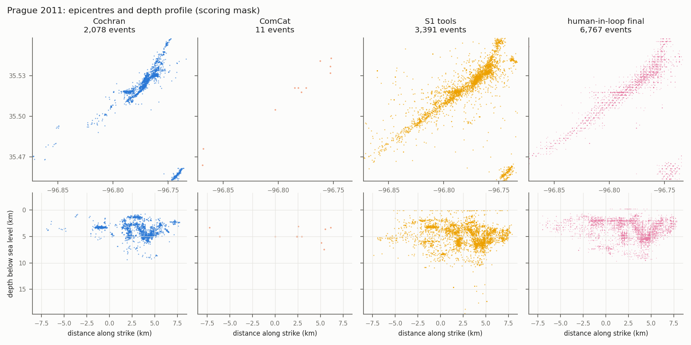
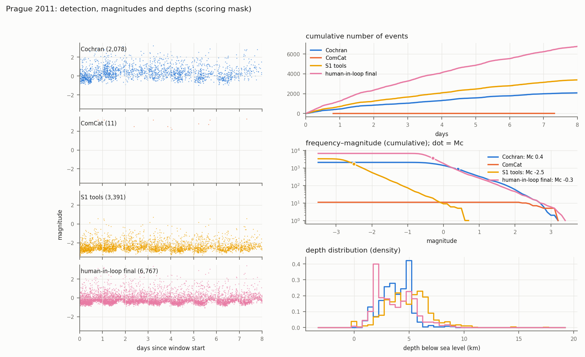

Magna 2020

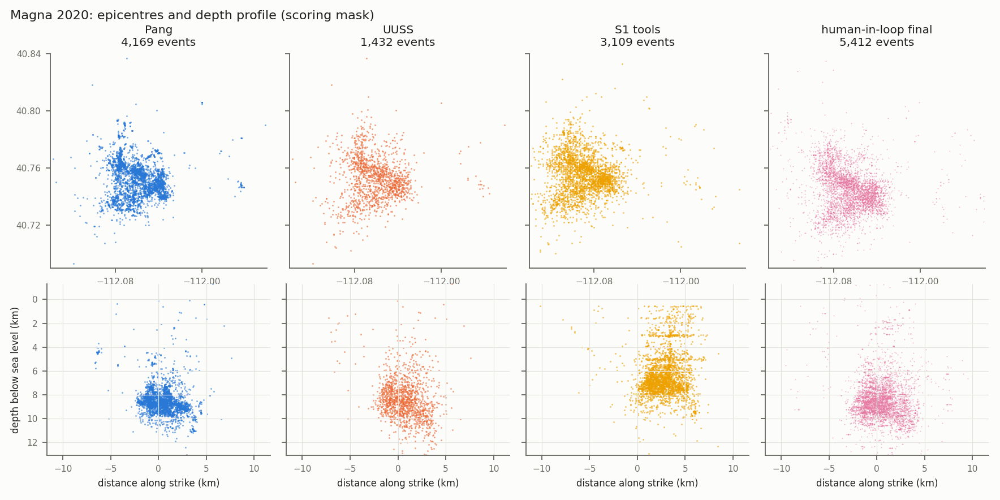
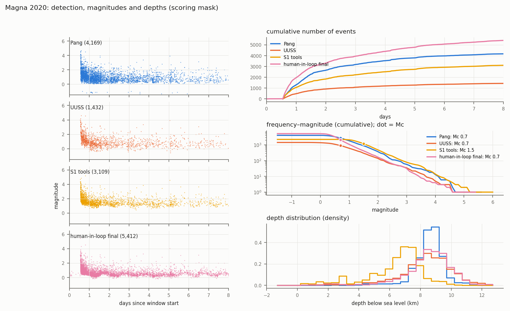

Maple Creek 2017

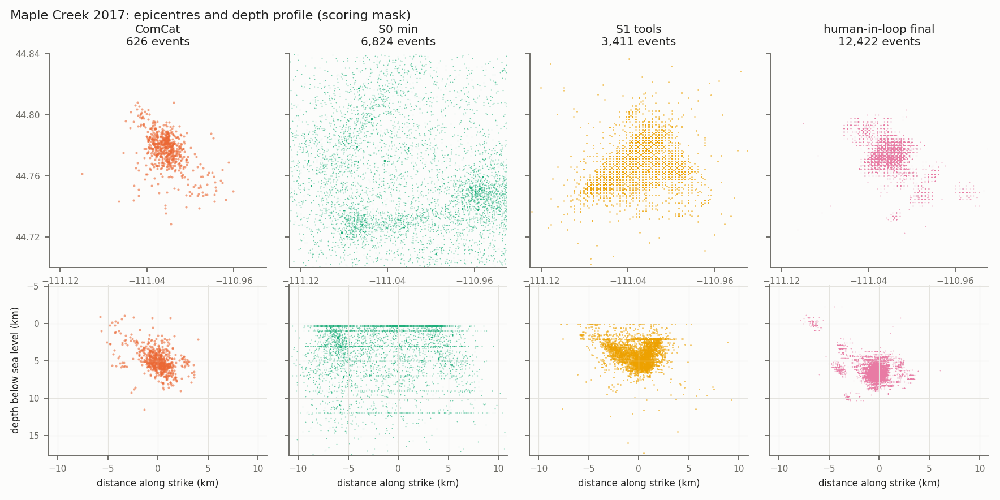
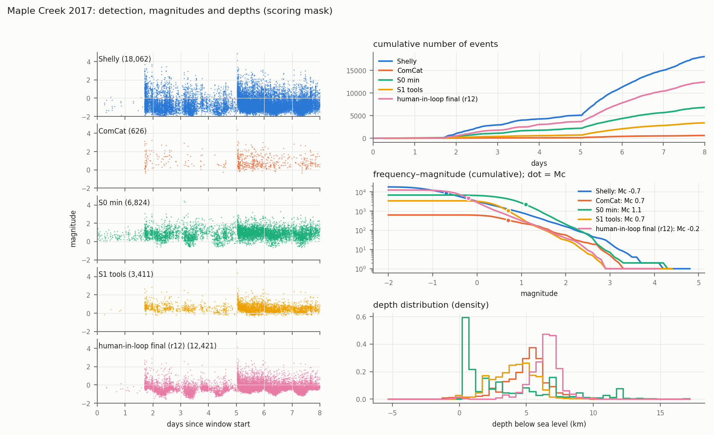

Kīlauea 2018

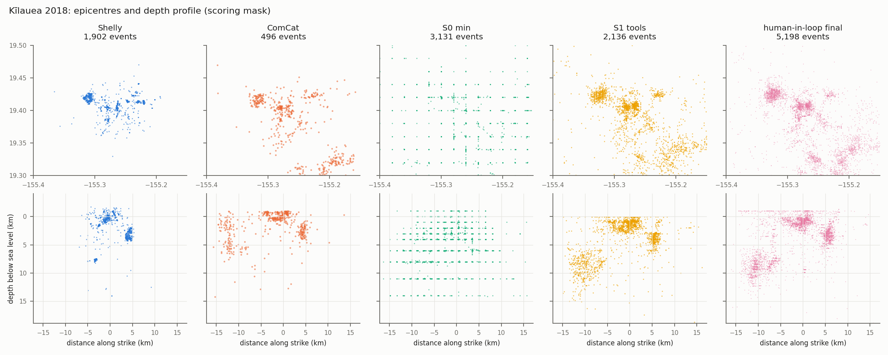
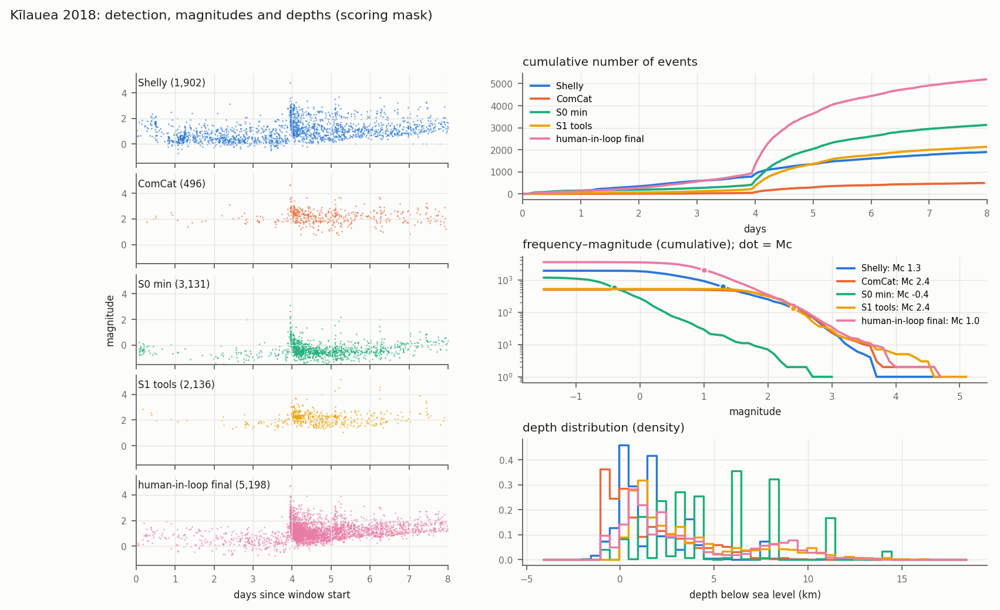

Ridgecrest 2019

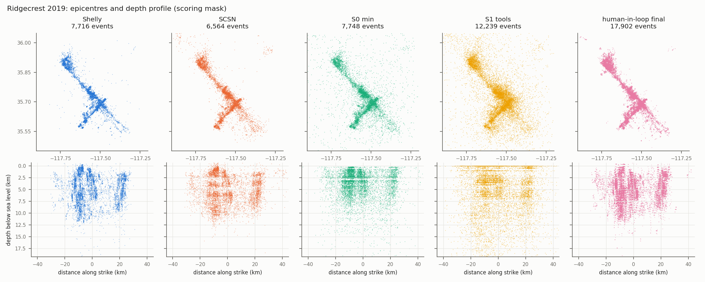
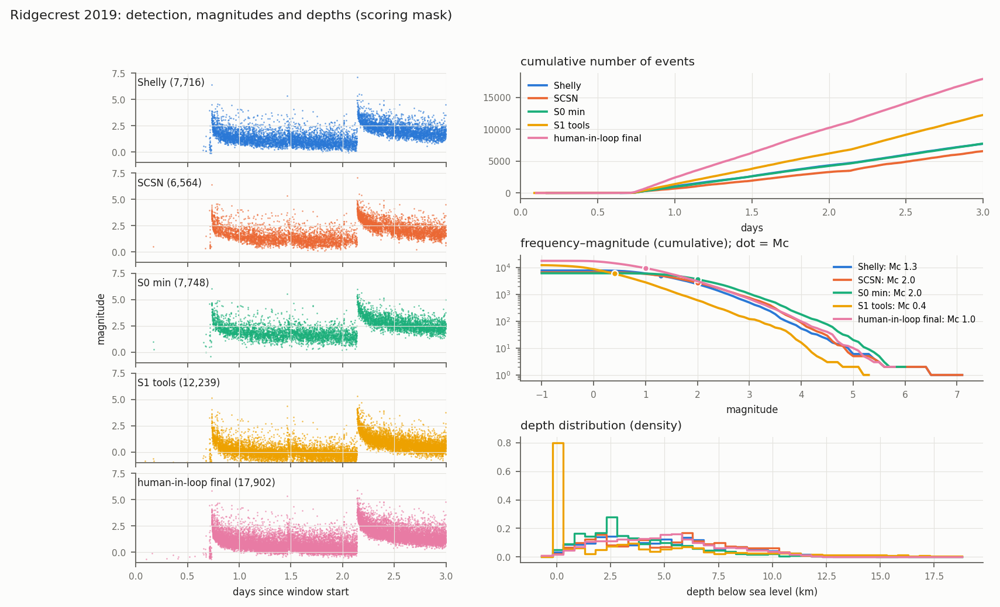

Kaikōura 2016

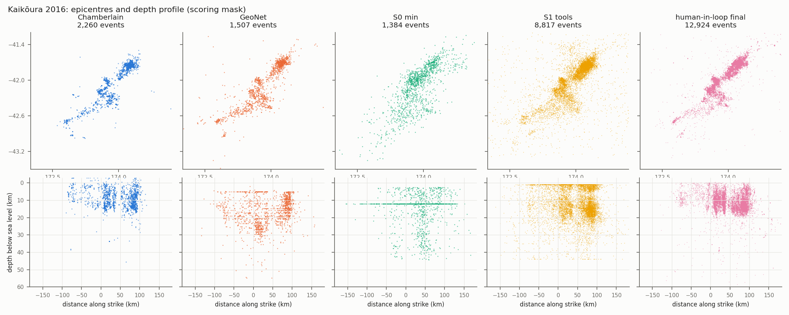
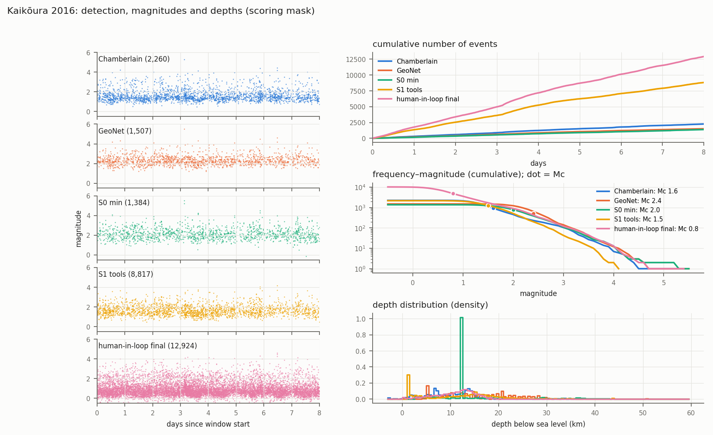

### 1.2 后端消融（B 层，checker 1.0，2026-11-01 至 11-03）

三个变体共用 S1 运行的拾取和关联，只做定位、相对定位和震级：`backend`（只有工具）、`backend_checker`（加 checker）、`backend_knowledge`（加 checker 和知识）。

| 案例 | S1 tools | backend | backend_checker | backend_knowledge |
|---|---|---|---|---|
| Prague | 2 | 4 | 2 | 1 |
| Magna | 3 | 4 | 3 | 3 |
| Maple Creek | 4 | 8 | 5 | 3 |
| Kīlauea | 2 | 2 | 2 | 2 |
| Ridgecrest | 6 | 4 | 3 | 3 |
| Kaikōura | 6 | 2 | 3 | 4 |
| **合计** | 23 | 24 | 18 | **16** |

统一测试试水（Kīlauea，checker 1.2，更新后的知识，2026-11-03）：`backend` 2 项、`backend_checker` 3 项、`backend_knowledge` **1 项**（相对 Shelly 时间偏差 +0.20 s、深度偏差 +0.68 km，只剩深度堆积；该项随后由 NonLinLoc 接口修正离线消除）。

（表中数字按 2026-11-05 的评分规则重判：时间和空间相对主要绝对定位参考。改动前三个变体合计为 24、19、20。）

**图（由** `python -m SeismoAgentBench.scoring.catalog_metrics.checker_effect_figures` **生成，**`assets/checker_effect/`**）。**

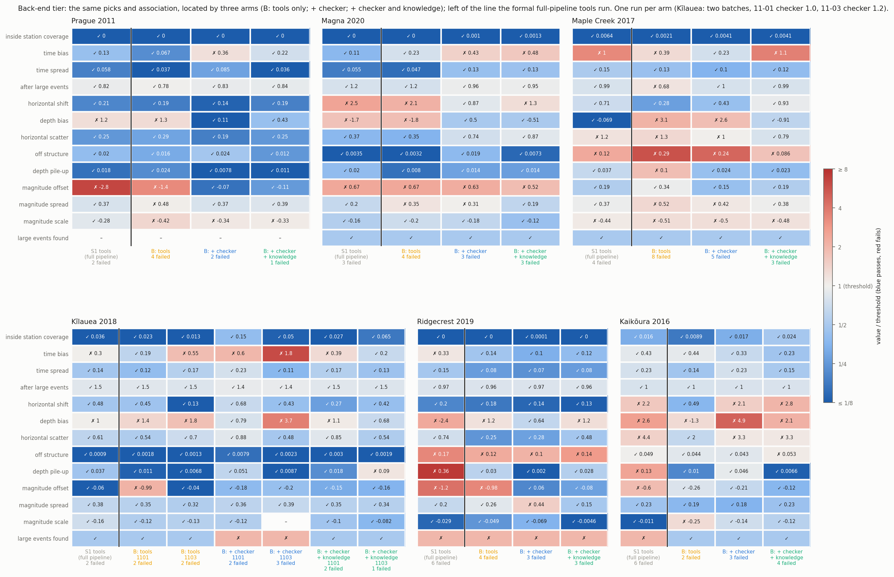

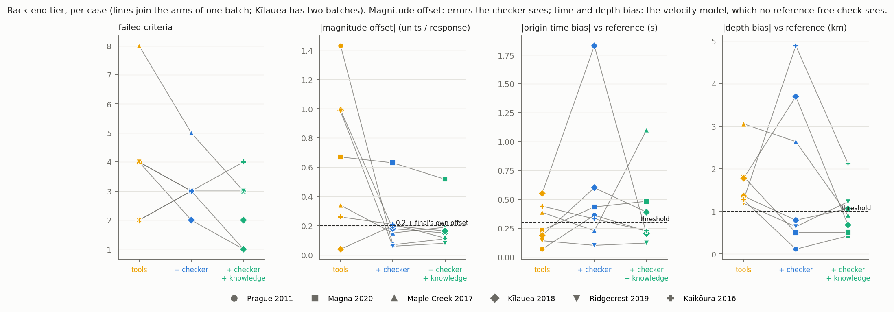

读法：
- **checker 稳定挡住了实现类错误。** 只有工具的 `backend` 在 Prague、Kīlauea、Ridgecrest 犯了震级单位或响应错误（偏差 −1.4、−0.99、−0.98）；两个带 checker 的变体在这三个案例上都没有犯（汇总图第二栏）。Magna 的震级偏差（+0.5–0.7）在所有变体都存在，属于定标，不是实现错误，checker 也不该看到。
- **速度模型类偏差没有一致改善。** 时间和深度偏差（相对参考，汇总图第三、四栏）在三个变体之间方向不一：checker 变体在 Prague、Magna、Ridgecrest 把深度偏差降到 1 km 以内，但 Kīlauea 第二批的 checker 变体时间偏差 1.8 s、深度偏差 3.7 km，Kaikōura 的 checker 变体深度偏差 4.9 km，都比只有工具时差；Maple 的知识变体时间偏差 1.1 s。这类偏差来自近地表速度和基准面，没有参考就看不到（§1.3 第 1、2 条）。
- **总体是净改善，样本很小。** 不通过总数 24 → 18（checker）→ 16（checker + 知识）；相对 `backend`，两个变体都是 4 个案例更好、1 个持平（Kīlauea）、1 个更差（Kaikōura）。每格只有一次运行，同一变体两批之间（Kīlauea）就相差 0–1 项。
- **这些运行用的是 checker 1.0（Kīlauea 第二批 1.2）和更新前的知识。** 1.3 和之后补充的知识（近地表、从数据建模型、水平框架、模板匹配）还没有经过 Agent 运行检验；完整流程的 S3 也还没有运行。

### 1.3 主要发现（细节见 `[02_Checker_Design.md](../02_Checker_Design.md)` §11）

1. **A 层错误被稳定挡住。** 不带 checker 的后端变体 6 个案例有 3 个犯了震级响应或单位错误，带 checker 的 12 次运行 0 次；起作用的主要是工具里正确的参考计算，Agent 照用了它。
2. **时间和深度的整体偏差来自速度模型（C 层），checker 和知识都没有修好。** 单因素重定位复现了主要偏差（模型顶面放在海平面、采用通用模型、近地表太快）。不提供具体模型时，数据只给方向不给水平；按任何单一测量值挑模型都会在某些案例上选错。
3. **报警会诱导表面修复，处置完整不等于正确。** 4 次报警驱动的改动使结果变差；试水中只有 checker 的 Agent 把正确的报警解释为拾取问题，用台站延迟吸收。
4. **知识在流程和约定上起作用。** 试水中知识变体从原图数字化模型、查明基准面，时间和深度都通过；只有 checker 的变体没取到模型数值、自拟了一个过慢的模型。
5. **工具的约定本身是误差来源。** HypoInverse CRH 模型忽略台站高程、NonLinLoc 深度搜索从参考高程开始、hypoDD 和 GrowClust 把台站放在模型深度 0，都会造成系统偏差；前两项已改接口默认值。
6. **水平偏移来自台站延迟和最终目录的框架，不来自拾取。** Kaikōura、Magna、Maple 上 10 个一维候选模型的水平偏移都在 1.1–2.9 km（门槛 1 km）。逐项替换：换成专家拾取最多改变 0.26 km；加上专家的台站延迟后，Kaikōura、Maple 降到 0.2–0.5 km；Magna、Ridgecrest 的最终目录框架来自双差重定位，绝对定位复现不了。另外，Kaikōura、Magna 的最终目录自身离绝对定位参考约 1–1.4 km，与门槛相当（[09](records/09_horizontal_shift.md)；评分口径见 注册表待决定事项）。
7. **检测差距主要是没有用模板匹配。** 最终目录去掉模板匹配事件后只剩 8–56 % 的事件，归一化召回从 0.99–1.85 降到 0.72–0.98；六个 tools 运行中五个没把模板匹配检测加进目录（三个未运行，Maple 只做试验，Ridgecrest 跑了全量只作核对）；门槛本身只在 Magna 造成明显损失（16.3，保留 55 % 对 80 %）。这是论点 2"工具必要但不充分"的直接证据（[10](records/10_template_threshold.md)）。

## 2. 进度（2026-11-05）

**已完成：** 六个案例的数据、参考目录、上限和 human-in-loop 最终目录；S0、S1 正式运行和评分；组件替换和专家阶梯；评分方法 v2 和两项修正；checker 1.0–1.2 和 1.3 开发版及其检验；知识 skill（小批量协议、方案决定、症状手册、checker 看不到的问题、震级资源）；B 层后端消融；统一测试试水；运行环境写保护、泄漏扫描两层。human-in-loop 最终目录的互相关重定位检验（2026-11-04）：只在 Kaikōura 采用（r9），其余五个案例保留原位置并标注网格精度，基线、分数和图已按新的最终目录重算；B 层运行进入所有案例的汇总和分数表。checker 移到顶层 `seismo_checker/`（不属于 seismotools，tools 阶段看不到）；完整流程的 S2c（`checker`）、S3（`knowledge`）任务包已建好并通过无模型的端到端测试（2026-11-05）。不提供模型时从数据建最小一维模型的离线检验（2026-11-05 记录，[08](records/08_velocity_from_data.md)）：四个案例有用、一个无变化、Magna 出错，写入知识 skill（带保护条件）和设计文档 §11。

**进行中：** 无。模板匹配门槛与召回的定量分析已完成（2026-11-05，[10](records/10_template_threshold.md)），知识 skill 已补充，并入 checker-v1.3（标签已移到这一提交，此前没有运行用过它）。水平偏移归因已完成（2026-11-05，[09](records/09_horizontal_shift.md)）；评分口径待定，见 注册表待决定事项。

**未开始：**

- S2（只有知识、没有 checker）的运行。
- 重复运行（研究计划 §2.6：先在 S1 和 S3 上重复）、第二个模型、保留案例。
- human-in-loop 干预编码；分级特征表；差距弥合的计算和图。
