# 当前结果（2026-11-05）

论文结构见 [01_Outline.md](01_Outline.md)。所有运行为 Claude Code × GLM-5.3，每个配置一次运行，按指标 v2（含 2026-11-04 两项口径修正）相对 human-in-loop 最终目录评分。运行数少，结论都是初步的。逐项数值见 [SCORE_TABLE.md](../docs/research/progress/SCORE_TABLE.md)。

## 1. 一览

| 论点 | 当前结论 | 依据 |
|---|---|---|
| 2a 工具必要 | S0 两个案例没有产出目录，其余不通过 5–12 项；S1 六个案例都完成，不通过 1–7 项 | §3.1 |
| 2b 工具不充分 | 没有一个 S1 运行可信；只找回最终目录 22–51 % 的事件 | §3.1 |
| 2c 差在哪里 | 检测：五个 S1 运行没有把模板匹配检测加进目录；定位：速度模型、台站延迟和工具约定 | §3.2 |
| 3a checker 挡住 A 层错误 | 震级单位和响应错误：不带 checker 3/6，带 checker 0/12 | §4 |
| 3b 知识的作用 | 单案例试水：知识变体只剩 1 项不通过，只有 checker 的变体 4 项 | §4 |
| 3c 弥合程度 | 尚无正式运行 | — |
| 4a 看不到的误差 | 时间、深度整体偏差来自速度模型，checker 和知识都没有修好；数据只给方向不给水平 | §5 |
| 4c 是否可信 | 至今没有运行达到可信标准 | §3.1、§4 |

## 2. 基准：human-in-loop 最终目录

- 六个案例都有最终目录、多份参考目录和互相召回上限。
- 最终目录的事件数和完整性主要来自模板匹配：去掉模板匹配事件后只剩 8–56 % 的事件，归一化召回从 0.99–1.85 降到 0.72–0.98（归一化召回 = 对主要检测参考的召回 ÷ 参考目录之间的互相召回，大于 1 即超过参考之间的互相召回）。
- 模板匹配事件落在模板周围 0.25 km（水平）× 0.5 km（深度）的网格上，没有再精细定位；网格误差远小于评分门限，不影响绝对定位判定，但最终目录的相对位置精度不如互相关重定位目录。互相关重定位只在 Kaikōura 改善了相对位置（2 km 内事件对的相对误差 1.53 → 0.69 km），已采用；其余五个案例保留原位置并标注网格精度。
- 判据门槛不宽松：参考目录相对最终目录也有不通过的判据（如 Kaikōura GeoNet 的深度偏差和水平离散、Kīlauea ComCat 的深度偏差）。

## 3. 工具：S0 对 S1（论点 2）

### 3.1 正式运行

| 案例（分级） | S0 不通过 | S0 召回 | S1 不通过 | S1 不通过的判据 | S1 召回 |
|---|---|---:|---|---|---:|
| Prague（基础） | 无有效目录 | — | 2 | 深度偏差、震级偏差 | 46 % |
| Magna（基础） | 无有效目录 | — | 3 | 深度偏差、水平偏移、震级偏差 | 51 % |
| Maple Creek（中等） | 12 | 13 % | 5 | 时间偏差、深度偏差、水平离散、偏离构造、震级标度 | 22 % |
| Kīlauea（中等） | 5 | 42 % | 1 | 时间偏差（−0.36 s，门槛 0.3 s） | 37 % |
| Ridgecrest（困难） | 6 | 30 % | 5 | 深度偏差、深度堆积、大事件、偏离构造、震级偏差 | 39 % |
| Kaikōura（困难） | 8 | 4 % | 7 | 时间偏差与离散、水平偏移与离散、深度堆积、大事件、震级偏差 | 43 % |

召回 = 找回最终目录事件的比例。Ridgecrest 的最终目录本身也漏了主震尾波中的几个 M ≥ 4 事件，所以"大事件"一项所有目录都不通过。

**判据热图**（每格 = 判据数值 ÷ 门槛；蓝色通过，红色超出）：

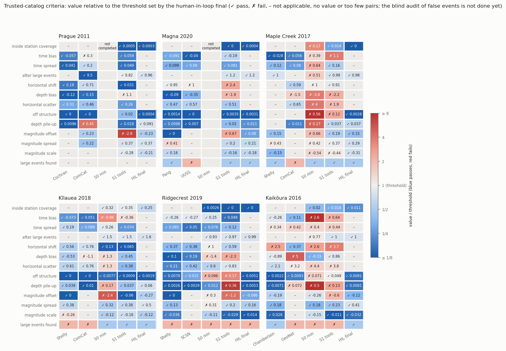

- S1 的不通过项集中在：时间偏差（Maple、Kīlauea、Kaikōura）、深度偏差（Prague、Magna、Maple、Ridgecrest）、深度堆积（Ridgecrest、Kaikōura）、震级偏差（Prague、Magna、Ridgecrest、Kaikōura）；水平偏移在 Magna、Kaikōura 不通过。
- S0 的错误在图上一眼可见：Maple 的震中散满整个区域，Kaikōura 大量事件压在 12 km 固定深度。
- S1 的空间分布比 S0 集中得多，但有定位假象：Ridgecrest 在网格顶部和速度分层界面上的水平条带，Maple 的震中落在定位网格上。

### 3.2 事件数与完整性

| 案例 | 事件数（最强参考 / 官方 / S0 / S1 / 最终） | Mc（同上） |
|---|---|---|
| Prague | 2,078 / 11 / — / 3,391 / 6,767 | 0.4 / – / – / −2.5* / −0.3 |
| Magna | 4,169 / 1,432 / — / 3,109 / 5,412 | 0.7 / 0.7 / – / 1.5 / 0.7 |
| Maple Creek | 18,062 / 626 / 6,824 / 3,411 / 12,422 | −0.7 / 0.7 / 1.1 / 0.7 / −0.2 |
| Kīlauea | 1,902 / 496 / 3,131 / 2,136 / 5,198 | 1.3 / 2.4 / −0.4* / 2.4 / 1.0 |
| Ridgecrest | 7,716 / 6,564 / 7,748 / 12,239 / 17,902 | 1.3 / 2.0 / 2.0 / 0.4* / 1.0 |
| Kaikōura | 2,260 / 1,507 / 1,384 / 8,817 / 12,924 | 1.6 / 2.4 / 2.0 / 1.5 / 0.8 |

\* 震级整体偏低（单位或响应错误：Prague S1 −2.8、Kīlauea S0 −2.4、Ridgecrest S1 −1.2），Mc 不可比。最强参考 / 官方目录：Prague 为 Cochran / ComCat，Magna 为 Pang / UUSS，Maple Creek 为 Shelly / ComCat，Kīlauea 为 Shelly / ComCat，Ridgecrest 为 Shelly / SCSN，Kaikōura 为 Chamberlain / GeoNet。

S1 的事件数在六个案例上都多于官方目录；最终目录除 Maple（Shelly 的模板匹配目录更多）外最多，Mc 在可比的案例中最低或并列最低。

### 3.3 S1 差在哪里

1. **检测：没有用模板匹配。** 六个 S1 运行中五个没把模板匹配检测加进目录：三个没有运行模板匹配，Maple 只做了一天的试验，Ridgecrest 跑了全量却只用来核对完整性。零假设检验给出的门槛在六个案例上都是 9.5（误检 0.5–1.5 %）；门槛本身只在 Magna 造成明显损失（Agent 用 16.3，保留最终目录事件 55 %，门槛 10 时为 80 %）。工具在手，Agent 没有用到产品里。
2. **定位和震级：后端。** 组件替换（Agent 拾取 + 专家定位）后，后端错误大部分消失：Maple S1 深度偏差 −2.18 → −0.31 km、时间偏差 1.01 → 0.20 s；Prague S1 深度偏差 +1.10 → 0.00 km；Magna S1 深度偏差 −1.94 → −0.96 km、水平偏移 2.50 → 1.61 km；Kīlauea S0 深度偏差 +1.29 → −0.03 km、时间偏差 0.90 → 0.19 s。
3. **水平偏移来自台站延迟和最终目录的框架，不来自拾取。** Kaikōura、Magna、Maple 上 10 个一维候选模型的水平偏移都在 1.1–2.9 km（门槛 1 km）。换成专家拾取最多改变 0.26 km；加上专家的台站延迟后，Kaikōura、Maple 降到 0.2–0.5 km。Magna、Ridgecrest 的最终目录框架来自双差重定位，绝对定位复现不了；Kaikōura、Magna 的最终目录自身离绝对定位参考约 1–1.4 km，与门槛相当。
4. **工具的约定本身是误差来源。** HypoInverse CRH 模型忽略台站高程、NonLinLoc 深度搜索从参考高程开始、hypoDD 和 GrowClust 把台站放在模型深度 0，都会造成系统偏差；前两项已改工具接口的默认值。

### 3.4 各案例图

空间图：上排震中，下排沿最终目录震中主轴的深度剖面。检测图：左侧时间—震级，右侧累计事件数、震级—频度分布（圆点为 Mc）、深度分布。颜色在所有图中固定对应目录。

**Prague 2011**

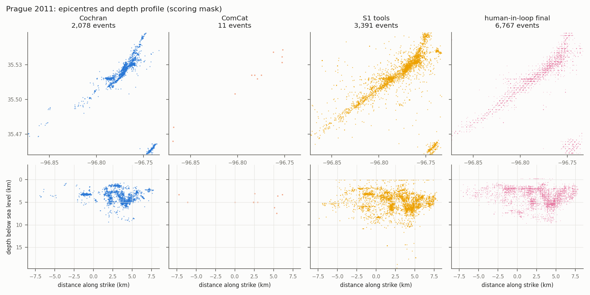
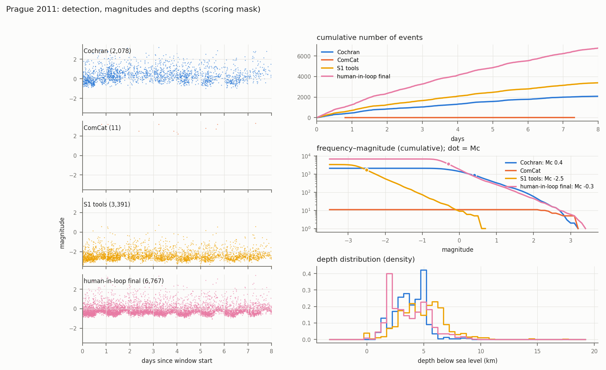

**Magna 2020**

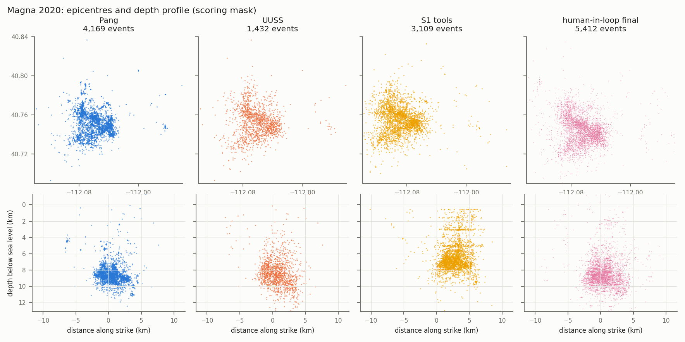
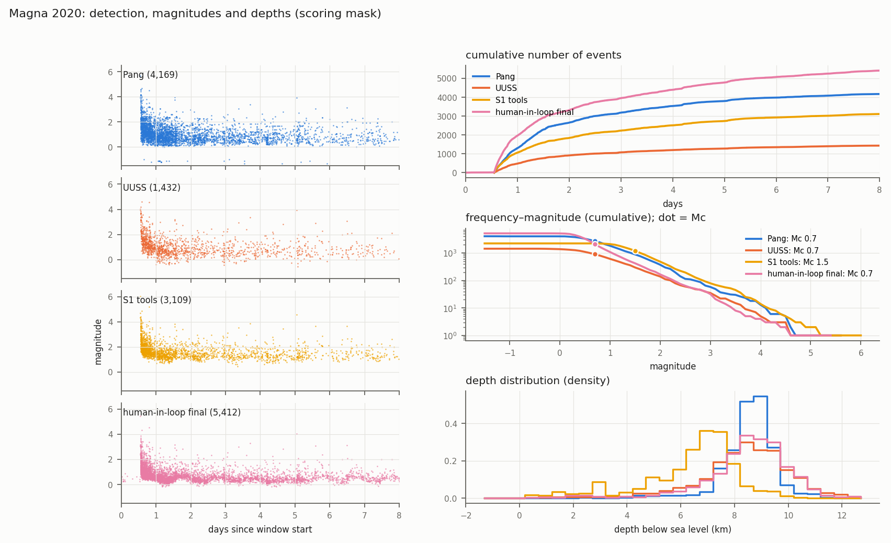

**Maple Creek 2017**

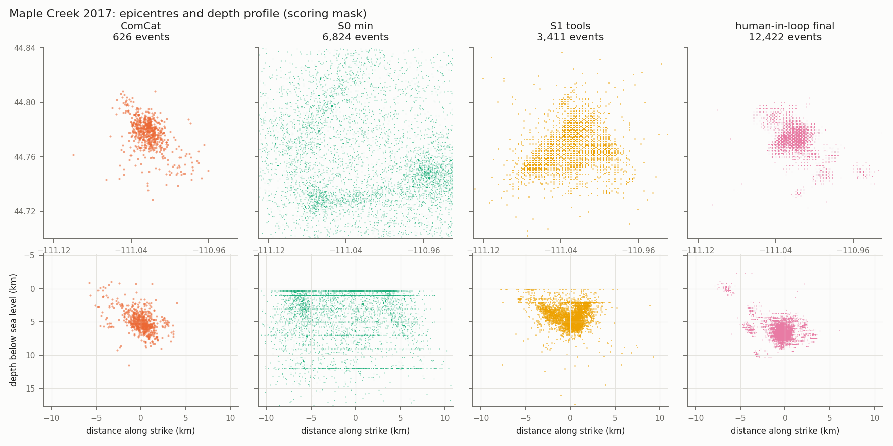
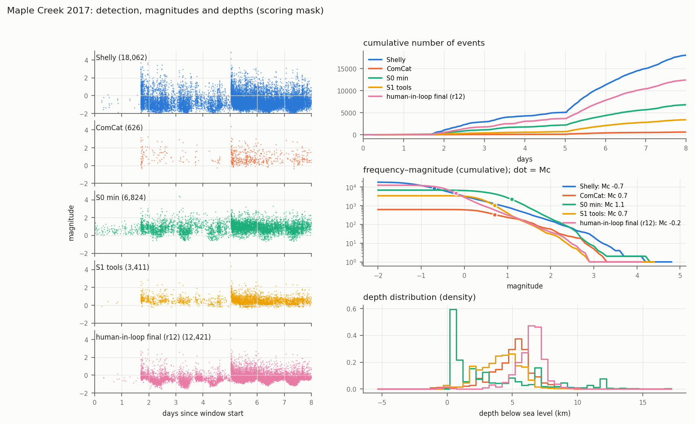

**Kīlauea 2018**

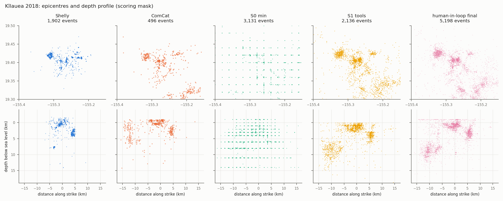
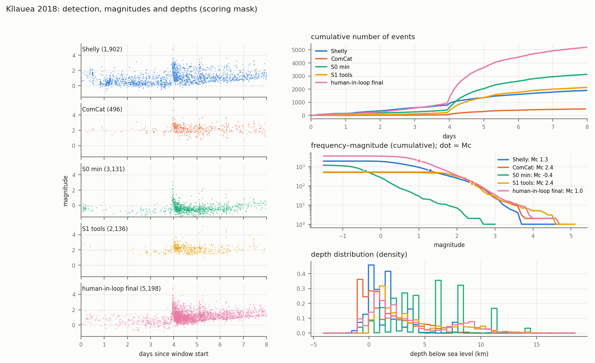

**Ridgecrest 2019**

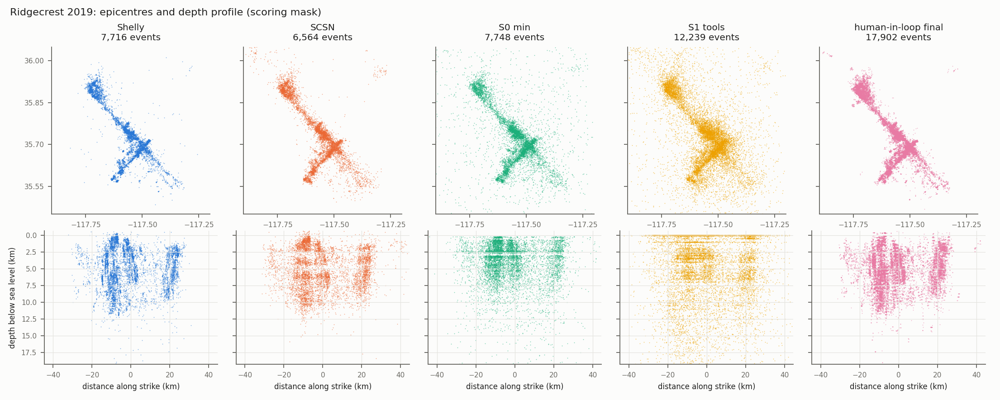
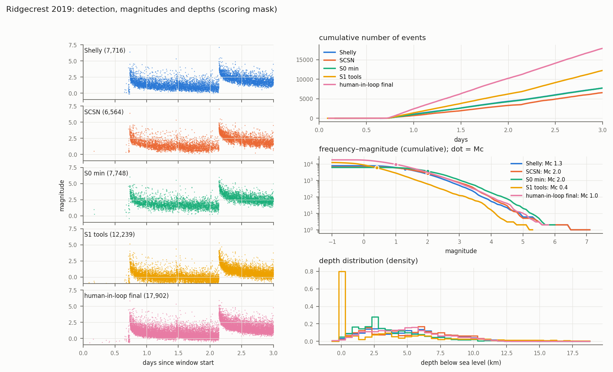

**Kaikōura 2016**

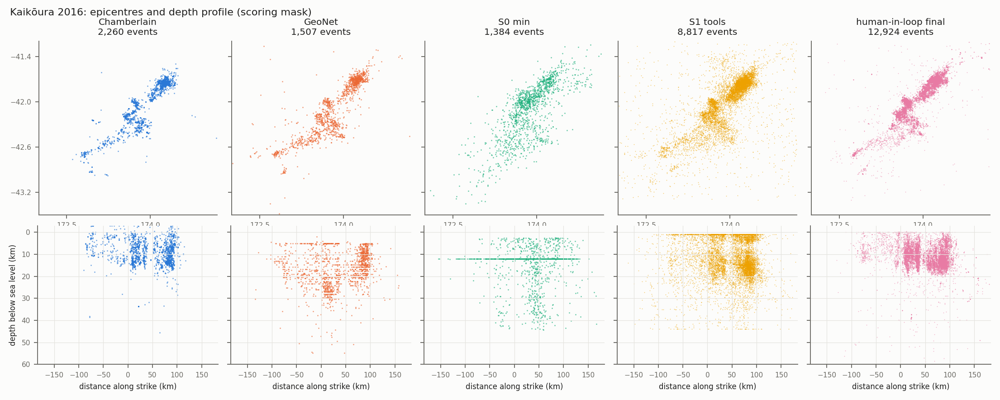
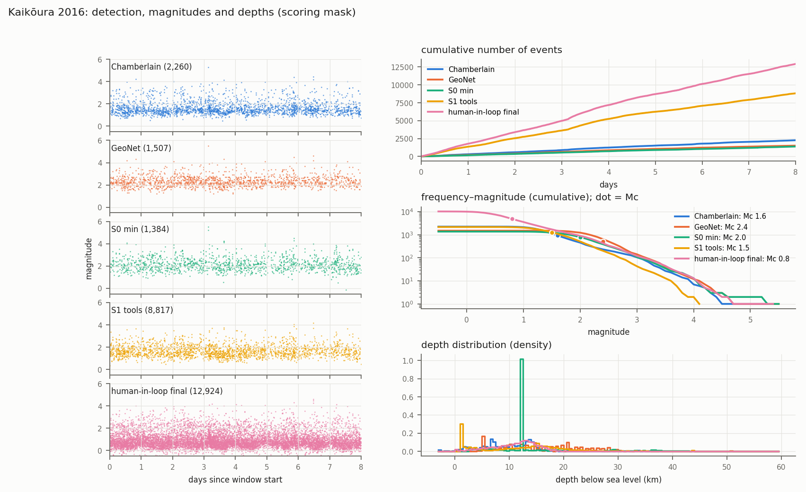

## 4. 知识与自动检验：后端消融（论点 3，初步）

正式的 S2c、S3 尚未运行。现有证据来自后端消融：三个变体共用 S1 运行的拾取和关联，只做定位、相对定位和震级——`backend`（只有工具）、`backend_checker`（加 checker）、`backend_knowledge`（加 checker 和知识）。

| 案例 | S1 | backend | backend_checker | backend_knowledge |
|---|---:|---:|---:|---:|
| Prague | 2 | 4 | 1 | 1 |
| Magna | 3 | 4 | 4 | 4 |
| Maple Creek | 5 | 6 | 4 | 5 |
| Kīlauea | 1 | 1 | 3 | 2 |
| Ridgecrest | 5 | 5 | 3 | 3 |
| Kaikōura | 7 | 4 | 4 | 6 |
| **合计** | 23 | 24 | **19** | 21 |

表中为不通过的可信标准数。统一后的试水（Kīlauea，更新后的 checker 和知识）：`backend` 3 项、`backend_checker` 4 项、`backend_knowledge` 1 项（时间偏差 +0.08 s、深度偏差 −0.07 km 都通过，只剩深度堆积；该项随后由 NonLinLoc 接口修正离线消除）。

主要发现：

1. **A 层错误被稳定挡住。** 不带 checker 的后端变体 6 个案例中 3 个犯了震级响应或单位错误，带 checker 的 12 次运行 0 次。起作用的主要是工具里正确的参考计算，Agent 照用了它，而不是被报警纠正。
2. **报警会诱导表面修复，处置完整不等于正确。** 4 次由报警驱动的改动使结果变差；试水中只有 checker 的 Agent 把正确的报警解释为拾取问题，用台站延迟吸收。
3. **知识在流程和约定上起作用。** 试水中知识变体从原图数字化速度模型、查明基准面，时间和深度都通过；只有 checker 的变体没有取到模型数值，自拟了一个过慢的模型。

## 5. 到不了的部分（论点 4）

1. **时间和深度的整体偏差来自速度模型。** 单因素重定位复现了主要偏差：模型顶面放在海平面、采用通用模型、近地表太快。不提供具体模型时，数据只给方向不给水平；按任何单一测量值挑模型都会在某些案例上选错。从数据建最小一维模型的离线检验：四个案例有用、一个无变化、Magna 出错。
2. **所有台站或事件共有的误差，只靠 Agent 自己的数据判断不了**：速度模型与近地表、震级定标水平、主震尾波中的漏检。这是 checker 研究的边界。
3. **最终目录有一部分依赖参考。** 专家阶梯已完成：模板匹配（Match&Locate）是专家检测上的主要增益，Agent 停在专家盲目录的水平；human-in-loop 干预编码未开始。
4. **至今没有运行达到可信标准。** 最接近的两个：Kīlauea S1（只有时间偏差 −0.36 s 不通过）和 Kīlauea 知识后端试水（只有深度堆积，已由工具修正离线消除）。

## 6. 尚缺的结果

| 内容 | 对应论点 | 状态 |
|---|---|---|
| 完整流程的 S2c、S3 任务包与正式运行 | 3a、3b、3c、4a | 后端版本已有，完整流程未搭建 |
| S2（只有知识）的运行 | 3b | 待定是否运行 |
| 重复运行（先 S1、S3，Prague 和 Magna 起步）、第二个模型、保留案例 | 全部 | 未开始 |
| 分级特征表 | 1a | 未开始 |
| human-in-loop 干预编码 | 4b | 未开始 |
| 差距弥合计算与瀑布图 | 3c | 未开始 |
